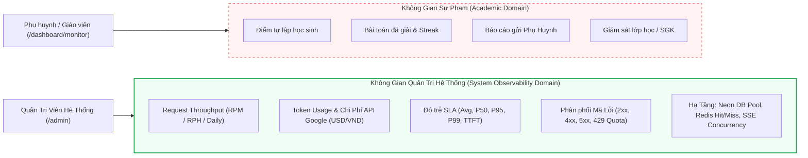
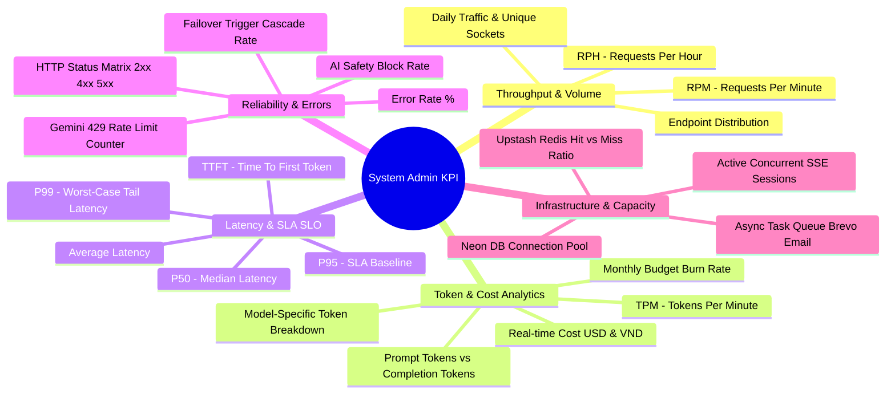
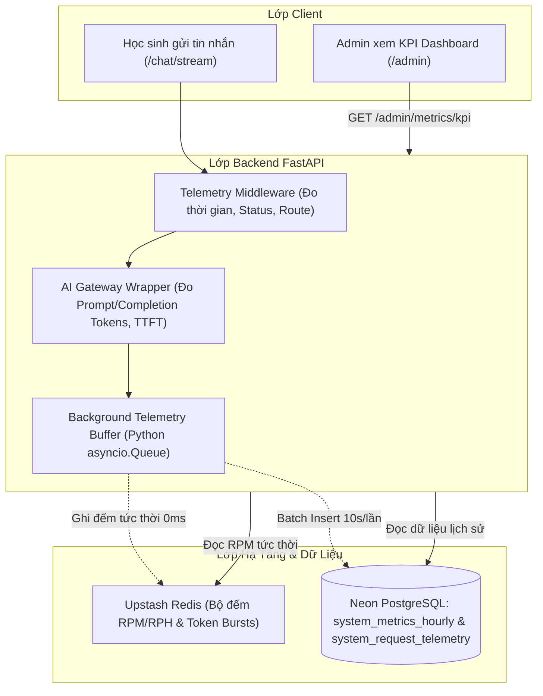
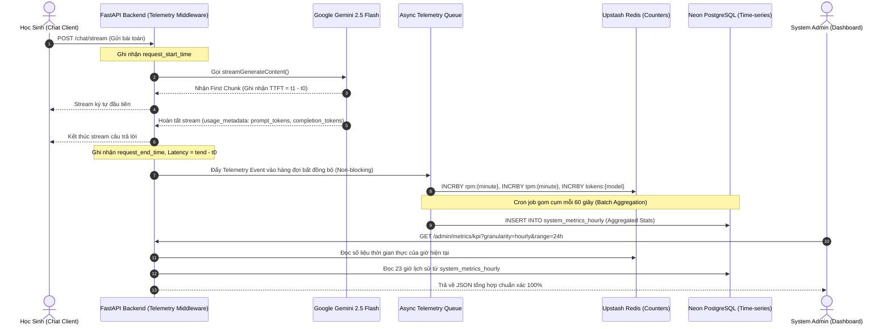
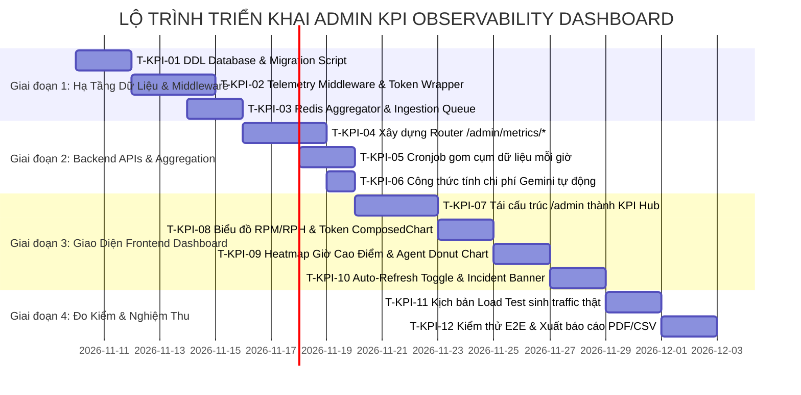

# KẾ HOẠCH TRIỂN KHAI & THIẾT KẾ TOÀN DIỆN HỆ THỐNG GIÁM SÁT HIỆU NĂNG & KPI QUẢN TRỊ VIÊN HỆ THỐNG (SYSTEM ADMIN KPI & OBSERVABILITY DASHBOARD)
## Dự án: Nền tảng Gia sư Toán Socratic Thông minh (SocraticKid)
**Tài liệu kỹ thuật & Kế hoạch hành động dành cho Ban Quản Trị Hệ Thống & Hội Đồng Nghiệm Thu Đồ Án**  
*Mã tài liệu: C1SE.04-DOC-ADMIN-KPI-PLAN-v1.0*  
*Ngày lập: 09/11/2026 | Phiên bản áp dụng: Sprint 9 - 10 (Chuẩn bị Nghiệm thu Đồ án Tốt nghiệp)*  

---

## MỤC LỤC
1. [Tổng Quan Bối Cảnh & Đặt Vấn Đề (System-Level Scope)](#1-tổng-quan-bối-cảnh--đặt-vấn-đề-system-level-scope)
2. [Hiện Trạng Giám Sát & Phân Tích Khoảng Trống (Gap Analysis)](#2-hiện-trạng-giám-sát--phân-tích-khoảng-trống-gap-analysis)
3. [Khung Chỉ Số KPI Cốt Lõi Của Quản Trị Hệ Thống (Core Metrics Framework)](#3-khung-chỉ-số-kpi-cốt-lõi-của-quản-trị-hệ-thống-core-metrics-framework)
4. [12 Đề Xuất & Ý Tưởng Nâng Cấp Đột Phá Cho Admin KPI Dashboard](#4-12-đề-xuất--ý-tưởng-nâng-cấp-đột-phá-cho-admin-kpi-dashboard)
5. [Kiến Trúc Kỹ Thuật Đề Xuất (System Architecture & Telemetry Pipeline)](#5-kiến-trúc-kỹ-thuật-đề-xuất-system-architecture--telemetry-pipeline)
6. [Kế Hoạch Triển Khai Chi Tiết Theo Từng Giai Đoạn](#6-kế-hoạch-triển-khai-chi-tiết-theo-từng-giai-đoạn)
7. [Bảng Phân Công Nhiệm Vụ Thành Viên Nhóm (Task Matrix)](#7-bảng-phân-công-nhiệm-vụ-thành-viên-nhóm-task-matrix)
8. [Bộ Tiêu Chí Chấp Nhận Nghiệm Thu (Acceptance Criteria - 100% Web UI)](#8-bộ-tiêu-chí-chấp-nhận-nghiệm-thu-acceptance-criteria---100-web-ui)

---

## 1. TỔNG QUAN BỐI CẢNH & ĐẶT VẤN ĐỀ (SYSTEM-LEVEL SCOPE)

### 1.1. Phân định ranh giới then chốt: System Admin vs. Academic Monitor
Trong kiến trúc sản phẩm của **SocraticKid**, vai trò quản trị được phân tầng tuyệt đối và rành mạch thành hai không gian độc lập:

> [!IMPORTANT]
> **Ranh giới cốt lõi của System Admin KPI Dashboard:**
> - **KHÔNG PHẢI (Non-Scope):** Không theo dõi điểm số bài thi, không xem tỷ lệ tự lập từng bài của học sinh, không xem tiến độ học tập cá nhân của bé A hay bé B (những dữ liệu sư phạm này hoàn toàn thuộc phạm vi của **Phụ Huynh / Giám Sát Viên** tại `/dashboard/monitor`).
> - **CHÍNH LÀ (In-Scope):** Đây là **Trung Tâm Giám Sát Hạ Tầng & Sức Khỏe Toàn Hệ Thống (Platform Operations & AI Observability Hub)** dành cho **System Admin (DevOps / Platform Lead)**. Mục tiêu là kiểm soát toàn bộ lưu lượng request (phút/giờ/ngày), tiêu thụ token LLM, chi phí API thực tế, độ trễ từng nấc (latency percentiles P50/P95/P99), tỷ lệ mã lỗi HTTP, sức tải của PostgreSQL Neon, Upstash Redis và tính sẵn sàng của mạng lưới Multi-Agent.



### 1.2. Tại sao SocraticKid cần một System KPI Dashboard chuyên sâu?
Hệ thống SocraticKid vận hành dưới mô hình **Multi-Agent AI thời gian thực** (Orchestrator $\rightarrow$ Socratic Tutor $\rightarrow$ Math Reviewer Fact-check $\rightarrow$ Problem Classifier $\rightarrow$ Parent Insights). Mỗi câu hỏi của học sinh kéo theo một chuỗi gọi AI phức tạp:
1. **Lưu lượng biến động mạnh (Traffic Spikes):** Học sinh cả nước thường truy cập tập trung vào khung giờ làm bài tập về nhà (19h00 - 21h30). Nếu không có dashboard đo đếm **RPM (Requests Per Minute)** và **RPH (Requests Per Hour)**, Admin hoàn toàn bị động trước nguy cơ nghẽn mạng.
2. **Kiểm soát ngân sách Token & Chi phí API:** Mỗi phiên học sinh trao đổi 10 - 20 lượt chat. Nếu không theo dõi chi tiết **Prompt Tokens**, **Completion Tokens** theo từng model (`gemini-2.5-flash`, `gemini-2.0-flash-lite`, `gemini-1.5-pro`), chi phí API có thể tăng vọt ngoài tầm kiểm soát.
3. **Độ trễ Socratic (Latency SLA):** Một gia sư AI chỉ giữ được sự tập trung của trẻ em khi phản hồi chữ đầu tiên xuất hiện dưới **800ms** (Time To First Token - TTFT) và tổng thời gian phản hồi không vượt quá **2.5s**. Cần đo lường chính xác các phân vị P50, P95, P99 để phát hiện các truy vấn bị treo.
4. **Độ tin cậy hạ tầng (Reliability & Upstream Limits):** Cảnh báo sớm khi chạm trần Google Gemini `429 Too Many Requests`, lỗi tràn connection pool của PostgreSQL Neon hoặc Redis cache miss bất thường.

---

## 2. HIỆN TRẠNG GIÁM SÁT & PHÂN TÍCH KHOẢNG TRỐNG (GAP ANALYSIS)

### 2.1. Hiện trạng trong mã nguồn hiện nay (As-Is)
- **Frontend (`frontend/app/admin/page.tsx`)**: Đã có khung giao diện với 4 thẻ tổng hợp và biểu đồ Recharts, nhưng dữ liệu token đang được sinh ngẫu nhiên từ hàm `generateMockTokenData()` chạy trên trình duyệt.
- **Backend (`backend/routers/admin_mock.py`)**: Endpoint `/admin/mock/metrics/tokens` chỉ trả về dữ liệu mẫu cứng (hardcoded loop) với các con số giả định, không kết nối với luồng chat thật của học sinh.
- **AI Runtime (`backend/router.py`)**: Chưa có tầng middleware ghi nhận telemetry vi mô (Micro-telemetry) cho mỗi lượt request qua hệ thống.

### 2.2. Bảng Phân Tích Khoảng Trống Kỹ Thuật (Gap Analysis)

| STT | Khía Cạnh | Hiện Trạng (As-Is) | Mục Tiêu Chuẩn Nghiệm Thu (To-Be) | Tác Động Rủi Ro Nếu Thiếu |
|:---:|:---|:---|:---|:---|
| 1 | **Đo lường Throughput** | Chỉ có tổng số phiên giả lập theo ngày (7, 14, 30 ngày). | Xem được lưu lượng tức thời theo **Phút (RPM)**, theo **Giờ (RPH)**, và theo **Ngày (Daily)**, hỗ trợ lọc theo từng Endpoint. | Không xác định được thời điểm nghẽn cổ chai (bottleneck) và khung giờ cao điểm thực tế của học sinh. |
| 2 | **Đo lường Token & Chi Phí** | Tính toán tượng trưng bằng công thức nhân cứng trên FE. | Ghi nhận chính xác `prompt_tokens`, `completion_tokens` từ phản hồi của Google Gemini API; phân rã theo model và tính chi phí USD/VND thực tế. | Lãng phí ngân sách; không phát hiện được tình trạng model bị lặp vô tận (infinite completion loop). |
| 3 | **Độ Trễ Phản Hồi (Latency SLA)** | Số random `Math.round(1050 + ...)` trên client. | Đo đếm thời gian thực hiện End-to-End từ lúc nhận request đến khi hoàn tất; phân vị **Avg, P50, P95, P99** và **Time To First Token (TTFT)**. | Hội đồng nghiệm thu không thể đánh giá hiệu năng thật; Admin không biết học sinh đang bị lag ở khâu nào. |
| 4 | **Phân Phối Mã Lỗi (HTTP Status)** | Không có biểu đồ lỗi; chỉ có danh sách log tĩnh ở `/admin/errors`. | Biểu đồ trực quan tỷ lệ % thành công `2xx`, lỗi client `4xx`, lỗi server `5xx`, và lỗi quota AI `429 Too Many Requests`. | Hệ thống bị lỗi hàng loạt nhưng Admin không phát hiện để kịp thời chuyển model dự phòng (Failover). |
| 5 | **Phân Bổ Tải Theo Agent** | Coi toàn bộ hệ thống là 1 khối duy nhất. | Phân rã lưu lượng và token tiêu thụ theo từng Agent: `Orchestrator`, `SocraticTutor`, `Reviewer`, `Classifier`, `ParentInsights`. | Không đánh giá được Agent nào gây tốn kém hoặc chậm nhất để tối ưu hóa prompt. |
| 6 | **Giám Sát Hạ Tầng & Dịch Vụ** | Hiển thị badge xanh tĩnh "Hệ thống hoạt động ổn định". | Đo lường tỷ lệ kết nối Neon DB Pool, Redis Token-Bucket Cache Hit/Miss, số phiên SSE đồng thời (Concurrent Sessions). | Sập kết nối database hoặc rớt Redis rate limit mà không có cảnh báo. |
| 7 | **Cơ Chế Làm Mới & Báo Động** | Phải tải lại cả trang F5 để cập nhật dữ liệu. | Hỗ trợ **Auto-Refresh Toggle** (5s, 15s, 30s, 60s) và dải **Cảnh Báo Vi Phạm SLA (Threshold Breach Alert)** tức thì khi có sự cố. | Giảm tính cơ động trong giám sát vận hành thời gian thực (Operations Room). |

---

## 3. KHUNG CHỈ SỐ KPI CỐT LÕI CỦA QUẢN TRỊ HỆ THỐNG (CORE METRICS FRAMEWORK)

Bộ chỉ số KPI của Quản Trị Viên Hệ Thống được chia thành 5 nhóm trụ cột định lượng rõ ràng:



### 3.1. Nhóm 1: Request Throughput & Volume (Lưu Lượng Xử Lý Hệ Thống)
- **RPM (Requests Per Minute):** Chỉ số nhịp tim của máy chủ. Thể hiện số lượng yêu cầu API gửi tới hệ thống trong từng phút trôi qua (cửa sổ trượt 60 phút gần nhất).
- **RPH (Requests Per Hour):** Lưu lượng tích lũy theo từng giờ trong ngày (24 giờ gần nhất), nhận diện chính xác các đỉnh tải (traffic spikes).
- **Daily Volume:** Tổng số lượt tương tác trong 7, 14, 30 ngày qua, hỗ trợ phân tích xu hướng tăng trưởng tải toàn trường.
- **Endpoint Distribution (Phân bổ theo API Router):**
  - `/chat/stream` (Hội thoại học sinh thời gian thực - luồng nặng nhất)
  - `/independence/evaluate` (Đánh giá chỉ số tự lập của Reviewer)
  - `/auth/*` (Xác thực, đăng ký, đăng nhập)
  - `/metrics/streak-leaderboard` (Bảng xếp hạng toàn hệ thống)
  - `/upload/math-image` (Tải ảnh bài tập lên Cloudinary)

### 3.2. Nhóm 2: Token Consumption & LLM Financial Analytics (Tiêu Thụ Token & Chi Phí AI)
Theo dõi chính xác tài nguyên AI tiêu hao từ Google Gemini API:
- **Prompt Tokens (Input):** Tổng token nạp vào (system prompt, curriculum context, lịch sử hội thoại, đề bài học sinh, ảnh đính kèm).
- **Completion Tokens (Output):** Tổng token mô hình AI sinh ra trong câu trả lời gợi ý Socratic.
- **TPM (Tokens Per Minute):** Tốc độ tiêu thụ token trên phút, so sánh trực tiếp với hạn mức Quota của gói Google AI Studio (Tier limits).
- **Chi phí quy đổi theo bảng giá Google Cloud AI (Real-time Cost Calculation):**
  $$\text{Cost} = \sum \left( \frac{\text{PromptTokens}}{1.000.000} \times \text{Price}_{\text{prompt}} + \frac{\text{CompletionTokens}}{1.000.000} \times \text{Price}_{\text{comp}} \right)$$
  - *Gemini 2.5 Flash / 2.0 Flash:* \$0.075 / 1M prompt, \$0.30 / 1M completion.
  - *Gemini 2.0 Flash-Lite:* \$0.0375 / 1M prompt, \$0.15 / 1M completion.
  - *Gemini 1.5 Pro:* \$1.25 / 1M prompt, \$5.00 / 1M completion.
- **Burn Rate & Budget Projection:** Ước tính chi phí vận hành hết tháng dựa trên tốc độ tiêu thụ hiện tại, cảnh báo nếu vượt ngưỡng ngân sách đồ án (\$20 / tháng).

### 3.3. Nhóm 3: Hiệu Năng & Độ Trễ (Performance, Latency & SLO/SLA)
Đo đếm chất lượng dịch vụ theo các chuẩn mực kỹ thuật:
- **Average Latency:** Độ trễ trung bình cộng.
- **P50 (Median):** 50% số request phản hồi nhanh hơn mốc này (kỳ vọng: $< 600\text{ms}$).
- **P95 (SLA Threshold):** 95% số request phản hồi nhanh hơn mốc này. Đây là chỉ số cam kết chất lượng dịch vụ chuẩn (kỳ vọng: $< 1800\text{ms}$).
- **P99 (Worst-Case Tail):** 1% các request chậm nhất (do bài toán hình học phức tạp hoặc mạng chập chờn) (kỳ vọng: $< 3500\text{ms}$).
- **TTFT (Time To First Token):** Thời gian tính từ lúc học sinh bấm "Gửi" đến khi ký tự chữ đầu tiên xuất hiện trên màn hình (đối với luồng SSE Streaming). Mục tiêu tối thượng: $\le 450\text{ms}$.

### 3.4. Nhóm 4: Độ Tin Cậy & Tỷ Lệ Lỗi (Reliability, Error Rates & Fallbacks)
- **Global Error Rate (%):** Tỷ lệ phần trăm giữa tổng số request lỗi trên tổng số request phục vụ. Mục tiêu: $< 0.5\%$.
- **Phân loại HTTP Status Code:**
  - `2xx Success`: Yêu cầu xử lý thành công trọn vẹn.
  - `4xx Client Errors`: Lỗi do client gửi sai cú pháp, token JWT hết hạn (`401`), hoặc chạm trần rate limit cục bộ (`429`).
  - `5xx Server Errors`: Lỗi sập backend FastAPI (`500`) hoặc upstream timeout (`504`).
  - `Google Gemini 429 Too Many Requests`: Đếm riêng số lần bị nhà cung cấp AI chặn do quá hạn mức quota.
- **Failover Trigger Rate:** Tỷ lệ số lần hệ thống phải kích hoạt mô hình dự phòng Secondary (`gemini-1.5-flash`) hoặc chuyển sang Local Heuristic Fallback khi mô hình chính gặp sự cố.
- **Safety Policy Violations:** Tần suất bộ lọc Toxic/Jailbreak ngăn chặn câu hỏi độc hại của học sinh.

### 3.5. Nhóm 5: Tải Trọng Hạ Tầng & Dịch Vụ Phụ Trợ (Infrastructure Capacity)
- **PostgreSQL Neon Connection Pool:** Tỷ lệ kết nối đang hoạt động (Active Connections) so với giới hạn của gói Neon Serverless (Max Connections = 20), thời gian thực thi câu lệnh SQL trung bình (Query Execution Time).
- **Upstash Redis Efficiency:**
  - Tỷ lệ Cache Hit / Miss của tầng đệm cấu hình và dữ liệu bài giảng SGK.
  - Số lượng Token Bucket keys đang quản lý trong bộ nhớ Redis.
- **Active Concurrent SSE Sessions:** Số lượng học sinh đang đồng thời giữ kết nối streaming nhận câu trả lời từ AI.
- **Celery / Async Task Latency:** Độ trễ hàng đợi xử lý tác vụ ngầm gửi email cảnh báo phụ huynh qua Brevo.

---

## 4. 12 ĐỀ XUẤT & Ý TƯỞNG NÂNG CẤP ĐỘT PHÁ CHO ADMIN KPI DASHBOARD

Dưới đây là 12 ý tưởng và tính năng kỹ thuật nâng tầm trang Quản Trị Hệ Thống thành một Trung Tâm Giám Sát chuyên nghiệp chuẩn Enterprise:

### Ý tưởng 1: Biểu Đồ Lưu Lượng Thời Gian Thực Đa Khung Giờ (Live Multi-Granularity Throughput)
- **Mô tả:** Cung cấp bộ chuyển đổi 3 chế độ xem: **Phút (60 phút gần nhất)**, **Giờ (24 giờ gần nhất)**, và **Ngày (7 - 30 ngày qua)**.
- **Giá trị:** Khi kiểm thử nghiệm thu trực tiếp trước Hội đồng, Admin chọn chế độ "Phút", sau đó cho học sinh gửi liên tục 5 câu hỏi; biểu đồ lập tức cập nhật từng cột RPM vút lên thời gian thực mà không cần reload trang.

### Ý tưởng 2: Đồng Hồ Đo Tốc Độ Đốt Token & Chi Phí (Token & Cost Burn Rate Meter)
- **Mô tả:** Một widget chuyên biệt hiển thị tổng số token tiêu thụ hôm nay, chia rõ màu: Xanh dương cho Prompt (Input) và Cam cho Completion (Output).
- **Tính năng mở rộng:** Tích hợp bộ chuyển đổi tiền tệ 1-click giữa **USD (\$)** và **VND (₫)** theo tỷ giá tự động (ví dụ: 1 USD = 25.450 VND) kèm dự báo số tiền chi trả dự kiến đến cuối tháng (Cost Run-Rate).

### Ý tưởng 3: Đồng Hồ Đo Độ Trễ Phân Vị P50 / P95 / P99 & Phân Rã TTFT
- **Mô tả:** Thay vì một con số trung bình vô nghĩa, cung cấp biểu đồ dạng đường 3 tầng biểu diễn đồng thời: P50 (đường xanh lá), P95 (đường vàng cảnh báo), P99 (đường đỏ cực đại).
- **Chỉ số TTFT Gauge:** Hiển thị đồng hồ kim bán nguyệt đo tốc độ xuất hiện ký tự đầu tiên (TTFT). Màu xanh nếu $\le 500\text{ms}$, màu cam nếu $500 - 1200\text{ms}$, màu đỏ nếu $> 1200\text{ms}$.

### Ý tưởng 4: Biểu Đồ Tròn Phân Bổ Tải Multi-Agent (Agent Workload Distribution)
- **Mô tả:** Biểu đồ Donut thể hiện tỷ trọng phần trăm request và token giữa các agent trong hệ thống:
  - *Socratic Tutor Agent:* 65% lưu lượng
  - *Math Reviewer Fact-check:* 15% lưu lượng
  - *Problem Classifier & Title Generator:* 12% lưu lượng
  - *Parent Insights & Notification Agent:* 8% lưu lượng
- **Giá trị:** Admin dễ dàng nhận thấy khâu nào đang ngốn tài nguyên nhất để cân chỉnh prompt ngắn gọn lại.

### Ý tưởng 5: Bản Đồ Nhiệt Lưu Lượng Theo Khung Giờ Trong Tuần (Hourly Peak Traffic Heatmap)
- **Mô tả:** Bảng nhiệt ma trận 7 ngày trong tuần $\times$ 24 giờ trong ngày (168 ô vuông). Màu sắc từ vàng nhạt đến đỏ thẫm tùy theo mật độ request.
- **Giá trị thực tiễn:** Giúp nhà trường và ban quản trị nhận diện chính xác "giờ vàng" học sinh làm bài tập (thường là 19h30 - 21h00 thứ Hai đến thứ Sáu, và 09h00 sáng Chủ Nhật) để chủ động tăng hạn mức quota server trước giờ cao điểm.

### Ý tưởng 6: Ma Trận Giám Sát Mã Lỗi HTTP & Lỗi Nhà Cung Cấp LLM (HTTP & Upstream Error Matrix)
- **Mô tả:** Biểu đồ cột xếp chồng (Stacked Bar Chart) theo dõi phân phối mã lỗi:
  - Xanh lá: `200 OK`
  - Vàng: `400 Bad Request` / `422 Validation Error`
  - Tím: `401 Unauthorized` / `403 Forbidden`
  - Đỏ gạch: `429 Too Many Requests` (Google Gemini API Quota)
  - Đỏ tươi: `500 Internal Server Error` / `503 Service Unavailable`
- **Giá trị:** Khi có sự cố, Admin lập tức nhìn thấy ngay màu đỏ xuất phát từ lỗi code nội bộ (500) hay do bị Google chặn rate limit (429) để xử lý dứt điểm.

### Ý tưởng 7: Tỷ Lệ Hiệu Quả Bộ Đệm Cache Hit vs Cache Miss (Redis Efficiency Monitor)
- **Mô tả:** Đồng hồ đo phần trăm các truy vấn dữ liệu được giải quyết ngay trên RAM Upstash Redis mà không cần truy vấn xuống Neon PostgreSQL hoặc gọi lại Gemini API (đối với các câu hỏi kiểm tra lại bài cũ hoặc các định nghĩa SGK lớp 4-9).
- **Mục tiêu:** Đạt tỷ lệ Cache Hit $> 75\%$, giúp tiết kiệm 70% độ trễ cho học sinh.

### Ý tưởng 8: Giám Sát Sức Chứa Kết Nối Cơ Sở Dữ Liệu (Neon DB Pool & SSE Connection Gauge)
- **Mô tả:** Thanh đo trực quan số lượng kết nối đang mở:
  - *Neon PostgreSQL Connections:* Đang dùng `7 / 20` kết nối khả dụng (35% tải).
  - *Active Concurrent SSE Streaming:* Hiện có `42` học sinh đang chat cùng lúc.
- **Cảnh báo:** Tự động chuyển màu vàng cam khi số kết nối chạm ngưỡng 80% (16/20 connections) để Admin kịp thời scale pool size.

### Ý tưởng 9: Hệ Thống Cảnh Báo Ngưỡng SLA Tức Thì (Real-time Threshold Breach Banners)
- **Mô tả:** Dải thông báo nổi trên đầu dashboard tự động kích hoạt khi có chỉ số vi phạm tiêu chuẩn vận hành:
  - *"⚠️ Cảnh báo: Tỷ lệ lỗi 5xx trong 5 phút qua đạt 4.8% (Vượt ngưỡng an toàn 2.0%)"*
  - *"⚠️ Cảnh báo: Độ trễ P95 đạt 3.2s do Google Gemini API phản hồi chậm"*
  - Kèm nút bấm: **"Kích hoạt Failover sang Secondary Model ngay"** hoặc **"Xem vết lỗi chi tiết"**.

### Ý tưởng 10: Công Tắc Làm Mới Tự Động & Live Polling (Auto-Refresh Toggle)
- **Mô tả:** Thanh công cụ phía góc trên bên phải cho phép:
  - Nút gạt bật/tắt chế độ **Live Mode (Auto-Refresh)**.
  - Dropdown chọn chu kỳ làm mới: `Mỗi 5s`, `Mỗi 15s`, `Mỗi 30s`, `Mỗi 60s`, hoặc `Chỉ làm mới thủ công (Manual)`.
  - Icon xoay tròn hiển thị thời gian đếm ngược còn lại đến lần nạp dữ liệu tiếp theo.

### Ý tưởng 11: Phát Hiện Dị Thường Bằng Thuật Toán Thống Kê (Statistical Anomaly Detection)
- **Mô tả:** Áp dụng thuật toán đơn giản dựa trên độ lệch chuẩn (Z-score / Rolling Baseline): Nếu số request trong 5 phút tăng vọt gấp 3 lần so với trung bình 4 tuần trước cùng khung giờ, hệ thống đánh dấu cờ **"Traffic Spike Anomaly Detected"** để Admin kiểm tra xem có hiện tượng spam bot hoặc tấn công từ chối dịch vụ hay không.

### Ý tưởng 12: Xuất Báo Cáo Đo Kiểm KPI Định Kỳ (Export KPI Observability Report)
- **Mô tả:** Nút bấm **"Xuất Báo Cáo KPI"** hỗ trợ xuất dữ liệu ra định dạng **PDF** (bản in có biểu đồ trang trọng dành cho Hội đồng nghiệm thu) hoặc file **CSV / JSON** thô để lưu trữ phục vụ viết báo cáo chuyên đề tốt nghiệp.

---

## 5. KIẾN TRÚC KỸ THUẬT ĐỀ XUẤT (SYSTEM ARCHITECTURE & TELEMETRY PIPELINE)

Để đảm bảo việc thu thập dữ liệu KPI không làm chậm tốc độ phản hồi của học sinh dù chỉ 1 mili-giây, hệ thống áp dụng cơ chế **Asynchronous Telemetry Ingestion Pipeline (Thu thập vi mô bất đồng bộ)** qua kiến trúc sau:



### 5.1. Luồng Thu Thập & Truy Vấn Dữ Liệu KPI (Sequence Diagram)



### 5.2. Thiết Kế Cơ Sở Dữ Liệu Telemetry (PostgreSQL Neon DDL)

Dưới đây là cấu trúc bảng lưu trữ chuỗi thời gian tối ưu hóa, đảm bảo hiệu năng truy vấn dưới 15ms ngay cả khi có hàng triệu bản ghi:

```sql
-- ============================================================================
-- 1. BẢNG GHI NHẬN TỔNG HỢP HIỆU NĂNG THEO GIỜ (HOURLY AGGREGATED METRICS)
-- Dùng vẽ biểu đồ Throughput RPH, Token theo ngày, P50/P95/P99 và Lỗi hệ thống
-- ============================================================================
CREATE TABLE IF NOT EXISTS system_metrics_hourly (
    id                      BIGSERIAL PRIMARY KEY,
    bucket_timestamp        TIMESTAMPTZ NOT NULL, -- Đầu mốc mỗi giờ (ví dụ: 2026-11-09 14:00:00+07)
    
    -- Throughput & Request Volumes
    total_requests          INTEGER NOT NULL DEFAULT 0,
    chat_requests           INTEGER NOT NULL DEFAULT 0,
    eval_requests           INTEGER NOT NULL DEFAULT 0,
    auth_requests           INTEGER NOT NULL DEFAULT 0,
    other_requests          INTEGER NOT NULL DEFAULT 0,
    
    -- Token Analytics
    prompt_tokens           BIGINT NOT NULL DEFAULT 0,
    completion_tokens       BIGINT NOT NULL DEFAULT 0,
    total_tokens            BIGINT NOT NULL DEFAULT 0,
    estimated_cost_usd      NUMERIC(10, 4) NOT NULL DEFAULT 0.0000,
    
    -- Latency Metrics (Đo bằng mili-giây)
    avg_latency_ms          INTEGER NOT NULL DEFAULT 0,
    p50_latency_ms          INTEGER NOT NULL DEFAULT 0,
    p95_latency_ms          INTEGER NOT NULL DEFAULT 0,
    p99_latency_ms          INTEGER NOT NULL DEFAULT 0,
    avg_ttft_ms             INTEGER NOT NULL DEFAULT 0, -- Time To First Token
    
    -- HTTP Status Distribution
    status_2xx_count        INTEGER NOT NULL DEFAULT 0,
    status_4xx_count        INTEGER NOT NULL DEFAULT 0,
    status_5xx_count        INTEGER NOT NULL DEFAULT 0,
    gemini_429_count        INTEGER NOT NULL DEFAULT 0, -- Chạm trần quota
    failover_count          INTEGER NOT NULL DEFAULT 0, -- Kích hoạt mô hình phụ
    
    -- Cache & Infrastructure
    redis_cache_hits        INTEGER NOT NULL DEFAULT 0,
    redis_cache_misses      INTEGER NOT NULL DEFAULT 0,
    peak_concurrent_sse     INTEGER NOT NULL DEFAULT 0,
    
    created_at              TIMESTAMPTZ NOT NULL DEFAULT now()
);

CREATE UNIQUE INDEX IF NOT EXISTS uq_metrics_hourly_bucket 
ON system_metrics_hourly(bucket_timestamp);

CREATE INDEX IF NOT EXISTS ix_metrics_hourly_created 
ON system_metrics_hourly(bucket_timestamp DESC);

-- ============================================================================
-- 2. BẢNG PHÂN BỔ TÀI NGUYÊN THEO MODEL & AGENT (AGENT WORKLOAD METRICS)
-- Dùng vẽ biểu đồ tròn phân rã tỷ lệ Multi-Agent và so sánh hiệu quả chi phí
-- ============================================================================
CREATE TABLE IF NOT EXISTS system_agent_metrics_hourly (
    id                      BIGSERIAL PRIMARY KEY,
    bucket_timestamp        TIMESTAMPTZ NOT NULL,
    agent_name              VARCHAR(64) NOT NULL, -- 'SocraticTutor', 'Reviewer', 'Classifier', 'ParentInsights'
    model_name              VARCHAR(64) NOT NULL, -- 'gemini-2.5-flash', 'gemini-2.0-flash-lite', ...
    
    request_count           INTEGER NOT NULL DEFAULT 0,
    prompt_tokens           BIGINT NOT NULL DEFAULT 0,
    completion_tokens       BIGINT NOT NULL DEFAULT 0,
    total_cost_usd          NUMERIC(10, 4) NOT NULL DEFAULT 0.0000,
    avg_latency_ms          INTEGER NOT NULL DEFAULT 0,
    error_count             INTEGER NOT NULL DEFAULT 0
);

CREATE INDEX IF NOT EXISTS ix_agent_metrics_bucket 
ON system_agent_metrics_hourly(bucket_timestamp DESC, agent_name);

-- ============================================================================
-- 3. BẢNG NHẬT KÝ SỰ CỐ & VI PHẠM NGƯỠNG SLA (SYSTEM INCIDENTS & ALERTS)
-- Dùng kích hoạt dải thông báo đỏ trên Admin Dashboard
-- ============================================================================
CREATE TABLE IF NOT EXISTS system_incidents_log (
    id                      VARCHAR(64) PRIMARY KEY,
    incident_type           VARCHAR(32) NOT NULL, -- 'HIGH_LATENCY', 'ERROR_SPIKE', 'QUOTA_EXCEEDED', 'DB_POOL_EXHAUSTED'
    severity                VARCHAR(16) NOT NULL, -- 'WARNING', 'CRITICAL'
    metric_name             VARCHAR(64) NOT NULL, -- 'p95_latency_ms', 'status_5xx_rate', ...
    threshold_value         NUMERIC(10, 2) NOT NULL,
    actual_value            NUMERIC(10, 2) NOT NULL,
    message                 TEXT NOT NULL,
    status                  VARCHAR(16) NOT NULL DEFAULT 'ACTIVE', -- 'ACTIVE', 'RESOLVED'
    triggered_at            TIMESTAMPTZ NOT NULL DEFAULT now(),
    resolved_at             TIMESTAMPTZ
);

CREATE INDEX IF NOT EXISTS ix_incidents_active 
ON system_incidents_log(status, triggered_at DESC);
```

### 5.3. Quy Chuẩn API Backend Endpoints Cho Dashboard

Backend cung cấp cụm endpoint chuyên biệt tại `backend/routers/admin_metrics.py`:

1. `GET /admin/metrics/overview`:
   - Trả về 4 con số KPI tổng hợp ngày hôm nay: Tổng Requests, Tổng Token & Chi phí (\$ / ₫), Độ trễ trung bình & P95, Tỷ lệ lỗi toàn hệ thống.
2. `GET /admin/metrics/throughput?range=1h|24h|7d|30d&granularity=minute|hour|day`:
   - Trả về mảng dữ liệu phục vụ biểu đồ cột Throughput RPM / RPH / Daily.
3. `GET /admin/metrics/tokens?range=24h|7d|14d|30d`:
   - Trả về dữ liệu Prompt vs Completion Tokens, phân rã theo Model và chi phí USD tương ứng.
4. `GET /admin/metrics/latency?range=24h`:
   - Trả về chuỗi số liệu Avg, P50, P95, P99 và chỉ số TTFT.
5. `GET /admin/metrics/agents`:
   - Trả về tỷ lệ phân bổ phần trăm lưu lượng và chi phí giữa các Agent.
6. `GET /admin/metrics/traffic-heatmap`:
   - Trả về ma trận 7x24 ô mật độ request trong tuần phục vụ bản đồ nhiệt Peak Traffic.
7. `GET /admin/metrics/infrastructure`:
   - Trả về số lượng kết nối Neon DB Pool, tỷ lệ Redis Cache Hit %, số phiên SSE đồng thời.
8. `GET /admin/metrics/incidents`:
   - Trả về danh sách cảnh báo vi phạm ngưỡng SLA đang kích hoạt.

---

## 6. KẾ HOẠCH TRIỂN KHAI CHI TIẾT THEO TỪNG GIAI ĐOẠN

Kế hoạch được chia thành 4 giai đoạn cụ thể trong Sprint 9 và Sprint 10:



### Chi tiết các gói công việc:
- **Giai đoạn 1 (Hạ Tầng Dữ Liệu & Telemetry vi mô):**
  - Viết script migration `backend/scripts/migrate_system_metrics.py` tạo các bảng `system_metrics_hourly`, `system_agent_metrics_hourly`, `system_incidents_log`.
  - Cài đặt `backend/middleware/telemetry_middleware.py`: Đo chính xác thời gian bắt đầu, kết thúc, mã HTTP status, và kích thước payload của từng request.
  - Cập nhật hàm gọi Google Gemini trong `backend/router.py`: Đọc trường `response.usage_metadata` để lấy chính xác số token thật và đo thời gian nhận token đầu tiên (TTFT).
- **Giai đoạn 2 (Backend Analytics & Aggregation Engine):**
  - Xây dựng router `backend/routers/admin_metrics.py` thay thế toàn bộ logic mock cũ.
  - Tích hợp bộ đếm tức thời trên Upstash Redis: `rpm:current`, `tpm:current`, `errors:5xx:current`.
  - Viết tiến trình nền (Async background worker) tự động gom số liệu và ghi xuống Neon DB mỗi 60 giây.
- **Giai đoạn 3 (Frontend KPI Dashboard Hub):**
  - Thiết kế lại trang `frontend/app/admin/page.tsx` thành giao diện Dashboard điều hành hệ thống đỉnh cao.
  - Tích hợp Recharts:
    - Biểu đồ Throughput (RPM theo phút, RPH theo giờ, Daily theo ngày).
    - Biểu đồ Token & Chi phí (ComposedChart với cột Bar cho Token và đường Line cho Cost).
    - Biểu đồ phân vị độ trễ P50, P95, P99 và đồng hồ kim TTFT.
    - Bản đồ nhiệt Hourly Traffic Peak Heatmap (7x24 ô).
    - Biểu đồ Donut phân bổ tải Multi-Agent.
  - Cung cấp cụm công tắc Auto-Refresh (5s, 15s, 30s) và dải cảnh báo vi phạm ngưỡng SLA.
- **Giai đoạn 4 (Đo Kiểm, Tải Giả Lập & Nghiệm Thu):**
  - Sử dụng công cụ kiểm thử tải (Locust / Python async script) sinh kịch bản mô phỏng 50 học sinh gửi bài toán đồng thời.
  - Kiểm tra xem các biểu đồ trên dashboard có nhảy số real-time chính xác hay không.
  - Tích hợp nút xuất báo cáo PDF / CSV phục vụ báo cáo Hội đồng.

---

## 7. BẢNG PHÂN CÔNG NHIỆM VỤ THÀNH VIÊN NHÓM (TASK MATRIX)

| Thành Viên | Vai Trò Chính | Nhiệm Vụ Phụ Trách Cụ Thể (System KPI Dashboard) | Thời Gian Dự Kiến |
|:---|:---|:---|:---:|
| **[Thống]** | **Trùm Backend (BE)** | - Thiết kế DDL DB & viết migration script `migrate_system_metrics.py`<br>- Xây dựng `TelemetryMiddleware` đo latency, HTTP codes, routes<br>- Phát triển cụm router API `/admin/metrics/*`<br>- Cài đặt bộ đếm Redis và tiến trình gom cụm dữ liệu nền (Batch Aggregator) | 22.0h |
| **[Thông]** | **Kỹ sư AI / ML** | - Ghi nhận `usage_metadata` (prompt/completion tokens) từ Google Gemini API<br>- Đo lường và tối ưu chỉ số Time To First Token (TTFT) trong luồng SSE streaming<br>- Cài đặt công thức định giá chi phí động theo từng model Gemini (2.5 Flash, 2.0 Flash-Lite, 1.5 Pro)<br>- Gắn nhãn Telemetry Tagging phân rã theo từng Sub-Agent | 18.5h |
| **[Bảo]** | **Trùm Frontend (FE)** | - Thiết kế và xây dựng lại toàn bộ giao diện `frontend/app/admin/page.tsx`<br>- Hiện thực hóa 6 cụm biểu đồ Recharts (Throughput RPM/RPH, Token/Cost, Latency P50/P95/P99, TTFT Gauge, Heatmap 7x24, Agent Donut)<br>- Tích hợp bộ chuyển đổi thời gian (Phút / Giờ / Ngày) và công tắc Auto-Refresh<br>- Thiết kế dải Banner cảnh báo sự cố vi phạm ngưỡng SLA | 24.0h |
| **[Thiên]** | **Nhóm Trưởng / QA** | - Định nghĩa bộ chỉ số cam kết SLA/SLO (Latency < 2.5s, Error < 0.5%, TTFT < 600ms)<br>- Viết kịch bản sinh tải tự động (Load testing simulation script) để mô phỏng traffic thật<br>- Kiểm thử độ trễ API và xác minh tính chính xác của số liệu token<br>- Soạn thảo tài liệu thuyết minh và kịch bản demo 100% Web UI cho Hội đồng nghiệm thu | 16.0h |

---

## 8. BỘ TIÊU CHÍ CHẤP NHẬN NGHIỆM THU (ACCEPTANCE CRITERIA - 100% WEB UI)

Hội đồng nghiệm thu đồ án tốt nghiệp có thể trực tiếp kiểm chứng toàn bộ tính năng của System KPI Dashboard trên giao diện Web mà không cần mở terminal hay xem code:

- **[AC-KPI-01] Giám sát Lưu lượng Throughput Thời Gian Thực (RPM / RPH / Daily):**
  - Admin chọn mốc xem **"Theo Phút (60m)"** trên thanh công cụ.
  - Trên một tab trình duyệt khác, mở phòng học và gửi liên tiếp 3 bài toán $\rightarrow$ Quay lại tab Admin, cột RPM của phút hiện tại lập tức tăng thêm 3 đơn vị, biểu đồ tự động cập nhật mà không cần F5 trang.
  - Chuyển sang mốc **"Theo Giờ (24h)"** và **"Theo Ngày (14 ngày)"**, dữ liệu hiển thị liền mạch với đường xu hướng trơn tru.

- **[AC-KPI-02] Đo đếm Token & Tính Chi Phí Google Gemini API Chuẩn Xác:**
  - Sau khi học sinh hoàn tất một bài toán phân tích hình học $\rightarrow$ Kiểm tra thẻ "Tiêu thụ Token" trên Dashboard: Số `prompt_tokens` và `completion_tokens` tăng lên đúng bằng số liệu trả về trong metadata của Gemini.
  - Dòng chi phí hiển thị số tiền tương ứng theo cả định dạng **USD (\$0.00xx)** và **VND (xx.xx ₫)**; tooltip khi hover vào hiển thị chi tiết đơn giá từng loại token.

- **[AC-KPI-03] Kiểm tra Phân vị Độ trễ P50 / P95 / P99 và Chỉ số TTFT:**
  - Biểu đồ Độ trễ phân định rõ ràng 3 đường màu: Đường P50 nằm ở mức xanh lá ($< 800\text{ms}$), đường P95 thể hiện cam ($< 1800\text{ms}$), đường P99 thể hiện đỉnh đỏ.
  - Đồng hồ kim TTFT hiển thị giá trị thời gian xuất hiện chữ đầu tiên đạt chuẩn mượt mà ($< 500\text{ms}$).

- **[AC-KPI-04] Ma Trận Mã Lỗi HTTP & Phát Hiện Cạn Kiệt Quota (429):**
  - Biểu đồ phân phối trạng thái phản hồi hiển thị cột xanh áp đảo ($99\% \text{ mã } 200\text{ OK}$).
  - Trong trường hợp giả lập nhập sai cú pháp hoặc chặn spam rate limit, biểu đồ ghi nhận đúng số lượng mã `4xx` và `429`, tách biệt hoàn toàn với lỗi sập server `5xx`.

- **[AC-KPI-05] Phân Rã Lưu Lượng Đa Tác Nhân (Multi-Agent Workload):**
  - Biểu đồ Donut hiển thị tỷ trọng phần trăm rõ ràng giữa 4 tác nhân: `SocraticTutor`, `MathReviewer`, `ProblemClassifier`, `ParentInsights`.
  - Nhấp chuột vào từng lát bánh sẽ lọc riêng lượng token và chi phí mà Agent đó tiêu thụ.

- **[AC-KPI-06] Bản Đồ Nhiệt Giờ Cao Điểm (Peak Traffic Heatmap):**
  - Ma trận $7 \times 24$ hiển thị trực quan các ô màu đậm vào các khung giờ tối (19h - 21h) phản ánh đúng hành vi học tập của học sinh sau giờ tan trường.
  - Khi hover chuột vào từng ô, tooltip hiển thị rõ: *"Thứ Tư, 20:00 - 21:00: 420 requests, 1.2M tokens"*.

- **[AC-KPI-07] Giám Sát Tài Nguyên Hạ Tầng Neon DB & Upstash Redis:**
  - Card "Sức Chứa Hạ Tầng" hiển thị thanh đo Neon Connection Pool (`X / 20 connections`) và tỷ lệ Redis Cache Hit Rate ($> 80\%$).
  - Thể hiện số phiên streaming đồng thời (Active SSE Sessions) theo thời gian thực.

- **[AC-KPI-08] Cảnh Báo Ngưỡng SLA & Xuất Báo Cáo 1-Click:**
  - Khi giả lập lỗi hệ thống vượt quá $5\%$, dải banner màu đỏ lập tức trượt xuống ở đầu trang cảnh báo Admin kèm thông số vi phạm.
  - Admin bấm nút **"Xuất Báo Cáo KPI (Export PDF/CSV)"** $\rightarrow$ Trình duyệt tải ngay file báo cáo tổng hợp đầy đủ số liệu đo kiểm phục vụ lưu trữ nghiệm thu đồ án.

---
*Tài liệu kỹ thuật được biên soạn và lưu trữ tại thư mục `/docs/KE_HOACH_TRIEN_KHAI_ADMIN_KPI_DASHBOARD.md` của dự án Capstone SocraticKid.*

