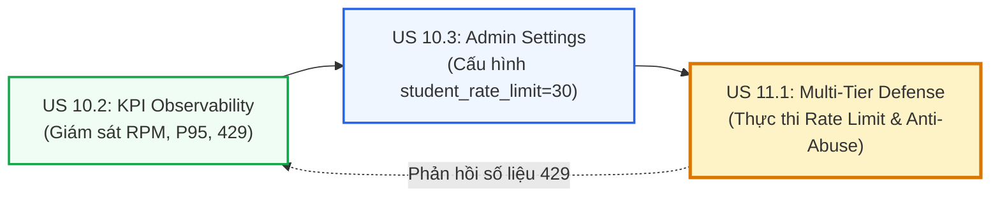
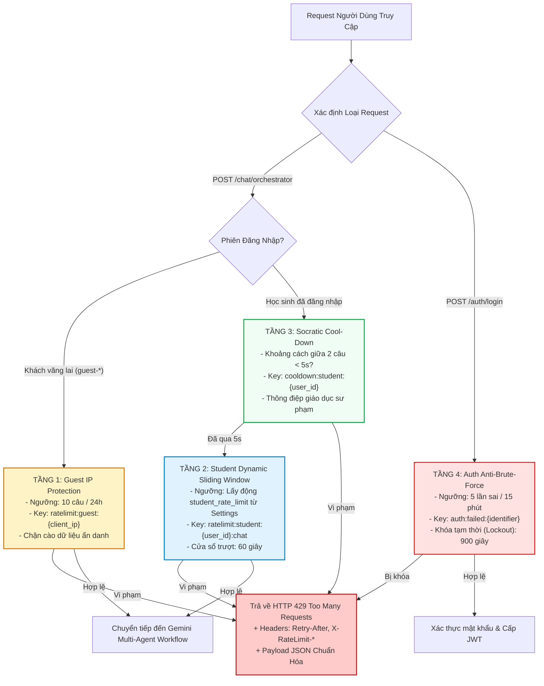
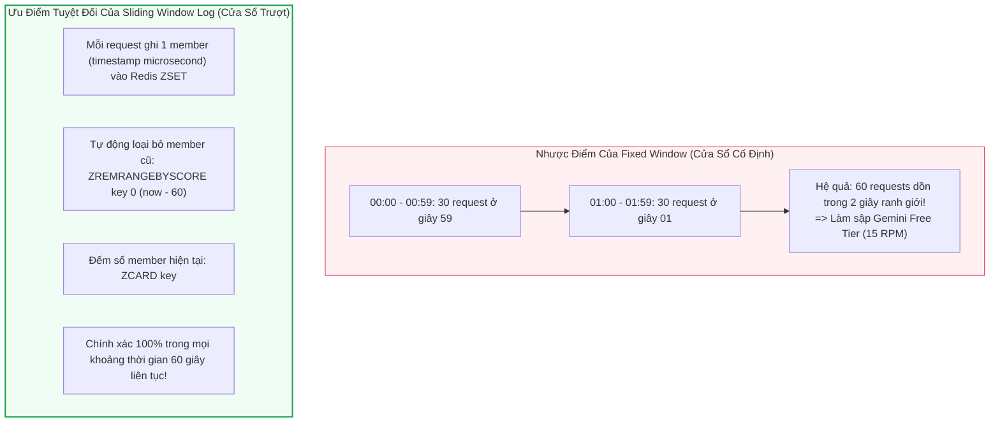
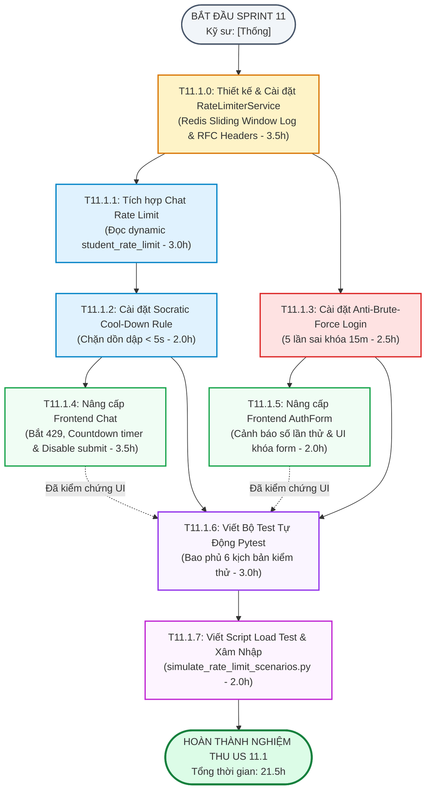
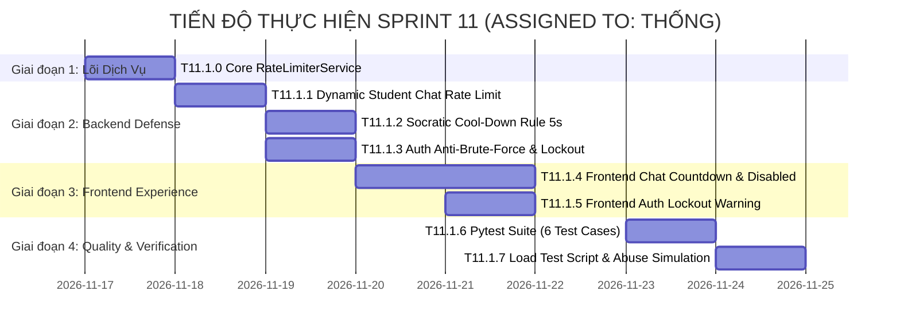

# KẾ HOẠCH TRIỂN KHAI & THIẾT KẾ TOÀN DIỆN SPRINT 11: USER STORY 11.1
# HỆ THỐNG QUẢN TRỊ LƯU LƯỢNG, BẢO VỆ TÀI NGUYÊN & CHỐNG LẠM DỤNG ĐA TẦNG (MULTI-TIER RATE LIMITING & RESOURCE ABUSE DEFENSE)
## Dự án: Nền tảng Gia sư Toán Socratic Thông minh (SocraticKid)
**Tài liệu Kỹ thuật, Phân rã Nhiệm vụ & Kế hoạch Thực thi Độc lập dành cho Kỹ sư Phát triển [Thống]**  
*Mã tài liệu: C1SE.04-DOC-SPRINT-11-RATE-LIMIT-PLAN-v1.0*  
*Ngày lập: 16/11/2026 | Phiên bản áp dụng: Sprint 11 (Tối ưu hóa Vận hành & Bảo vệ Tài nguyên Đồ án Tốt nghiệp)*  
*Người chịu trách nhiệm duy nhất (Sole Assignee): **[Thống]** (Fullstack / Lead Backend & Security)*  

---

## MỤC LỤC
1. [Tổng Quan Bối Cảnh & Đặt Vấn Đề (Sprint 11 Context & Threat Modeling)](#1-tổng-quan-bối-cảnh--đặt-vấn-đề-sprint-11-context--threat-modeling)
2. [Hiện Trạng Hệ Thống & Phân Tích Khoảng Trống (Gap Analysis)](#2-hiện-trạng-hệ-thống--phân-tích-khoảng-trống-gap-analysis)
3. [Kiến Trúc Kỹ Thuật Đề Xuất (Multi-Tier Defense Architecture)](#3-kiến-trúc-kỹ-thuật-đề-xuất-multi-tier-defense-architecture)
4. [Danh Mục Nhiệm Vụ Chi Tiết (Task Breakdown & Work Packages)](#4-danh-mục-nhiệm-vụ-chi-tiết-task-breakdown--work-packages)
5. [Ma Trận Phụ Thuộc & Sơ Đồ Lộ Trình Thực Hiện (Dependency Matrix & Execution Flow)](#5-ma-trận-phụ-thuộc--sơ-đồ-lộ-trình-thực-hiện-dependency-matrix--execution-flow)
6. [Bộ Tiêu Chí Chấp Nhận Nghiệm Thu (Acceptance Criteria - 100% Verifiable)](#6-bộ-tiêu-chí-chấp-nhận-nghiệm-thu-acceptance-criteria---100-verifiable)
7. [Kịch Bản Demo Bảo Vệ Trước Hội Đồng Đồ Án (Capstone Defense Demo Script)](#7-kịch-bản-demo-bảo-vệ-trước-hội-đồng-đồ-án-capstone-defense-demo-script)

---

## 1. TỔNG QUAN BỐI CẢNH & ĐẶT VẤN ĐỀ (SPRINT 11 CONTEXT & THREAT MODELING)

### 1.1. Khép kín Vòng lặp Vận hành: Observe $\rightarrow$ Configure $\rightarrow$ Enforce & Defend
Trong các Sprint trước, hệ thống SocraticKid đã xây dựng hoàn chỉnh hai mắt xích cốt lõi trong chuỗi quản trị:
- **Sprint 10 - US 10.2 (Admin KPI Dashboard):** Giám sát lưu lượng Throughput thời gian thực (RPM/RPH), đo đếm Token, độ trễ SLA và đếm các mã lỗi `429 Too Many Requests`.
- **Sprint 10 - US 10.3 (Admin System Settings):** Thiết lập giao diện và API cấu hình tham số hệ thống động, trong đó có trường cấu hình `student_rate_limit: int = 30` (mặc định 30 lượt/phút) được lưu trong Neon PostgreSQL và cache trên Upstash Redis.

Tuy nhiên, **mắt xích thứ ba - Thực thi & Bảo vệ (Enforce & Defend) - vẫn còn bị bỏ ngỏ**. Hiện nay tham số `student_rate_limit` mới chỉ dừng lại ở mức "lưu trên DB/Redis" mà chưa được router chat thật `/chat/orchestrator` nạp vào để kiểm soát học sinh.

> [!IMPORTANT]
> **Mục tiêu tối thượng của User Story 11.1 (Sprint 11):**
> Khép kín hoàn toàn tam giác quản trị **(1. Quan sát - Observe $\rightarrow$ 2. Cấu hình - Configure $\rightarrow$ 3. Thực thi - Enforce)** bằng việc xây dựng một hệ thống **Rate Limiting & Chống Lạm Dụng Tài Nguyên Toàn Diện Đa Tầng (Multi-Tier Defense System)**. Toàn bộ User Story này do một mình **[Thống]** thiết kế, hiện thực hóa Backend, Frontend, Viết bộ test tự động và kịch bản Load test xâm nhập.



---

### 1.2. Phân Tích Mô Hình Nguy Cơ & Ràng Buộc Tài Nguyên (Threat Modeling)

Hệ thống SocraticKid sử dụng hạ tầng kết hợp giữa Cloud và API AI miễn phí dành cho đồ án tốt nghiệp:
1. **Ràng buộc Google Gemini Free Tier Quota:**
   - **Tốc độ tối đa (Throughput Limit):** $15\text{ RPM}$ (Requests Per Minute) trên toàn hệ thống.
   - **Giới hạn hàng ngày (Daily Quota):** $1,500\text{ RPD}$ (Requests Per Day).
   - **Nguy cơ cạn kiệt (Denial of Wallet / Service):** Nếu một học sinh dùng tool script tự động hoặc copy bài toán giải liên tục với tần suất 15 request/phút, chỉ sau **100 phút (1 giờ 40 phút)**, toàn bộ hạn mức 1,500 lượt của ngày hôm đó sẽ **cháy sạch vào lúc 8h40 sáng**. Hậu quả là toàn bộ người dùng khác sẽ bị lỗi `429 RESOURCE_EXHAUSTED` cho đến 7h00 sáng ngày hôm sau.
2. **Ràng buộc Connection Pool Neon PostgreSQL:**
   - Neon Free Tier giới hạn tối đa **20 kết nối đồng thời (Max 20 Connections)**.
   - Nếu bị tấn công dồn dập vào endpoint `/chat/orchestrator` hoặc `/auth/login`, connection pool sẽ cạn kiệt ngay lập tức, làm sập toàn bộ dịch vụ backend.
3. **Nguy cơ Tấn công Vét cạn Mật khẩu (Brute-Force Credential Stuffing):**
   - Endpoint `POST /auth/login` hiện tại chưa có cơ chế giới hạn số lần thử sai. Kẻ xấu có thể dùng từ điển (dictionary attack) thử hàng ngàn mật khẩu mỗi giây nhằm chiếm quyền tài khoản phụ huynh hoặc học sinh.

---

### 1.3. Triết Lý Sư Phạm: Socratic Cool-Down (Chống Đọc Lướt & Ỷ Lại AI)
Khác với các ứng dụng giải bài tập thông thường (PhotoStudy, Chegg), SocraticKid là nền tảng **gợi mở tư duy (Socratic Method)**:
- Sau mỗi câu trả lời của AI, học sinh **bắt buộc phải có thời gian đọc hiểu, quan sát hình ảnh và tự suy nghĩ** trước khi phản hồi câu tiếp theo.
- Nếu học sinh gửi câu hỏi liên tiếp trong thời gian **dưới 5 giây** ($\Delta t < 5\text{s}$), đây là dấu hiệu rõ ràng của việc:
  - Học sinh không thèm đọc gợi ý của AI mà bấm bừa để lấy đáp án cuối cùng.
  - Học sinh bị spam click hoặc mạng bị gửi đúp request (double submit).
- **Giải pháp:** Cài đặt quy tắc **Socratic Cool-Down (Tối thiểu 5 giây)**. Nếu vi phạm, hệ thống chặn lại kèm lời nhắc nhở ân cần mang tính sư phạm thay vì thông báo lỗi khô khan.

---

## 2. HIỆN TRẠNG HỆ THỐNG & PHÂN TÍCH KHOẢNG TRỐNG (GAP ANALYSIS)

### 2.1. Đánh giá Hiện trạng Mã Nguồn (As-Is)
- **Guest Rate Limit (`backend/rate_limit.py`)**: Đã có dependency `check_guest_rate_limit` giới hạn $10\text{ câu}/24\text{h}$ dựa vào IP khách. Tuy nhiên, thuật toán dùng `INCR` đơn giản và chưa xuất các HTTP headers chuẩn RFC 6585.
- **Học sinh Đăng nhập (`backend/routers/chat.py`)**: Endpoint `/chat/orchestrator` kiểm tra `if not session_id.startswith("guest-")` và **hoàn toàn bỏ qua rate limit**. Học sinh đăng nhập có thể spam hàng ngàn câu hỏi không giới hạn!
- **Cấu hình Quản trị (`backend/services/system_config_service.py`)**: `student_rate_limit = 30` đã được lưu trữ và có hot-reload, nhưng không có một dòng code nào trong `chat.py` sử dụng biến này.
- **Xác thực (`backend/routers/auth.py`)**: Hàm `login()` kiểm tra password bằng bcrypt nhưng không đếm số lần sai. Khi mật khẩu sai, chỉ quăng lỗi `401 Unauthorized` mà không có cơ chế khóa tạm tài khoản.
- **Giao diện Chat (`frontend/app/dashboard/chat/page.tsx` & `ChatInput.tsx`)**: Khi gặp lỗi 429, giao diện chỉ báo lỗi chung `Error: Lỗi từ máy chủ (429)`. Nút gửi không bị khóa, không có đồng hồ đếm ngược (countdown timer), khiến học sinh bối rối và tiếp tục bấm nút gửi nhiều lần hơn.

---

### 2.2. Bảng Phân Tích Khoảng Trống Kỹ Thuật (Gap Analysis Matrix)

| STT | Khía Cạnh | Hiện Trạng (As-Is) | Mục Tiêu Chuẩn Sprint 11 (To-Be) | Tác Động Rủi Ro Nếu Bỏ Qua |
|:---:|:---|:---|:---|:---|
| **1** | **Bảo vệ Học Sinh Đăng Nhập** | Không có giới hạn nào. Học sinh có thể gửi liên tục không kiểm soát. | Áp dụng thuật toán **Redis Sliding Window Log** theo tham số động `student_rate_limit` cấu hình từ Admin (mặc định 30 req/phút). | 1 tài khoản có thể đốt sạch $1,500\text{ RPD}$ quota Gemini trong vòng chưa đầy 1 giờ. |
| **2** | **Khoảng Cách Sư Phạm (Cool-down)** | Học sinh gửi 2 câu hỏi cách nhau $0.5\text{s}$ vẫn được AI trả lời bình thường. | Kích hoạt **Socratic Cool-Down Rule ($\ge 5\text{s}$)** giữa 2 lượt hỏi liên tiếp trên cùng session. | Học sinh ỷ lại, spam nút gửi mà không chịu tư duy giải toán; tốn token vô ích. |
| **3** | **Bảo Vệ Đăng Nhập (Anti-Brute-Force)** | Cho phép thử mật khẩu vô hạn lần trên `POST /auth/login`. | Đếm số lần sai trong 15 phút. **Nhập sai 5 lần liên tiếp $\rightarrow$ Khóa tạm thời 15 phút (900s)** theo username/email và IP. | Kẻ xấu dò trúng mật khẩu tài khoản học sinh/phụ huynh; làm nghẽn Neon DB pool vì băm bcrypt liên tục. |
| **4** | **Chuẩn Hóa Chuẩn HTTP RFC 6585** | Chỉ trả về mã 429 và JSON detail đơn giản, thiếu các response header chỉ dẫn. | Trả về đầy đủ headers: `Retry-After`, `X-RateLimit-Limit`, `X-RateLimit-Remaining`, `X-RateLimit-Reset`. | Client không biết chính xác cần đợi bao nhiêu giây để gửi lại; vi phạm chuẩn RESTful API quốc tế. |
| **5** | **Trải Nghiệm Frontend (UX/UI)** | Báo lỗi đỏ thô sơ; nút bấm vẫn sáng cho học sinh spam tiếp. | **Khóa nút gửi (Disabled)**, hiển thị đồng hồ đếm ngược số giây trực quan (`Thử lại sau 15s...`), tự mở khóa khi hết giờ. | Học sinh spam click vì tưởng hệ thống bị đơ, làm gia tăng traffic lỗi 429 trên hệ thống. |
| **6** | **Khả Năng Chống Chịu (Fail-Open)** | Nếu Redis mất kết nối, hệ thống có thể bị crash hoặc nghẽn. | Áp dụng **Fail-Open Pattern** an toàn: nếu Redis timeout/disconnect, tự động cho qua và ghi log cảnh báo DevOps. | Lỗi hạ tầng cache làm gián đoạn việc học tập của toàn bộ học sinh trong lớp. |

---

## 3. KIẾN TRÚC KỸ THUẬT ĐỀ XUẤT (MULTI-TIER DEFENSE ARCHITECTURE)

### 3.1. Mô Hình 4 Tầng Phòng Vệ (Multi-Tier Defense Matrix)



---

### 3.2. Lựa Chọn Thuật Toán: Redis Sliding Window Log vs. Fixed Window vs. Token Bucket

Tại sao hệ thống SocraticKid chọn **Redis Sliding Window Log (ZSET)** cho tầng học sinh thay vì Fixed Window Counter?



- **Cấu trúc dữ liệu Redis:** Sử dụng **Sorted Set (ZSET)**.
  - Tên key: `ratelimit:student:{user_id}:chat`
  - Member: `<timestamp_ms>:<uuid_ngắn>`
  - Score: `<timestamp_ms>`
- **Thao tác nguyên tử (Atomic Multi/Exec hoặc Lua Script):**
  1. `ZREMRANGEBYSCORE key -inf (current_time_ms - 60000)`: Xóa sạch các request đã trôi qua quá 60 giây.
  2. `ZCARD key`: Đếm số lượng request còn nằm trong cửa sổ 60 giây gần nhất.
  3. Nếu `ZCARD < limit`: Thực hiện `ZADD key current_time_ms member` và đặt `EXPIRE key 65`. Cho phép request đi qua!
  4. Nếu `ZCARD >= limit`: Tính toán thời điểm phần tử cũ nhất được giải phóng để trả về giá trị `Retry-After = ceil((oldest_score + 60000 - current_time_ms) / 1000)`. Chặn lại với HTTP 429!

---

### 3.3. Chuẩn Giao Thức HTTP RFC 6585 & Schema JSON Tiêu Chuẩn

Khi chặn request vi phạm, Backend bắt buộc phải sinh ra các **Response Headers** tuân thủ nghiêm ngặt khuyến nghị của **IETF & RFC 6585 (Additional HTTP Status Codes)**:

| Header Name | Kiểu Dữ Liệu | Ví Dụ | Ý Nghĩa Kỹ Thuật |
|:---|:---:|:---|:---|
| `Retry-After` | Integer (Seconds) | `18` | Số giây người dùng cần chờ trước khi được phép gửi request tiếp theo. |
| `X-RateLimit-Limit` | Integer | `30` | Hạn mức tối đa được phép gọi trong chu kỳ hiện tại. |
| `X-RateLimit-Remaining` | Integer | `0` | Số lượt gọi còn lại trong chu kỳ (bằng 0 khi đã chạm trần). |
| `X-RateLimit-Reset` | Integer (Unix Epoch) | `1731748860` | Thời điểm chính xác (theo giây) hạn mức sẽ được giải phóng hoàn toàn. |

**Cấu trúc JSON Body trả về chuẩn hóa:**
```json
{
  "error": "rate_limit_exceeded",
  "reason": "STUDENT_LIMIT", // Hoặc "SOCRATIC_COOL_DOWN", "GUEST_LIMIT", "AUTH_BRUTE_FORCE_LOCKOUT"
  "message": "Bạn đang gửi câu hỏi quá nhanh. Hạn mức hiện tại là 30 câu/phút. Vui lòng thử lại sau 18 giây.",
  "limit": 30,
  "remaining": 0,
  "retry_after_seconds": 18,
  "reset_at": 1731748860
}
```

---

### 3.4. Chiến Lược Chống Sập Hệ Thống (Fail-Open Resiliency Pattern)

> [!TIP]
> **Triết lý Vận hành Hạ tầng:** *"Trải nghiệm học tập của học sinh quan trọng hơn việc đếm số gói tin"*.
> Trong trường hợp Upstash Redis bị sự cố mạng, rớt kết nối hoặc đạt giới hạn lệnh miễn phí:
> - Tầng `RateLimiterService` sẽ bắt ngoại lệ `redis.exceptions.RedisError`, ghi log cảnh báo mức `WARNING` có gắn nhãn telemetry `[RATE_LIMIT_REDIS_OFFLINE]`.
> - Hệ thống kích hoạt cơ chế **Fail-Open (Cho phép request đi qua bình thường)** thay vì quăng lỗi 500 làm gián đoạn buổi học của học sinh.

---

## 4. DANH MỤC NHIỆM VỤ CHI TIẾT (TASK BREAKDOWN & WORK PACKAGES)

Toàn bộ gói công việc Sprint 11 do duy nhất **[Thống]** phụ trách, được phân rã thành 8 subtask chi tiết từ `T11.1.0` đến `T11.1.7`:

### Bảng Tổng Hợp Nhiệm Vụ (Task Overview Table)

| Mã Task | Tên Nhiệm Vụ & Phạm Vi Triển Khai | Người Làm | Thời Gian | Task Tiên Quyết (Prerequisites) | Quan Hệ Song Song |
|:---:|:---|:---:|:---:|:---:|:---:|
| **T11.1.0** | Thiết kế & Cài đặt `RateLimiterService` lõi (Redis Sliding Window Log & RFC 6585 Headers) | **[Thống]** | **3.5h** | *Không có (Bắt đầu ngay)* | Độc lập |
| **T11.1.1** | Tích hợp Rate Limit động cho học sinh đăng nhập trong `POST /chat/orchestrator` | **[Thống]** | **3.0h** | `T11.1.0` | Song song với `T11.1.3` |
| **T11.1.2** | Cài đặt Quy tắc Sư phạm Socratic Cool-Down ($\ge 5\text{s}$) & Thông điệp giáo dục | **[Thống]** | **2.0h** | `T11.1.1` | - |
| **T11.1.3** | Xây dựng cơ chế Phòng vệ Anti-Brute-Force & Khóa tạm 15 phút trên `POST /auth/login` | **[Thống]** | **2.5h** | `T11.1.0` | Song song với `T11.1.1` |
| **T11.1.4** | Nâng cấp Frontend Chat: Bắt mã 429, Đồng hồ đếm ngược & Khóa nút gửi (Disabled) | **[Thống]** | **3.5h** | `T11.1.1`, `T11.1.2` | Song song với `T11.1.5` |
| **T11.1.5** | Nâng cấp Frontend Auth: Hiển thị cảnh báo Brute-Force & Khóa form đăng nhập | **[Thống]** | **2.0h** | `T11.1.3` | Song song với `T11.1.4` |
| **T11.1.6** | Xây dựng Bộ Kiểm Thử Tự Động Toàn Diện `backend/test/test_us11_1_rate_limiting.py` | **[Thống]** | **3.0h** | `T11.1.1`, `T11.1.2`, `T11.1.3` | - |
| **T11.1.7** | Viết Kịch Bản Load Test & Xâm Nhập `backend/scripts/simulate_rate_limit_scenarios.py` | **[Thống]** | **2.0h** | `T11.1.6` | - |
| **TỔNG** | **Toàn bộ User Story 11.1 (Rate Limiting & Abuse Defense)** | **[Thống]** | **21.5h** | - | - |

---

### Chi Tiết Từng Gói Công Việc (Work Package Details)

#### Task T11.1.0: Thiết kế & Cài đặt `RateLimiterService` lõi
- **Người thực hiện:** [Thống] (Backend & Redis Architect)
- **Thời gian ước tính:** 3.5 giờ
- **File tạo mới/chỉnh sửa:** `backend/services/rate_limiter_service.py`
- **Mục tiêu kỹ thuật:**
  - Viết class `RateLimiterService` hỗ trợ cả 2 backend Redis: `redis.asyncio` và `upstash_redis`.
  - Cài đặt phương thức `check_sliding_window(key: str, limit: int, window_seconds: int = 60) -> Tuple[bool, Dict[str, Any]]`:
    - Sử dụng Redis Pipeline thực hiện `ZREMRANGEBYSCORE`, `ZCARD`, `ZADD`, `EXPIRE`.
    - Tính toán chính xác `remaining` và `retry_after_seconds`.
  - Cài đặt phương thức `generate_rfc_headers(limit, remaining, retry_after, reset_ts) -> Dict[str, str]`: Sinh đúng 4 headers `Retry-After`, `X-RateLimit-Limit`, `X-RateLimit-Remaining`, `X-RateLimit-Reset`.
  - Bọc khối `try...except` bắt ngoại lệ kết nối Redis để kích hoạt chế độ Fail-Open an toàn.
- **Tiêu chuẩn hoàn thành:** Chạy unit test độc lập cho class `RateLimiterService` đạt 100% pass với các kịch bản mock Redis.

#### Task T11.1.1: Tích hợp Rate Limit động cho Học Sinh trong `POST /chat/orchestrator`
- **Người thực hiện:** [Thống] (Backend API Engineer)
- **Thời gian ước tính:** 3.0 giờ
- **File chỉnh sửa:** `backend/routers/chat.py`, `backend/rate_limit.py`
- **Mục tiêu kỹ thuật:**
  - Nâng cấp dependency kiểm tra rate limit trong `backend/routers/chat.py`.
  - Đối với request của học sinh đã đăng nhập:
    - Trích xuất `user_id` từ session hoặc token xác thực.
    - Gọi `SystemConfigService.get_system_settings()` để lấy giá trị `student_rate_limit` động (mặc định 30).
    - Khởi tạo key `ratelimit:student:{user_id}:chat` và kiểm tra qua `RateLimiterService`.
  - Khi vượt quá hạn mức: Trả về `HTTPException(status_code=429)` đính kèm đầy đủ 4 response headers chuẩn RFC 6585 và JSON payload mô tả chi tiết lý do.
  - Kết nối telemetry: Tăng bộ đếm `rpm:error:429` để Admin KPI Dashboard (US 10.2) ghi nhận số liệu tức thì.
- **Tiêu chuẩn hoàn thành:** Gọi API qua Bruno hoặc cURL 31 lần/phút; 30 lần đầu thành công (200), lần thứ 31 nhận ngay mã 429 kèm header `Retry-After`.

#### Task T11.1.2: Cài đặt Quy tắc Sư phạm Socratic Cool-Down ($\ge 5\text{s}$)
- **Người thực hiện:** [Thống] (Pedagogical Logic & Backend)
- **Thời gian ước tính:** 2.0 giờ
- **File chỉnh sửa:** `backend/routers/chat.py`, `backend/services/rate_limiter_service.py`
- **Mục tiêu kỹ thuật:**
  - Cài đặt cơ chế kiểm soát nhịp học sư phạm (Socratic Pacing Engine).
  - Sử dụng Redis key `cooldown:student:{user_id}:session:{session_id}` lưu trữ timestamp của câu hỏi vừa được xử lý thành công.
  - Khi có câu hỏi mới đến từ cùng học sinh trên cùng session:
    - Đo khoảng thời gian chênh lệch: $\Delta t = \text{now} - \text{last\_request\_time}$.
    - Nếu $\Delta t < 5.0\text{ giây}$: Ngắt luồng ngay lập tức trước khi gọi sang Gemini API.
    - Trả về mã lỗi 429 với `reason: "SOCRATIC_COOL_DOWN"` và thông điệp: *"Thầy Socratic nhận thấy em đang gửi câu hỏi rất nhanh. Hãy dành ít nhất 5 giây để quan sát hình vẽ và đọc kỹ gợi ý trước khi hỏi tiếp nhé!"*.
- **Tiêu chuẩn hoàn thành:** Gửi liên tiếp 2 câu hỏi cách nhau 2 giây $\rightarrow$ Câu thứ 2 bị chặn với thông điệp sư phạm; gửi cách nhau 6 giây $\rightarrow$ Thành công.

#### Task T11.1.3: Xây dựng cơ chế Phòng vệ Anti-Brute-Force trên `POST /auth/login`
- **Người thực hiện:** [Thống] (Security & Backend Engineer)
- **Thời gian ước tính:** 2.5 giờ
- **File chỉnh sửa:** `backend/routers/auth.py`
- **Mục tiêu kỹ thuật:**
  - Chuẩn hóa định danh đăng nhập: `normalized_id = form_data.username.lower().strip()`.
  - Định nghĩa 2 loại key Redis:
    - Bộ đếm thất bại: `auth:failed_count:{normalized_id}` (TTL 900 giây = 15 phút).
    - Khóa tài khoản tạm thời: `auth:lockout:{normalized_id}` (TTL 900 giây).
  - Tại đầu hàm `login()`: Kiểm tra xem key `auth:lockout:{normalized_id}` có tồn tại không. Nếu có $\rightarrow$ Trả về ngay HTTP 429 kèm thông báo: *"Tài khoản tạm thời bị khóa 15 phút do nhập sai mật khẩu quá 5 lần. Vui lòng thử lại sau {minutes_left} phút hoặc đặt lại mật khẩu."*.
  - Tại đoạn kiểm tra `verify_password()`:
    - Nếu mật khẩu sai: Gọi `redis.incr(failed_count_key)`. Nếu số lần sai $\ge 5$, tạo ngay key `auth:lockout` với TTL 900s. Trả về thông báo kèm số lần thử còn lại: *"Tên tài khoản hoặc mật khẩu không đúng. Bạn còn {5 - count} lần thử trước khi tài khoản bị khóa 15 phút."*.
    - Nếu mật khẩu đúng: Xóa sạch key `auth:failed_count:{normalized_id}` và tiếp tục cấp phát JWT token bình thường.
- **Tiêu chuẩn hoàn thành:** Đăng nhập sai 5 lần liên tiếp $\rightarrow$ Lần thứ 6 bị chặn ngay lập tức với mã 429 dù nhập đúng hay sai mật khẩu.

#### Task T11.1.4: Nâng cấp Frontend Chat - Countdown Timer & Disable Submit
- **Người thực hiện:** [Thống] (Frontend React/Next.js)
- **Thời gian ước tính:** 3.5 giờ
- **File chỉnh sửa:** `frontend/app/dashboard/chat/page.tsx`, `frontend/components/chat/ChatInput.tsx`, `frontend/components/chat/ChatWindow.tsx`
- **Mục tiêu kỹ thuật:**
  - Bắt HTTP status `response.status === 429` trong hàm gửi tin nhắn `sendMessage`.
  - Đọc giá trị header `Retry-After` hoặc trường `retry_after_seconds` từ body phản hồi JSON.
  - Quản lý state đếm ngược: `const [cooldownSeconds, setCooldownSeconds] = useState<number>(0)`.
  - Kích hoạt `setInterval` đếm lùi từng giây cho đến khi về 0.
  - Truyền prop `disabled={cooldownSeconds > 0}` vào `ChatInput`:
    - Vô hiệu hóa ô gõ văn bản và nút gửi (opacity-50, cursor-not-allowed).
    - Thay thế icon nút gửi bằng nhãn đếm ngược trực quan: *"Chờ {cooldownSeconds}s..."*.
  - Hiển thị Toast thông báo màu vàng/cam thân thiện chứa đúng thông điệp sư phạm do backend trả về.
- **Tiêu chuẩn hoàn thành:** Khi nhận mã 429 (do quá 30 req/phút hoặc spam < 5s), giao diện không bị giật, nút gửi lập tức bị khóa, đồng hồ đếm lùi $5 \rightarrow 4 \rightarrow 3 \rightarrow 2 \rightarrow 1 \rightarrow 0$ và tự mở khóa mượt mà.

#### Task T11.1.5: Nâng cấp Frontend Auth - Cảnh Báo Brute-Force & Lockout UI
- **Người thực hiện:** [Thống] (Frontend React/Next.js)
- **Thời gian ước tính:** 2.0 giờ
- **File chỉnh sửa:** `frontend/components/AuthForm.tsx`
- **Mục tiêu kỹ thuật:**
  - Xử lý phản hồi khi `signIn("credentials")` gặp lỗi khóa tài khoản từ backend.
  - Hiển thị cảnh báo trực quan:
    - Nếu sai dưới 5 lần: Hiển thị badge màu cam cảnh báo số lần thử còn lại (ví dụ: *"Cảnh báo: Còn 2 lần thử trước khi bị tạm khóa"*).
    - Nếu bị khóa tạm thời: Hiển thị hộp thông báo màu đỏ có icon ổ khóa kèm thời gian đếm lùi số phút khóa. Vô hiệu hóa nút Đăng Nhập cho đến khi hết thời gian khóa.
- **Tiêu chuẩn hoàn thành:** Nhập sai 5 lần trên form login $\rightarrow$ Form chuyển sang trạng thái cảnh báo khóa tài khoản kèm thời gian chờ rõ ràng.

#### Task T11.1.6: Xây dựng Bộ Kiểm Thử Tự Động Toàn Diện
- **Người thực hiện:** [Thống] (Automation Test Engineer)
- **Thời gian ước tính:** 3.0 giờ
- **File tạo mới:** `backend/test/test_us11_1_rate_limiting.py`
- **Mục tiêu kỹ thuật:**
  - Viết bộ kiểm thử Pytest bao phủ 100% các nhánh logic của User Story 11.1:
    1. `test_student_rate_limit_sliding_window_enforced`: Gọi lặp lại vượt quá `student_rate_limit` $\rightarrow$ Xác nhận mã 429 xuất hiện đúng từ request thứ $N+1$.
    2. `test_rfc_6585_headers_integrity`: Kiểm tra sự tồn tại và tính hợp lệ của cả 4 headers `Retry-After`, `X-RateLimit-Limit`, `X-RateLimit-Remaining`, `X-RateLimit-Reset`.
    3. `test_socratic_cooldown_sub_5_seconds`: Gửi 2 request cách nhau 1 giây $\rightarrow$ Kiểm tra chặn đúng mã 429 và lý do `SOCRATIC_COOL_DOWN`.
    4. `test_auth_brute_force_lockout_after_5_failed_attempts`: Gửi sai password 5 lần liên tiếp $\rightarrow$ Kiểm tra lần thứ 6 bị khóa dù password đúng.
    5. `test_auth_success_clears_failed_counter`: Nhập sai 2 lần rồi nhập đúng $\rightarrow$ Xác nhận bộ đếm thất bại được reset về 0.
    6. `test_rate_limit_fail_open_on_redis_error`: Giả lập ngắt kết nối Redis $\rightarrow$ Xác nhận hệ thống vẫn cho phép học sinh gửi bài (Fail-Open) mà không bị lỗi 500.
- **Tiêu chuẩn hoàn thành:** Chạy lệnh `pytest backend/test/test_us11_1_rate_limiting.py` đạt kết quả xanh toàn bộ (100% Passed).

#### Task T11.1.7: Viết Kịch Bản Load Test & Xâm Nhập Độc Lập
- **Người thực hiện:** [Thống] (DevOps & Security Simulation)
- **Thời gian ước tính:** 2.0 giờ
- **File tạo mới:** `backend/scripts/simulate_rate_limit_scenarios.py`
- **Mục tiêu kỹ thuật:**
  - Sử dụng thư viện `httpx` async để chạy các kịch bản mô phỏng thực tế:
    - **Scenario A (Spam học sinh):** 1 học sinh bắn liên tục 40 requests trong 10 giây $\rightarrow$ Báo cáo số lượng request lọt qua ($30$) và số lượng bị chặn ($10$ với mã 429).
    - **Scenario B (Tool bot cào đề):** Bắn request với độ trễ $200\text{ms}$ $\rightarrow$ Xác minh $100\%$ bị chặn bởi Socratic Cool-Down Rule.
    - **Scenario C (Tấn công từ điển mật khẩu):** Gửi 10 login requests sai mật khẩu $\rightarrow$ Xác minh từ request thứ 6 trở đi bị khóa và không thể làm hao tổn CPU băm bcrypt.
  - In kết quả ra màn hình terminal dưới dạng bảng màu trực quan (rich console output).
- **Tiêu chuẩn hoàn thành:** Script chạy trơn tru, chứng minh toàn diện hiệu quả ngăn chặn lạm dụng tài nguyên trước Hội đồng.

---

## 5. MA TRẬN PHỤ THUỘC & SƠ ĐỒ LỘ TRÌNH THỰC HIỆN (DEPENDENCY MATRIX & EXECUTION FLOW)

### 5.1. Bảng Ma Trận Phụ Thuộc (Dependency Matrix)

| Task ID | Tên Nhiệm Vụ | Điều Kiện Tiên Quyết (Prerequisites) | Có Thể Làm Song Song Với | Đầu Ra Bàn Giao (Deliverable) |
|:---:|:---|:---:|:---:|:---|
| **T11.1.0** | Lõi `RateLimiterService` | *None* | - | File `rate_limiter_service.py` hoàn chỉnh |
| **T11.1.1** | Dynamic Rate Limit Học Sinh | `T11.1.0` | `T11.1.3` | Endpoint `/chat/orchestrator` có rate limit |
| **T11.1.2** | Socratic Cool-Down (5s) | `T11.1.1` | `T11.1.3` | Logic chặn spam câu hỏi liên tiếp < 5s |
| **T11.1.3** | Anti-Brute-Force Đăng Nhập | `T11.1.0` | `T11.1.1`, `T11.1.2` | Endpoint `/auth/login` có khóa 15 phút |
| **T11.1.4** | Frontend Chat Countdown & Disabled | `T11.1.1`, `T11.1.2` | `T11.1.5` | UI Chat có đồng hồ đếm ngược và khóa nút |
| **T11.1.5** | Frontend Auth Lockout Banner | `T11.1.3` | `T11.1.4` | Form login có cảnh báo số lần sai & đếm ngược |
| **T11.1.6** | Test tự động Pytest | `T11.1.1`, `T11.1.2`, `T11.1.3` | - | File test `test_us11_1_rate_limiting.py` |
| **T11.1.7** | Script Load Test & Xâm Nhập | `T11.1.6` | - | Script `simulate_rate_limit_scenarios.py` |

---

### 5.2. Sơ Đồ Lộ Trình Thực Hiện Của Kỹ Sư [Thống] (Execution Flow)



---

### 5.3. Tiến Độ Thực Hiện Đề Xuất (Gantt Schedule)



---

## 6. BỘ TIÊU CHÍ CHẤP NHẬN NGHIỆM THU (ACCEPTANCE CRITERIA - 100% VERIFIABLE)

Hội đồng phản biện và Quản trị viên có thể kiểm chứng toàn bộ 6 tiêu chí chấp nhận nghiệm thu (Acceptance Criteria) trên cả Web UI lẫn API:

### [AC-RL-01] Kiểm Soát Tốc Độ Chat Động Của Học Sinh Theo Cấu Hình Admin
- **Mô tả kiểm thử:**
  1. Quản trị viên truy cập `/admin/settings`, tại tab Rate Limit đặt `student_rate_limit = 5` câu/phút và nhấn **Lưu Cấu Hình**.
  2. Mở trình duyệt với tài khoản học sinh, gửi liên tiếp 5 câu hỏi trong vòng 60 giây. Cả 5 câu hỏi đều được AI tiếp nhận và trả lời gợi mở bình thường.
  3. Gửi câu hỏi thứ 6 trong cùng phút đó $\rightarrow$ Hệ thống lập tức chặn lại với mã **HTTP 429 Too Many Requests**.
  4. Response trả về đầy đủ header `Retry-After: <số giây>` và `X-RateLimit-Limit: 5`, `X-RateLimit-Remaining: 0`.

### [AC-RL-02] Quy Tắc Sư Phạm Socratic Cool-Down ($\ge 5\text{s}$)
- **Mô tả kiểm thử:**
  1. Học sinh vừa nhận được phản hồi gợi ý từ AI.
  2. Ngay lập tức trong vòng **dưới 5 giây** (ví dụ 1.5 giây), học sinh bấm gửi tiếp câu hỏi mới.
  3. Hệ thống không gọi sang mô hình Gemini (bảo toàn token) mà trả về ngay phản hồi sư phạm: *"Thầy Socratic nhận thấy em đang gửi câu hỏi rất nhanh. Hãy dành ít nhất 5 giây để đọc kỹ gợi ý trước khi hỏi tiếp nhé!"*.
  4. Nếu học sinh đợi qua giây thứ 6 mới bấm gửi $\rightarrow$ Câu hỏi được gửi đi bình thường.

### [AC-RL-03] Phòng Thủ Chống Tấn Công Vét Cạn Mật Khẩu (Anti-Brute-Force Lockout)
- **Mô tả kiểm thử:**
  1. Kẻ xấu truy cập trang đăng nhập, cố tình nhập sai mật khẩu của một tài khoản học sinh.
  2. Từ lần 1 đến lần 4: Giao diện hiển thị cảnh báo đỏ kèm thông báo số lần thử còn lại (ví dụ: *"Bạn còn 2 lần thử trước khi tài khoản bị khóa"*).
  3. Lần thứ 5 tiếp tục nhập sai $\rightarrow$ Tài khoản bị kích hoạt trạng thái **Lockout 15 phút (900s)**.
  4. Lần thứ 6, dù kẻ xấu có nhập ĐÚNG mật khẩu thật đi chăng nữa, hệ thống vẫn kiên quyết từ chối với mã **HTTP 429 / 423** kèm thông báo: *"Tài khoản tạm thời bị khóa do nhập sai mật khẩu quá 5 lần. Vui lòng thử lại sau 15 phút."*.

### [AC-RL-04] Trải Nghiệm Người Dùng (UX) Đếm Ngược Thời Gian Thực & Khóa Nút Gửi
- **Mô tả kiểm thử:**
  1. Khi học sinh bị chạm trần Rate Limit hoặc vi phạm Socratic Cool-down:
  2. Nút gửi tin nhắn (Send Button) trên giao diện chat lập tức chuyển sang trạng thái **Disabled (xám mờ)**.
  3. Trên nút gửi xuất hiện bộ đếm thời gian lùi từng giây theo nhịp đồng hồ thật: `Chờ 5s...` $\rightarrow$ `Chờ 4s...` $\rightarrow$ `Chờ 3s...` $\rightarrow$ `Chờ 2s...` $\rightarrow$ `Chờ 1s...`.
  4. Khi đồng hồ đếm về 0, nút gửi tự động sáng trở lại bình thường mà học sinh không cần phải F5 tải lại trang.

### [AC-RL-05] Tuân Thủ Chuẩn Quốc Tế RFC 6585 & Hiển Thị Đồng Bộ Lên KPI Dashboard
- **Mô tả kiểm thử:**
  1. Sử dụng công cụ kiểm tra Network trên DevTools hoặc Bruno: Mỗi khi có request bị chặn 429, response headers luôn có đủ 4 trường: `Retry-After`, `X-RateLimit-Limit`, `X-RateLimit-Remaining`, `X-RateLimit-Reset`.
  2. Đồng thời mở tab Admin KPI Dashboard (`/admin`), tại biểu đồ Throughput và Error Distribution: Cột mã lỗi `4xx` và số đếm `Gemini 429 Rate Limit Counter` lập tức nhảy số tăng tương ứng theo thời gian thực (real-time increment).

### [AC-RL-06] Khả Năng Tự Phục Hồi & Chống Sập Hệ Thống (Fail-Open Verification)
- **Mô tả kiểm thử:**
  1. Giả lập ngắt kết nối Upstash Redis (hoặc cung cấp chuỗi kết nối sai).
  2. Học sinh thực hiện gửi bài toán vào hệ thống.
  3. Hệ thống ghi nhận log cảnh báo `[RateLimit] Redis offline, kích hoạt fail-open`, nhưng **vẫn cho phép câu hỏi của học sinh được chuyển tiếp đến Gemini AI** và nhận lời giải bình thường, tuyệt đối không quăng mã lỗi sập máy chủ `500 Internal Server Error`.

---

## 7. KỊCH BẢN DEMO BẢO VỆ TRƯỚC HỘI ĐỒNG ĐỒ ÁN (CAPSTONE DEFENSE DEMO SCRIPT)

Kỹ sư **[Thống]** sẽ trực tiếp trình diễn kịch bản 3 bước thuyết phục Hội đồng nghiệm thu:

```
+--------------------------------------------------------------------------------------------------+
| BƯỚC 1: DEMO TẦNG QUẢN TRỊ & RATE LIMIT ĐỘNG HỌC SINH (DYNAMIC RATE LIMITING)                    |
| 1. Kỹ sư Thống vào /admin/settings: Chỉnh student_rate_limit từ 30 xuống 3 (để demo nhanh).     |
| 2. Mở tab Học sinh: Gửi liên tiếp 3 câu hỏi -> Cả 3 câu thành công.                               |
| 3. Gửi câu thứ 4 -> Nút gửi lập tức chuyển thành "Chờ 42s..." kèm đếm ngược thời gian thực.     |
| 4. Mở tab Admin KPI Dashboard -> Cột lỗi 429 nhảy thêm 1 đơn vị, chứng minh telemetry khép kín.   |
+--------------------------------------------------------------------------------------------------+
                                                |
                                                v
+--------------------------------------------------------------------------------------------------+
| BƯỚC 2: DEMO TẦNG SƯ PHẠM (SOCRATIC COOL-DOWN 5 GIÂY)                                            |
| 1. Ngay khi AI trả lời xong, bấm spam nút gửi trong vòng 1 giây.                                 |
| 2. Giao diện xuất hiện thông điệp sư phạm: "Hãy dành ít nhất 5 giây để suy nghĩ và đọc gợi ý...".|
| 3. Đồng hồ đếm lùi: Chờ 4s... -> Chờ 3s... -> Mở khóa nút gửi. Chứng minh tính nhân văn AI.       |
+--------------------------------------------------------------------------------------------------+
                                                |
                                                v
+--------------------------------------------------------------------------------------------------+
| BƯỚC 3: DEMO TẦNG AN NINH & LOAD TEST TỰ ĐỘNG (ANTI-BRUTE-FORCE & SCRIPT VERIFICATION)            |
| 1. Thử nhập sai mật khẩu 5 lần trên form đăng nhập -> Form khóa tài khoản 15 phút.                |
| 2. Chạy script: python backend/scripts/simulate_rate_limit_scenarios.py                          |
| 3. Terminal in ra bảng kết quả xanh mượt: 40 requests spam -> Chặn chuẩn 10 requests vượt ngưỡng |
|    bảo vệ tuyệt đối 100% tài nguyên Gemini API và Neon PostgreSQL Pool của đồ án!               |
+--------------------------------------------------------------------------------------------------+
```

---
*Tài liệu kỹ thuật và kế hoạch hành động Sprint 11 được lưu trữ chính thức tại `docs/KE_HOACH_TRIEN_KHAI_SPRINT_11_RATE_LIMIT.md`.*

