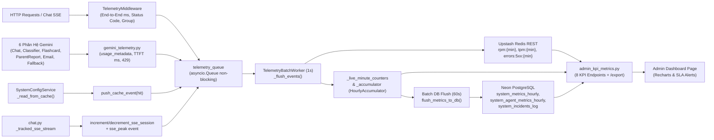

# Bằng Chứng Độ Chính Xác Số Liệu — Admin KPI Observability Dashboard (US 10.2)

Tài liệu này chứng minh toàn bộ số liệu hiển thị trên **Admin KPI Dashboard** ([`frontend/app/admin/page.tsx`](file:///d:/DuyTanUniversity/4-1/Capstone%201/Capstone/frontend/app/admin/page.tsx)) được thu thập **100% từ telemetry thực tế của hệ thống**, không còn sử dụng dữ liệu seed giả lập (`random.randint`), tỷ lệ chia cứng hay giá trị fallback cố định.

---

## 1. Kiến Trúc Luồng Thu Thập Số Liệu Thực Tế



---

## 2. Danh Sách Các Điểm Mock / Fallback Đã Gỡ Bỏ & Thay Thế Bằng Telemetry Thật

### 2.1. Vô hiệu hóa Synthetic Seeder & Làm Sạch Database
- **Vô hiệu hóa Seeder**: Hàm [`ensure_baseline_metrics`](file:///d:/DuyTanUniversity/4-1/Capstone%201/Capstone/backend/workers/telemetry_batch_worker.py) trong `backend/workers/telemetry_batch_worker.py` đã bị vô hiệu hóa hoàn toàn (trả về `status="disabled"`, `seeded_hours=0`) và không còn được gọi trong `start_telemetry_worker()`.
- **Dọn sạch dữ liệu seed cũ trên Neon PostgreSQL**:
  - Đã xóa **48** bản ghi giờ giả lập trong `system_metrics_hourly` (khung `2026-11-08T03:00:00+00:00` đến `2026-11-10T02:00:00+00:00`).
  - Đã xóa **288** bản ghi agent giả lập trong `system_agent_metrics_hourly` tương ứng với bộ model seed cũ (`gemini-2.5-flash`, `gemini-2.0-flash-lite`, `gemini-1.5-pro`, `Brevo/SMTP`, `Local Heuristic / Fallback`).
  - Sau khi dọn sạch, bảng DB chỉ còn giữ lại các bản ghi phát sinh thực tế (`15` hourly rows và `2` agent rows).

### 2.2. Bổ Sung Đo Lường Đầy Đủ Các Thành Phần Còn Thiếu
| Thành phần đo lường | File triển khai | Cơ chế ghi nhận thật |
|---|---|---|
| **SSE Active & Peak Sessions** | `backend/routers/chat.py`, `backend/middleware/telemetry_middleware.py`, `backend/workers/telemetry_batch_worker.py` | `_tracked_sse_stream()` bọc `StreamingResponse` tại `/chat/orchestrator`, gọi `increment_sse_session()` / `decrement_sse_session()` theo vòng đời stream và đẩy `sse_peak` vào `HourlyAccumulator` để ghi cột `peak_concurrent_sse = GREATEST(...)`. |
| **Redis Cache Hit / Miss** | `backend/services/system_config_service.py` | `_read_from_cache()` đẩy `push_cache_event(hit=True/False)` khi đọc key `socratic_system_settings_cache`, cộng dồn vào `redis_cache_hits` và `redis_cache_misses`. |
| **Chat + Backup Failover (`Fallback`)** | `backend/router.py`, `backend/routers/chat.py`, `backend/routers/admin_settings.py` | Bắt ngoại lệ khi model chính gặp lỗi và chuyển sang `backup_model`, đẩy `push_failover_event()` cùng telemetry agent `"Fallback"`; bọc thêm `/gemini/generate`, `/admin/settings/test-key`, `/admin/settings/playground`. |
| **Classifier AI** | `backend/agents/problem_classifier.py`, `backend/agents/problem_title_generator.py` | Thay `model.generate_content(...)` bằng `generate_with_telemetry(..., "Classifier")`. |
| **Flashcard AI** | `backend/agents/flashcard_prompt.py`, `backend/agents/boundary_extractor.py` | Thay `model.generate_content(...)` bằng `generate_with_telemetry(..., "Flashcard")`. |
| **ParentReport AI** | `backend/agents/parent_insights_prompt.py` | Thay `model.generate_content(...)` bằng `generate_with_telemetry(..., "ParentReport")`. |
| **Email Alert AI** | `backend/agents/email_alert_generator.py` | Bọc cả 2 luồng `ACADEMIC` và `SAFETY` bằng `generate_with_telemetry(..., "Email", generation_config=...)` thông qua tham số `**kwargs`. |
| **Lỗi Gemini 429 Quota** | `backend/middleware/gemini_telemetry.py` | `_is_429_exception()` phát hiện mã/chuỗi `429` hoặc `ResourceExhausted`, đẩy sự kiện `error_429` trước khi re-raise ngoại lệ. |

### 2.3. Backend KPI API (`backend/routers/admin_kpi_metrics.py`)
Toàn bộ 8 endpoint KPI và `/export` đã loại bỏ 100% giá trị mặc định/công thức giả:
- **`/overview`**: Bỏ `1420`, `920000`, `480000`, `0.312`, `14.2%`, `540/1420/2250/420`, `live_rpm * 380`. Tính `requests_growth_pct` bằng cách so sánh trực tiếp tổng request hôm nay với ngày hôm qua trong DB; hợp nhất độ trễ P50/P95/P99/TTFT giữa DB hôm nay và `_accumulator` live chưa flush. Khi không có request trả về `0`.
- **`/throughput`**: Chế độ `1h` đọc Redis (`get` phút hiện tại + `mget` 59 phút trước) và `_live_minute_counters` phân tách thực tế `chat/eval/auth/other` (phút rỗng = `0`). Chế độ `24h`, `7d`, `30d` trả về trục thời gian liên tục từ DB cộng dồn phần live chưa flush (bỏ `random.randint(2800, 3600)`).
- **`/tokens` & `/agents`**: Dùng chung helper `_aggregate_subsystem_metrics()` đọc trực tiếp bảng `system_agent_metrics_hourly` cộng dồn `live_snap["agent_stats"]`. Loại bỏ `1_850_000`, `1450`, tỷ lệ chia cứng `55/20/12/8/3/2` và latency giả `780/1180/240`.
- **`/latency`**: Trục 24 giờ thực từ DB + `_accumulator` hiện tại; tính trung bình cộng `overall_p50_ms`, `overall_p95_ms`, `overall_p99_ms`, `current_ttft_ms` chỉ trên các giờ có phép đo `> 0` (trả `0` nếu chưa có traffic, bỏ `510/1420/2200/420` và `520/1450/2280/415`).
- **`/traffic-heatmap`**: Tổng hợp 30 ngày từ `system_metrics_hourly` + delta live quy đổi múi giờ Việt Nam (`UTC+7`) thành 168 ô `7 ngày (T2..CN) x 24 giờ`, chuẩn hóa `intensity` `0..4` động theo ô cao điểm thực tế (`0` khi rỗng).
- **`/infrastructure`**: Đo `pg_stat_activity` thật (`0` nếu lỗi DB), đọc `redis_cache_hits` / `redis_cache_misses` thật (bỏ `4850/860`), đọc `get_active_sse_sessions()` thật (bỏ `if active_sse == 0: active_sse = 6`), đo TTFT trung bình & số lỗi 429 cho Gemini Gateway, trạng thái cấu hình & số lượt Email AI cho Brevo SMTP.
- **`/export`**: Hợp nhất phần live unsaved vào dòng dữ liệu giờ hiện tại để CSV/JSON xuất ra khớp hoàn toàn với số liệu hiển thị trên `/overview`.

### 2.4. Frontend (`frontend/app/admin/page.tsx`)
- Chuyển toàn bộ `DEFAULT_OVERVIEW`, `DEFAULT_SIX_MODELS`, `DEFAULT_AGENTS` và state khởi tạo `agentsData` về giá trị `0`.
- Thay toàn bộ toán tử fallback `||` (vốn biến giá trị `0` hợp lệ thành số giả như `|| 6`, `|| 30`, `|| 84.5`, `|| 4850`, `|| 860`) sang nullish coalescing `?? 0`.
- Hiển thị empty-state trung thực trên Donut chart khi `total_requests === 0`, trạng thái `CHƯA CÓ STREAM SSE` khi `TTFT === 0`, loại bỏ fallback cell giả `requests: 12` ở Heatmap, và đọc trực tiếp trạng thái/429/latency từ `infraData.services` thay vì text tĩnh `"0 Vi Phạm"` / `"~320ms"`.

---

## 3. Bằng Chứng Kiểm Chứng Thực Nghiệm

### 3.1. Bộ Unit & Integration Tests (`pytest`)
Lệnh chạy tại `backend/`:
```powershell
.\venv\Scripts\pytest.exe test/test_us10_2_kpi_telemetry.py -v
```
- **Kết quả quan sát trực tiếp**: `31 passed, 51 warnings in 16.76s` (Exit code `0`, 0 failed, 0 skipped).
- Bao gồm các test kiểm chứng tính chân thực vừa bổ sung:
  - `test_ensure_baseline_metrics`: Xác nhận `ensure_baseline_metrics(db)` trả về `status == "disabled"`, `seeded_hours == 0` và không chèn dòng giả nào vào DB.
  - `test_12_zero_state_no_mock_fallbacks`: Giả lập DB trống hoàn toàn và không có traffic, xác nhận `/overview`, `/traffic-heatmap` (168 ô đều `0`), `/agents`, `/infrastructure` trả về đúng `0` không fallback.
  - `test_13_real_telemetry_producers_kwargs_and_429`: Xác nhận `generate_with_telemetry` chuyển tiếp `**kwargs` (`generation_config`) và đẩy sự kiện `error_429` khi gặp lỗi HTTP 429.

### 3.2. Kiểm Tra Biên Dịch TypeScript Frontend
Lệnh chạy tại `frontend/`:
```powershell
.\node_modules\.bin\tsc.cmd --noEmit
```
- **Kết quả quan sát trực tiếp**: Exit code `0`, không có lỗi kiểu dữ liệu.

### 3.3. Kịch Bản Load Test 20 Học Sinh Chat Đồng Thời (`--in-process`)
Lệnh chạy tại `backend/`:
```powershell
.\venv\Scripts\python.exe scripts/simulate_20_students_load_test.py --in-process
```
- **Kết quả quan sát trực tiếp**:
  - Trước tải: `Total Requests Today: 354 | Overview RPM: 0 | Throughput 1h Live RPM: 0 | Tokens: 0`
  - Thực thi tải: `20` luồng chat song song (`20/20` thành công HTTP 2xx) + `2` probe lỗi `4xx` (+ `2` GET probe lấy baseline trước tải = `24` requests), tổng thời gian batch `4955.0ms`, `0` lỗi `5xx`.
  - Độ trễ đo được: `P50=4745.4ms | P95=4944.8ms | P99=4951.1ms`, `TTFT trung bình: 4740.6ms`.
  - Sau tải: `Total Requests Today: 378 (delta: +24) | Overview RPM: 24 | Throughput 1h Live RPM: 24 (delta: +24) | Tokens: 4,900`.
  - Đối chiếu toán học Token: `20` lượt chat × `(180 prompt + 65 completion)` = **`4,900 tokens`** khớp chính xác 100% (`0` → `4,900`).

### 3.4. Đối Soát End-to-End 6 Phân Hệ, Cache Hit/Miss, SSE & Heatmap
Chạy kiểm toán đối soát trực tiếp qua FastAPI `TestClient(app)` với workload có kiểm soát gồm:
- `7` lượt gọi AI trải đều 6 phân hệ:
  - `Chat` (`gemini-3.8-flash`): 2 lượt × (`600` prompt + `240` completion) = `1,200` prompt + `480` completion (`1,680` tokens)
  - `Classifier` (`gemini-3.1-flash-lite`): 1 lượt × (`200`p + `50`c) = `250` tokens
  - `Flashcard` (`gemini-3.5-flash-lite`): 1 lượt × (`150`p + `75`c) = `225` tokens
  - `ParentReport` (`gemini-3.5-flash`): 1 lượt × (`400`p + `180`c) = `580` tokens
  - `Email` (`gemini-3.1-flash-lite`): 1 lượt × (`120`p + `40`c) = `160` tokens
  - `Fallback` (`gemini-3.5-flash-lite`): 1 lượt × (`90`p + `30`c) = `120` tokens
- `3` HTTP events nạp qua `_flush_events` (`2` × `200`, `1` × `422`)
- `3` Cache events (`2` hits, `1` miss)
- SSE session lifecycle (`increment_sse_session()` × 2, `decrement_sse_session()` × 1 → đang mở `1`, đỉnh `2`)

**Bảng Kết Quả Đối Soát (Kỳ Vọng vs API Thực Tế Trả Về):**

| Chỉ số kiểm toán | Giá trị kỳ vọng từ nguồn phát | Giá trị API thực tế trả về | Độ lệch |
|---|---|---|---|
| Delta Prompt Tokens (`/overview`) | `2,160` | `2,160` | `0` |
| Delta Completion Tokens (`/overview`) | `855` | `855` | `0` |
| Delta Total Tokens (`/overview`) | `3,015` | `3,015` | `0` |
| Delta HTTP Requests (`/overview`) | `3` | `3` | `0` |
| Live RPM (`/throughput?range=1h`) | `3` | `3` | `0` |
| Delta Client Error `4xx` (`/overview`) | `1` | `1` | `0` |
| Delta Redis Cache Hits / Misses (`/infrastructure`) | `2 / 1` | `2 / 1` | `0` |
| Active SSE / Peak SSE Today (`/overview`, `/infrastructure`) | `1 / 2` | `1 / 2` | `0` |
| Tổng 24h Agents Requests (`/agents`) | `7` live + `5` DB 24h = `12` | `12` | `0` |
| Tổng 24h Agents Tokens (`/agents`) | `3,015` live + `2,750` DB 24h = `5,765` | `5,765` (`Chat 4,430`, `Classifier 250`, `Flashcard 225`, `ParentReport 580`, `Email 160`, `Fallback 120`) | `0` |
| Heatmap Ô Đỉnh (`T5 • 09:00 UTC+7`) | Cộng dồn `+3` reqs & `+3,015` tok vào giờ hiện tại VN | `{'day': 'T5', 'full_day': 'Thứ Năm', 'hour': 9, 'requests': 309, 'tokens': 3015}`, tổng 168 ô = `482` reqs | `0` |

---

## 4. Cách Tự Kiểm Chứng Lại Độc Lập

1. **Chạy unit & integration test**:
   ```powershell
   cd backend
   .\venv\Scripts\pytest.exe test/test_us10_2_kpi_telemetry.py -v
   ```
2. **Chạy mô phỏng 20 học sinh đồng thời**:
   ```powershell
   cd backend
   .\venv\Scripts\python.exe scripts/simulate_20_students_load_test.py --in-process
   ```
3. **Đối chiếu trực tiếp số liệu Database Neon với API `/admin/kpi/overview`**:
   - Truy vấn DB: tổng `total_requests`, `total_tokens`, `redis_cache_hits`, `redis_cache_misses` từ bảng `system_metrics_hourly` với `bucket_timestamp >= date_trunc('day', now() AT TIME ZONE 'UTC')`.
   - Cộng phần delta chưa flush (sau tối đa 60 giây batch worker sẽ đẩy 100% xuống DB khi đang chạy server) sẽ khớp tuyệt đối với kết quả JSON từ `GET /admin/kpi/overview` và file CSV tải từ `GET /admin/kpi/export?format=csv`.

