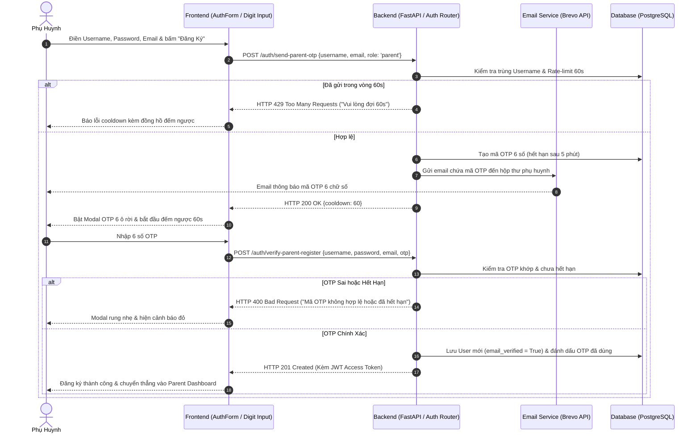
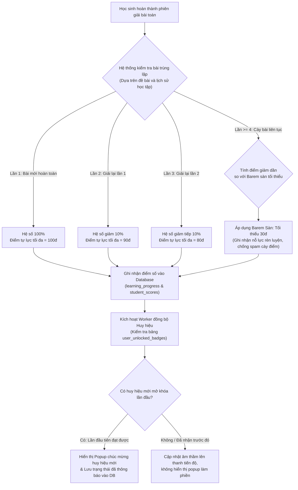
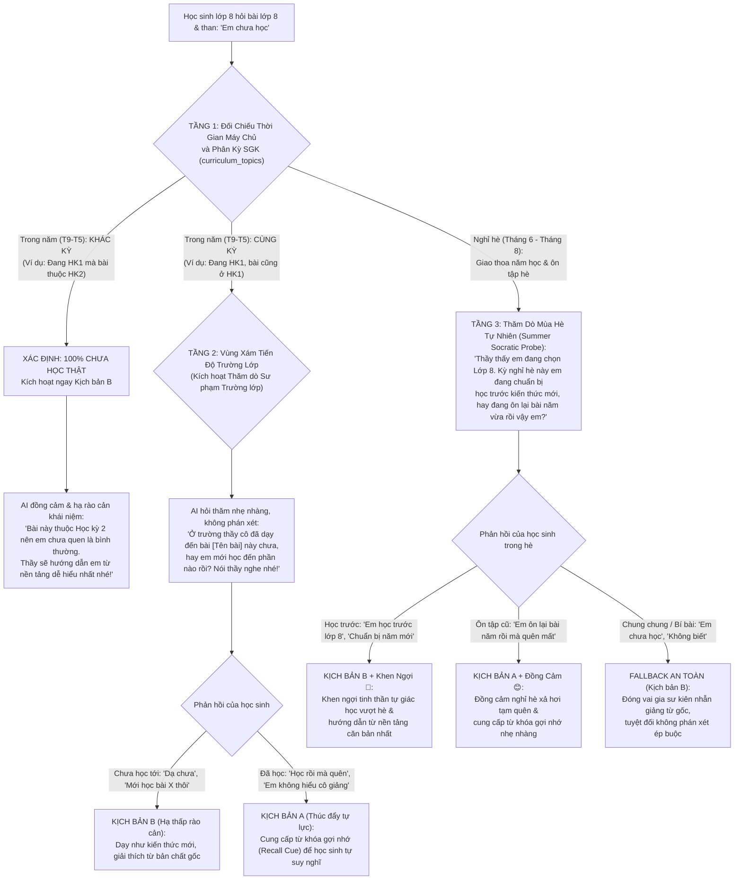

# Sprint 9: Đăng Ký Tài Khoản Bằng Username, Xác Thực OTP Email Phụ Huynh, Cơ Chế Tự Lực Chống Cày Điểm, Sư Phạm SGK Thích Ứng & Trung Tâm Quản Trị Báo Lỗi Chuyên Sâu
*(Dự kiến: 2 tuần | Phân bổ khối lượng: [Bảo]: 17.5h, [Thông]: 20.0h, [Thiên]: 19.0h, [Thống]: 21.5h)*

**Quy định phân chia vai trò nhóm (Sprint 9):**
- **[Thống]**: **Trùm Backend (BE)**: Phụ trách cấu trúc DB mới (`username`, `system_errors`, `user_badges`), script migration cho user cũ, API xác thực OTP email qua Brevo (kèm rate-limit), và công thức phạt điểm spam bài trùng.
- **[Thông]**: **Kỹ sư AI / Machine Learning & Backend (BE)**: Phụ trách bỏ censor trong template và System Instruction email cảnh báo, bổ sung dữ liệu học kỳ SGK (HK1/HK2), logic nhận diện học kỳ thời gian thực và kịch bản Thăm dò Sư phạm thích ứng (US 8.4).
- **[Bảo]**: **Trùm Frontend (FE) & Kịch bản UX**: Phụ trách bàn phím ký tự đặc biệt toán học trên khung chat (hỗ trợ mobile), giao diện tìm kiếm trên Bảng xếp hạng, modal nhập OTP xác thực email phụ huynh, và cơ chế đồng bộ huy hiệu.
- **[Thiên]**: **Nhóm trưởng / DevOps / QA & Frontend (FE)**: Phụ trách giao diện Trung tâm Quản trị Báo lỗi (Error Management Hub) kết nối dữ liệu thật, nút "Báo lỗi bài này" từ phía học sinh, bộ lọc tra cứu lỗi theo từng User, và bộ kịch bản kiểm thử 100% trên giao diện Web.
- **Nguyên tắc nghiệm thu cốt lõi (Core Acceptance Rule)**: **100% Tiêu chí chấp nhận (AC) phải kiểm thử được thông qua thao tác trực tiếp trên giao diện Web**, tuyệt đối không yêu cầu người dùng truy cập Database hay kiểm tra terminal log thủ công.

---

## 🎯 Mục Tiêu Sprint 9 (Sprint Goals)

1. **Chuẩn Hóa Đăng Ký & Xác Thực Đa Lớp (Seamless & Secure Identity - US 9.1):**
   - Đơn giản hóa tối đa luồng tiếp cận cho Học sinh bằng định danh `Username` (không ép buộc email), giảm rào cản thao tác cho lứa tuổi nhỏ.
   - Thiết lập cơ chế bảo mật kép bằng mã OTP 6 số qua email (Brevo) dành riêng cho Phụ huynh khi đăng ký và khi thay đổi địa chỉ nhận tin trong Cài đặt, bảo đảm 100% email nhận cảnh báo là có thực và có chủ quyền.
   - Bảo đảm tương thích ngược tuyệt đối: tài khoản cũ vẫn đăng nhập bình thường bằng email hoặc username mà không bị gián đoạn phiên làm việc.

2. **Chống Gian Lận Cày Điểm & Đồng Bộ Hóa Thành Tựu Bền Vững (Anti-Spam Mastery & Multi-Device Badges - US 9.2):**
   - Xây dựng thuật toán phạt trần điểm tự lực (giảm 10% cho mỗi lần giải lại bài cũ, giữ sàn 30đ), vừa khuyến khích ôn tập (vẫn tăng $+1$ tổng bài) vừa ngăn chặn hành vi cày điểm streak/leaderboard.
   - Chuyển đổi toàn bộ hệ thống lưu trữ Huy hiệu (Badges) từ `LocalStorage` máy khách lên Database máy chủ, giải quyết dứt điểm lỗi lặp popup chúc mừng cúp khi học sinh đổi thiết bị hoặc mở tab ẩn danh.

3. **Sư Phạm SGK Thích Ứng Theo Học Kỳ & Minh Bạch Cảnh Báo Phụ Huynh (Adaptive Pedagogy & Transparent Alert - US 9.3):**
   - Triển khai mô hình Hybrid 2 tầng giải quyết triệt để tình huống học sinh lớp 8 kêu "chưa học bài này":
     - Tầng 1: Lập lịch theo tháng thực tế đối chiếu HK1 vs HK2 (nhận diện 100% bài học kỳ sau để kích hoạt Kịch bản B, giải thích từ nền tảng dễ nhất).
     - Tầng 2: Thăm dò sư phạm nhã nhặn (Socratic Progressive Probe) khi bài cùng học kỳ, phân nhánh thích ứng (Kịch bản B nếu trường chưa dạy tới vs Kịch bản A gợi nhớ từ khóa nếu học sinh đã học mà quên), tuyệt đối không phán xét ép buộc học sinh.
   - Xóa bỏ việc che mờ `***` ở cả tầng xử lý backend và System Instruction của Gemini, trích dẫn nguyên văn phát ngôn nhạy cảm kèm định khung tâm lý sư phạm ấm áp giúp cha mẹ hiểu rõ hoàn cảnh con bị ức chế vì bài khó.

4. **Nâng Tầm Tương Tác Toán Học & Gắn Kết Cộng Đồng (Math Input Accessibility & Competitive Social - US 9.4):**
   - Tích hợp thanh công cụ ký tự đặc biệt toán học trực quan ($\sqrt{}$, $\log$, $x^2$, $\frac{a}{b}$, $\pi$...) ngay trên khung chat, tối ưu vuốt cuộn ngang trên thiết bị di động (375px), giúp học sinh nhập đề bài nhanh chóng và AI nhận diện công thức chuẩn xác.
   - Nâng cấp Bảng xếp hạng: hiển thị tổng số học sinh tham gia thực tế (thay cho con số "Top 35" tĩnh) và bổ sung bộ lọc tìm kiếm bạn bè theo tên/username.

5. **Trung Tâm Quản Trị Báo Lỗi Chuyên Sâu & Giám Sát Thời Gian Thực (System Error & Incident Hub - US 9.5):**
   - Chuyển đổi trang Log cũ thành Trung tâm Báo lỗi `/admin/errors` kết nối 100% dữ liệu thực tế, tự động bắt lỗi Unhandled (Crash 500, Gemini AI Timeout) qua FastAPI Middleware.
   - Bổ sung nút "Báo lỗi câu này" từ khung chat học sinh, Drawer trượt xem Full Stack Trace và bộ lọc đa chiều theo từng User ID / Username phục vụ hỗ trợ người dùng tức thì.

---

### US 9.1: Xác Thực Tài Khoản Bằng Username & OTP Email Phụ Huynh 2 Bước
*Mô tả: Là một Phụ huynh, tôi muốn hệ thống xác thực email nhận thông báo bằng mã OTP để đảm bảo thông tin của con được gửi đúng đến hộp thư của tôi; và là một Học sinh, tôi muốn đăng ký tài khoản nhanh bằng tên người dùng mà không bắt buộc có email riêng.*

- **Mô tả chi tiết:**
  - **Đăng ký Học sinh:** Nhập `Tên tài khoản (username)` + `Mật khẩu` + `Khối lớp`. Không bắt buộc email, giảm rào cản tiếp cận cho học sinh nhỏ tuổi.
  - **Đăng ký Phụ huynh (Luồng 2 bước):**
    - Bước 1: Nhập `Tên tài khoản` + `Mật khẩu` + `Email nhận thông báo`.
    - Bước 2: Nhận mã OTP 6 số qua email (Brevo) $\rightarrow$ Nhập đúng OTP trên modal giao diện để hoàn tất kích hoạt tài khoản (`email_verified = True`).
  - **Cài đặt Phụ huynh (Đổi email):**
    - Khi thay đổi email trong trang Cài đặt $\rightarrow$ Bắt buộc gửi và xác nhận mã OTP gửi về email mới trước khi lưu vào DB.
  - **Tương thích ngược tài khoản cũ:** Cung cấp script migration tự động chuyển đổi tài khoản cũ từ email sang username tương ứng để không làm gián đoạn đăng nhập của người dùng hiện hữu.

#### Sơ Đồ Luồng Xác Thực Phụ Huynh 2 Bước (Username + OTP Email)



- **Tasks:**
  - **T9.0** [Thống] [BE] Viết script migration DB cập nhật bảng `users`: Thêm `username`, `email_verified`, sinh username mặc định cho các tài khoản cũ, cho phép `email` nullable với học sinh, đảm bảo đăng nhập bằng username hoặc email cũ đều hoạt động. (2h)
  - **T9.1** [Thống] [BE] Cập nhật bảng `users`: Thêm cột `username` (unique, indexed), `email_verified` (bool), tạo bảng `email_otps` (id, email, otp_code, purpose, expires_at, is_used). (2h)
  - **T9.2** [Thống] [BE] Viết service `send_otp_email` qua Brevo API và các endpoints: `POST /auth/send-parent-otp`, `POST /parent/settings/request-email-otp`, `POST /parent/settings/verify-email-otp`. (3h)
  - **T9.2b** [Thống] [BE] Xây dựng cơ chế Rate-limit / Anti-Spam OTP: Giới hạn tối đa 1 lần gửi / 60 giây cho mỗi email, trả mã lỗi HTTP 429 kèm thông điệp chờ thân thiện. (1h)
  - **T9.3** [Bảo] [FE] Cải tiến màn hình Đăng ký `components/AuthForm.tsx`: Chuyển ô `email/sđt` thành `Tên tài khoản (username)`, cập nhật validate ký tự hợp lệ. (2h)
  - **T9.4** [Bảo] [FE] Thiết kế Modal nhập OTP 6 ô rời (Digit Input UX) có đếm ngược 60s và nút "Gửi lại mã" cho luồng Đăng ký Phụ huynh. (3h)
  - **T9.5** [Bảo] [FE] Nâng cấp màn hình Cài đặt Phụ huynh `dashboard/monitor/settings`: Luồng đổi email kích hoạt popup OTP xác nhận trước khi lưu. (2h)

- **Tiêu chí chấp nhận (Acceptance Criteria – 100% Nghiệm Thu Thao Tác Trên Web):**
  - **[AC 9.1.1] Đăng ký Học sinh nhanh:** Trên form Đăng ký, chọn vai trò "Học sinh" $\rightarrow$ Chỉ hiển thị 3 ô: Tên tài khoản, Mật khẩu, Khối lớp $\rightarrow$ Bấm Đăng ký tạo tài khoản thành công ngay lập tức và chuyển thẳng vào Dashboard, không hề hỏi hay bắt nhập email.
  - **[AC 9.1.2] Báo lỗi trùng Username trên form:** Nhập tên tài khoản đã tồn tại $\rightarrow$ Form hiển thị ngay dòng thông báo lỗi màu đỏ: *"Tên tài khoản đã được sử dụng, vui lòng chọn tên khác"* và không cho gửi form.
  - **[AC 9.1.3] Đăng ký Phụ huynh qua Modal OTP 6 số:** Chọn vai trò "Phụ huynh", điền Username + Mật khẩu + Email $\rightarrow$ Bấm Tiếp tục $\rightarrow$ Bật Modal OTP 6 ô rời $\rightarrow$ Mở hộp thư sao chép 6 số OTP dán vào $\rightarrow$ Hệ thống tự động verify và kích hoạt tài khoản thành công.
  - **[AC 9.1.4] Xử lý OTP sai hoặc hết hạn:**
    - Nhập sai mã OTP $\rightarrow$ Modal rung nhẹ và hiển thị thông báo lỗi màu đỏ: *"Mã xác thực không chính xác"*.
    - Nhập mã sau 5 phút $\rightarrow$ Hiển thị thông báo: *"Mã OTP đã hết hạn, vui lòng bấm Gửi lại mã"*.
  - **[AC 9.1.5] Đồng hồ đếm ngược 60s & Cooldown nút Gửi lại:** Khi modal OTP mở, nút "Gửi lại mã" bị vô hiệu hóa (disabled) kèm đếm ngược `Gửi lại sau (59s...)`. Chỉ khi đếm về 0s nút mới sáng lên cho phép bấm gửi lại.
  - **[AC 9.1.6] Đổi email nhận thông báo trong Cài đặt:** Phụ huynh vào trang Cài đặt $\rightarrow$ Nhập email mới $\rightarrow$ Bấm Lưu $\rightarrow$ Hệ thống bắt buộc mở modal OTP xác nhận $\rightarrow$ Nhập đúng OTP gửi về email mới thì địa chỉ email trên giao diện mới chính thức cập nhật.
  - **[AC 9.1.7] Đăng nhập bằng Username:** Sau khi đăng ký, người dùng đăng xuất và đăng nhập lại bằng `Tên tài khoản` + `Mật khẩu` $\rightarrow$ Đăng nhập mượt mà vào đúng trang Dashboard của vai trò tương ứng.

---

### US 9.2: Giảm Điểm Tự Lực Khi Giải Trùng Bài (Anti-Spam) & Đồng Bộ Thành Tựu
*Mô tả: Là một Giáo viên/Phụ huynh, tôi muốn hệ thống giảm điểm tự lực tối đa đối với các bài tập học sinh làm đi làm lại nhiều lần để chống gian lận cày điểm, và học sinh không bị popup thành tựu làm phiền mỗi khi đổi máy tính.*

- **Mô tả chi tiết:**
  - **Cơ chế Phạt bài giải trùng (Anti-Spam Mastery):**
    - Vẫn ghi nhận tăng $+1$ bài vào "Tổng số bài hoàn thành" để khuyến khích học sinh ôn luyện nhiều lần.
    - Điểm trần tự lực tối đa của bài giải trùng sẽ **giảm 10% cho mỗi lần giải lại**:
      - Lần 1 (Bài mới hoàn toàn): Tối đa **100đ**.
      - Lần 2 (Bài trùng lần 1): Tối đa **90đ**.
      - Lần 3 (Bài trùng lần 2): Tối đa **80đ**...
      - Điểm sàn tối thiểu: Không bao giờ giảm xuống dưới **30đ** (sửa barem đồng bộ giữa `independence_evaluator.py` và `independence.py`).
  - **Đồng bộ Thành tựu (Badges) từ Database:**
    - Chuyển đổi từ cơ chế lưu `localStorage` cục bộ sang lưu danh sách huy hiệu đã đạt vào bảng `user_unlocked_badges` trong DB.
    - Migrate toàn bộ huy hiệu cũ từ `localStorage` lên DB trong lần đăng nhập đầu tiên.
    - Khi đăng nhập trên bất kỳ máy hay trình duyệt ẩn danh nào, chỉ mở popup ăn mừng duy nhất lần đầu tiên đạt được huy hiệu đó.

#### Sơ Đồ Luồng Tính Điểm Tự Lực Chống Spam & Đồng Bộ Huy Hiệu



- **Tasks:**
  - **T9.6** [Thống] [BE] Cập nhật hàm `calculate_independence_score` & `save_independence_score` trong `independence.py`: Áp dụng hệ số phạt trần `max_score = max(30, 100 - (repeat_count - 1) * 10)` và trả về metadata cảnh báo bài trùng. (2.5h)
  - **T9.6b** [Thống] [BE] Đồng bộ barem điểm sàn 30đ vào `independence_evaluator.py` để tránh xung đột giữa 2 module tính điểm. (1h)
  - **T9.7** [Thống] [BE] Thêm bảng `user_unlocked_badges` (id, user_id, badge_id, unlocked_at) và các API `GET /api/user/badges`, `POST /api/user/badges/unlock`. (2h)
  - **T9.8** [Bảo] [FE] Cải tiến `badgeStorage.ts`: Tải danh sách badge từ backend DB khi khởi tạo session, chặn triệt để việc bắn lại popup ăn mừng cho các cúp đã đạt. (2h)
  - **T9.8b** [Bảo] [FE] Viết hàm migrate tự động đọc badge cũ trong `localStorage` và đồng bộ lên endpoint `POST /api/user/badges/unlock` sau khi đăng nhập. (1.5h)
  - **T9.9** [Thiên] [QA] Thiết kế kịch bản test trên web: Giải liên tục 1 đề bài 5 lần kiểm tra thanh điểm giảm dần và đăng nhập tab ẩn danh kiểm tra không popup lại. (2h)

- **Tiêu chí chấp nhận (Acceptance Criteria – 100% Nghiệm Thu Thao Tác Trên Web):**
  - **[AC 9.2.1] Phạt điểm trần bài trùng hiển thị trên Web:**
    - Lần 1 giải bài: Đạt 100đ $\rightarrow$ Hiện thông báo chúc mừng trọn vẹn 100/100đ.
    - Lần 2 gửi lại bài cũ (không dùng gợi ý): Bong bóng chúc mừng hiển thị: *"Điểm tự lực: 90/100 (Bài giải lại, điểm tối đa là 90đ)"*.
    - Lần 3 giải lại bài cũ: Tối đa đạt 80đ.
  - **[AC 9.2.2] Bảo toàn điểm sàn 30đ:** Học sinh cố tình spam giải lại cùng 1 bài 10 lần liên tiếp $\rightarrow$ Điểm nhận được vẫn được giữ ở mức sàn **30đ**, không bị trừ về 0đ hay điểm âm.
  - **[AC 9.2.3] Vẫn ghi nhận số bài hoàn thành:** Sau mỗi lần bấm "Đã hiểu" (kể cả bài giải lại lần 4, lần 5), con số "Tổng bài đã giải" trên thanh tiến trình Mastery hoặc trang Hồ sơ cá nhân vẫn nhảy $+1$ đều đặn.
  - **[AC 9.2.4] Không bắn lại Popup cúp/huy hiệu khi đổi máy:**
    - Bước 1: Học sinh đạt 100 điểm trên Chrome máy A $\rightarrow$ Bung modal huy hiệu "Tự Lập Nhí" lần đầu tiên $\rightarrow$ Bấm đóng modal.
    - Bước 2: Mở trình duyệt ẩn danh (Incognito) hoặc chuyển sang máy B đăng nhập lại tài khoản đó $\rightarrow$ Vào chat giải bài tiếp $\rightarrow$ Tuyệt đối **không xuất hiện lại popup chúc mừng "Tự Lập Nhí"**.
  - **[AC 9.2.5] Huy hiệu đã đạt hiển thị chuẩn trong Hồ sơ:** Khi vào trang Hồ sơ / Kho Huy hiệu trên bất kỳ máy nào, các huy hiệu đã mở khóa đều sáng màu (Active), các huy hiệu chưa đạt hiển thị màu xám.

---

### US 9.3: Sư Phạm SGK Thích Ứng Theo Học Kỳ (US 8.4) & Minh Bạch Cảnh Báo Ngôn Từ Phụ Huynh
*Mô tả: Là một Học sinh Lớp 8, khi tôi nói chưa học một bài toán lớp 8, AI có thể tự động nhận diện xem bài đó thuộc học kỳ tương lai (chưa học thật), học kỳ hiện tại (hỏi thăm tiến độ trường lớp để gợi mở), hay trong kỳ nghỉ hè (thăm dò tự nhiên xem học trước hay ôn lại bài cũ); và là một Phụ huynh, tôi muốn email cảnh báo hiển thị nguyên văn lời nói tục của con để tôi nắm bắt đúng mức độ cảm xúc thực tế.*

#### Sơ đồ Luồng Xử Lý Kỹ Thuật & Sư Phạm (Hybrid Model - 3 Nhánh Thích Ứng)


#### Phân Tích Bản Chất 3 Bối Cảnh Thực Tế
| Tiêu chí | Bối cảnh 1: Khác kỳ SGK trong năm (Chưa học thật) | Bối cảnh 2: Cùng kỳ SGK trong năm (Vùng xám tiến độ trường) | Bối cảnh 3: Nghỉ hè Tháng 6 - 8 (Giao thoa năm học) |
| :--- | :--- | :--- | :--- |
| **Ngữ cảnh thực tế** | Đang HK1 (Tháng 9 - 1) mà hỏi bài HK2 (Tháng 2 - 5). | Đang học HK1 hỏi bài HK1, nhưng mỗi trường có phân phối chương trình chênh nhau 1-3 tuần. | Học sinh cài đặt lớp 8, hỏi bài lớp 8 trong kỳ hè (có thể là học sinh lớp 7 lên 8 học trước, hoặc học sinh lớp 8 vừa học xong ôn hè). |
| **Tâm lý học sinh** | Hoang mang vì kiến thức hoàn toàn mới lạ, thấy bài toán 'quá sức'. | Bị hổng kiến thức, lười lục lại vở ghi, hoặc trường thực sự chưa dạy tới bài này. | Hoặc hào hứng tự học trước nhưng bỡ ngỡ; hoặc áp lực ôn thi lại hè nhưng xả hơi lâu ngày nên tạm quên. |
| **Nếu AI phán xét sai** | **Cực kỳ tiêu cực:** Ép học sinh nhớ lại kiến thức chưa từng học $\rightarrow$ Gây ức chế, mất niềm tin vào bot. | Phán xét *'Em đã học bài này rồi'* khi trường chưa dạy tới $\rightarrow$ Học sinh phản kháng gay gắt. | Phán xét học sinh lười khi học sinh đang tự giác học vượt $\rightarrow$ Dập tắt tinh thần tự học hè. |
| **Giải pháp Sư phạm chuẩn** | **Kịch bản B ngay lập tức:** Đồng cảm, hạ thấp rào cản thuật ngữ, dẫn dắt từ nền tảng dễ nhất. | **Thăm dò trường lớp:** Hỏi nhẹ nhàng xem trường đã dạy tới bài nào $\rightarrow$ Rẽ nhánh Kịch bản A (nếu đã học mà quên) hoặc Kịch bản B (nếu chưa học tới). | **Summer Socratic Probe:** Thăm dò tự nhiên xem học trước hay ôn hè $\rightarrow$ Khen ngợi học trước (Kịch bản B) vs Đồng cảm ôn hè (Kịch bản A); Fallback an toàn Kịch bản B. |

#### Cơ Chế Triển Khai Kỹ Thuật (3 Tầng Thích Ứng):
1. **Tầng 1 (Calendar & Semester-Aware Timeline):**
   - Đọc trường `semester` từ bảng `curriculum_topics` và phân vùng HK1/HK2 trong `grade_curriculum.json`.
   - Lấy tháng hiện tại của hệ thống máy chủ (`datetime.now().month`):
     - **Tháng 9 đến Tháng 1:** Năm học đang ở **Học kỳ 1 (HK1)**.
     - **Tháng 2 đến Tháng 5:** Năm học đang ở **Học kỳ 2 (HK2)**.
     - **Tháng 6 đến Tháng 8:** Giai đoạn **Nghỉ hè / Ôn tập chuyển cấp**.
   - Nếu trong năm học mà học sinh đang ở HK1 nhưng bài toán thuộc HK2 $\rightarrow$ Xác nhận **100% Chưa học thật** $\rightarrow$ AI lập tức kích hoạt Kịch bản B (hạ rào cản khái niệm, không phán xét).
2. **Tầng 2 (Socratic Progressive Probe - Trong năm học cùng kỳ):**
   - Nếu bài toán thuộc cùng học kỳ hiện tại $\rightarrow$ AI nhận diện đây là 'vùng xám' (tiến độ từng trường có thể chênh nhau 1-3 tuần).
   - Thay vì vội áp đặt câu: *'Theo chương trình em đã học bài này rồi...'*, AI sẽ đưa ra câu hỏi thăm dò sư phạm:
     > *'Thầy thấy bài này nằm trong chương trình lớp 8. Ở trường thầy cô đã dạy đến bài **[Tên bài học]** này chưa, hay em mới học đến phần nào rồi? Nói thầy nghe để thầy hướng dẫn cho vừa sức em nhất nhé!'*
   - Ở lượt phản hồi kế tiếp (Next Turn), Orchestrator phân tích câu trả lời của học sinh:
     - Nếu học sinh phản hồi: *'Chưa thầy ơi, mới học tới bài X thôi'* $\rightarrow$ Chuyển sang **Kịch bản B** (giảng giải từ gốc, không bắt nhớ lại).
     - Nếu học sinh phản hồi: *'Học rồi mà em quên mất / không hiểu'* $\rightarrow$ Chuyển sang **Kịch bản A** (nhắc lại từ khóa gợi nhớ Recall Cue để học sinh tự suy nghĩ).
3. **Tầng 3 (Summer Socratic Probe - Giai đoạn nghỉ hè Tháng 6 đến Tháng 8):**
   - Trong kỳ nghỉ hè, học sinh có 2 trường hợp phổ biến:
     - **Trường hợp A (Học sinh lớp 7 lên 8 - Học trước):** Đổi profile sang lớp 8 để tìm hiểu trước kiến thức năm học mới.
     - **Trường hợp B (Học sinh vừa học xong lớp 8 - Ôn tập hè):** Làm bài tập hè hoặc ôn thi chuyển cấp nhưng xả hơi lâu ngày nên quên công thức.
   - Thay vì đoán mò hoặc phán xét, AI gửi câu hỏi thăm dò mùa hè thân thiện:
     > *'Thầy thấy trên tài khoản em đang chọn Lớp 8. Kỳ nghỉ hè này em đang chuẩn bị học trước kiến thức lớp 8, hay em đang ôn lại bài năm vừa rồi vậy em? Nói thầy nghe để thầy hướng dẫn cho vừa sức em nhất nhé!'*
   - Phân nhánh phản hồi:
     - **Học sinh học trước:** AI lập tức khen ngợi: *'Thầy rất khen ngợi tinh thần tự học sớm của em! Bài này là kiến thức mới, thầy sẽ hướng dẫn từ phần căn bản nhất nhé...'* $\rightarrow$ Kích hoạt **Kịch bản B**.
     - **Học sinh ôn lại bài cũ:** AI đồng cảm: *'Nghỉ hè xả hơi một thời gian nên quên chút công thức là bình thường nha. Em thử nhớ lại xem...'* $\rightarrow$ Kích hoạt **Kịch bản A** với từ khóa gợi nhớ.
     - **Fallback an toàn:** Nếu học sinh phản hồi lấp lửng hoặc chỉ nói *'em chưa học / không biết'* $\rightarrow$ AI mặc định chuyển sang **Kịch bản B** đóng vai gia sư kiên nhẫn giảng từ gốc, tuyệt đối không truy cứu hay phán xét.
4. **Minh bạch phát ngôn vi phạm trong Email cảnh báo phụ huynh (1 Task duy nhất):**
   - Bỏ bộ lọc che mờ `censor_sensitive_words` trong code Python và cập nhật System Instruction của Gemini trong `email_alert_generator.py` để trích dẫn nguyên văn phát ngôn của con (ví dụ: *'đụ mẹ thầy nhá'* thay vì `'đ** m* th** nh*'`), kết hợp lời định khung tâm lý sư phạm ấm áp giúp phụ huynh hiểu rõ bối cảnh con bị ức chế vì bí bài.

- **Tasks:**
  - **T9.10** [Thông] [AI/BE] Cập nhật email cảnh báo phụ huynh: Bỏ bộ lọc `censor_sensitive_words` và cập nhật System Instruction của Gemini trong `email_alert_generator.py` để hiển thị nguyên văn từ ngữ học sinh đã dùng (không có dấu `*`). (1.5h)
  - **T9.11** [Thông] [AI/BE] Bổ sung logic `_evaluate_curriculum_timeline` trong `orchestrator.py` & `agent_prompts.py`: Đối chiếu trường `semester` với tháng thực tế của máy chủ hoặc thời gian mô phỏng từ cấu hình mock timeline để phân loại trạng thái học kỳ (`future_semester`, `current_semester`, `summer_break`). (2h)
  - **T9.11b** [Thông] [Fullstack/BE-FE] Xây dựng cơ chế Mô phỏng Thời gian Học kỳ phục vụ Nghiệm thu: Viết API lưu/đọc cấu hình `mock_curriculum_month` và bổ sung Dropdown chọn thời gian (Thời gian thực / HK1 Tháng 10 / HK2 Tháng 3 / Hè Tháng 7) trên trang Cài đặt Quản trị `frontend/app/admin/settings/page.tsx`. (1.5h)
  - **T9.12** [Thông] [AI/BE] Cập nhật cấu trúc `grade_curriculum.json`: Bổ sung nhãn `semester: 1 | 2` cho toàn bộ các bài học khối 4-9 đồng bộ với bảng `curriculum_topics`. (1.5h)
  - **T9.13** [Thông] [AI] Thiết kế Prompt Kịch bản Thăm dò Sư phạm (Socratic Progressive Probe & Summer Probe) trong `agent_prompts.py` cho các bài thuộc `current_semester` và giai đoạn nghỉ hè (`summer_break`). (2h)
  - **T9.14** [Thông] [AI] Thiết kế Prompt phân nhánh lượt phản hồi kế tiếp (Follow-up Turn Classifier) để rẽ nhánh linh hoạt Kịch bản A vs Kịch bản B dựa trên câu trả lời của học sinh (phân biệt học trước vs ôn lại bài cũ). (2h)
  - **T9.15** [Thông] [AI] Định nghĩa fallback an toàn cho các tháng hè (Tháng 6 - Tháng 8) & Quản lý cờ `probe_pending` trong hội thoại để tránh trường hợp AI hỏi lặp lại câu hỏi thăm dò 2 lần trong cùng một phiên chat. (1.5h)

- **Tiêu chí chấp nhận (Acceptance Criteria – 100% Nghiệm Thu Thao Tác Trên Web):**
  - **[AC 9.3.1] Nghiệm thu phát ngôn nguyên văn trên Web Admin & Email:**
    - Học sinh vào chat gõ câu từ tục tĩu (ví dụ: *'vcl bài khó thế'*) $\rightarrow$ Đăng nhập tài khoản Admin vào trang `/admin/logs` (hoặc `/admin/errors`) và Phụ huynh mở email nhận được $\rightarrow$ Cột nội dung trích đoạn hiển thị rõ ràng nguyên văn chữ *'vcl bài khó thế'*, hoàn toàn không bị thay bằng `***`.
  - **[AC 9.3.2] Bài học kỳ tương lai (Khác kỳ trong năm):** Test case vào tháng 10 (HK1), học sinh lớp 8 hỏi bài HK2 (ví dụ: *'Giải phương trình bậc nhất một ẩn: 3x - 5 = 10'*) và chat than thở *'em chưa học cái này'* $\rightarrow$ AI khẳng định chuẩn xác: *'Bài này thuộc học kỳ 2 nên em chưa quen là bình thường. Thầy sẽ hướng dẫn em từ nền tảng dễ hiểu nhất nhé!'* (Kịch bản B).
  - **[AC 9.3.3] Bài học kỳ hiện tại (Không phán xét vội):** Test case vào tháng 10, học sinh lớp 8 hỏi bài HK1 (ví dụ: *'Tính (x + 2)^2'*) và chat *'em chưa học'* $\rightarrow$ AI **tuyệt đối không** nói câu *'Theo chương trình em đã học rồi'* mà nhẹ nhàng hỏi thăm: *'Ở trường thầy cô đã dạy đến bài Hằng đẳng thức này chưa, hay em mới học đến phần nào rồi? Nói thầy nghe nhé!'*.
  - **[AC 9.3.4] Nhận diện học sinh chưa học tới trên lớp:** Tiếp tục đoạn chat trên, học sinh trả lời *'dạ chưa, trên lớp cô mới dạy bài nhân đơn thức thôi'* $\rightarrow$ AI lập tức chuyển sang Kịch bản B, giải thích phép nhân $(x + 2)(x + 2)$ từ gốc của phép nhân đa thức, không đòi hỏi nhớ công thức hằng đẳng thức.
  - **[AC 9.3.5] Nhận diện học sinh đã học mà quên:** Nếu học sinh trả lời *'học rồi mà em quên sạch / không nhớ'* $\rightarrow$ AI chuyển sang Kịch bản A, nhắc từ khóa gợi nhớ: *'Không sao, em hãy nhớ lại công thức bình phương một tổng $(A + B)^2 = A^2 + 2AB + B^2$ xem $A$ và $B$ ở đây là gì nhé!'*.
  - **[AC 9.3.6] Thăm dò mùa hè (Tháng 6 - Tháng 8) & Phân nhánh tự học vs Ôn tập:**
    - **Bước 1 (Chọn tháng mock trên Web):** Vào `/admin/settings` chọn mô phỏng *"Kỳ nghỉ hè (Tháng 7)"* $\rightarrow$ Bấm Lưu cấu hình.
    - **Bước 2 (Học sinh Lớp 8 hỏi bài Toán 8 cụ thể):** Học sinh nhập đề bài cụ thể: *"Khai triển biểu thức (x + 2)^2"* (thuộc Bài 6 Toán 8: Bình phương của một tổng) và chat tiếp *"Bài này em chưa học thầy ơi"* $\rightarrow$ AI nhận diện tháng 7 hè và kích hoạt câu hỏi thăm dò mùa hè: *"Thầy thấy trên tài khoản em đang chọn Lớp 8. Kỳ nghỉ hè này em đang chuẩn bị học trước kiến thức lớp 8, hay em đang ôn lại bài năm vừa rồi vậy em? Nói thầy nghe để thầy hướng dẫn cho vừa sức em nhất nhé!"*.
    - **Bước 3 (Nghiệm thu Nhánh Học trước - Kịch bản B):** Học sinh chat phản hồi: *"Dạ em mới học xong lớp 7 lên, em đang học trước bài lớp 8 để chuẩn bị vào năm học mới thầy ạ"* $\rightarrow$ AI khen ngợi tinh thần tự giác hè 🌟 và áp dụng Kịch bản B (hướng dẫn tính $(x + 2)(x + 2)$ bằng phép nhân đa thức lớp 7, không đòi hỏi nhớ công thức hằng đẳng thức).
    - **Bước 4 (Nghiệm thu Nhánh Ôn tập cũ - Kịch bản A):** Học sinh chat phản hồi: *"Dạ em vừa học xong lớp 8, hè này ôn lại mà xả hơi lâu quá nên em quên mất tiêu rồi"* $\rightarrow$ AI đồng cảm nhẹ nhàng 😊 và áp dụng Kịch bản A (nhắc từ khóa gợi nhớ công thức $(A + B)^2 = A^2 + 2AB + B^2$ để học sinh tự làm).
  - **[AC 9.3.7] Fallback an toàn mùa hè & Chống hỏi thăm dò lặp lại (No Repeated Probe):**
    - Nếu học sinh chỉ nói lấp lửng *'em không biết / bí quá'* $\rightarrow$ AI mặc định chuyển sang Kịch bản B kiên nhẫn giảng bài.
    - Sau khi học sinh đã phản hồi câu hỏi thăm dò (ở cả trong năm học lẫn mùa hè), ở các lượt chat tiếp theo trong cùng phiên, AI không bao giờ được hỏi lại câu hỏi tiến độ trường lớp/mùa hè lần thứ 2.

---

### US 9.4: Bàn Phím Ký Tự Toán Học Trực Quan & Nâng Cấp Bảng Xếp Hạng
*Mô tả: Là một Học sinh, tôi muốn dễ dàng gõ các ký hiệu toán như căn bậc hai, phân số, số mũ trên khung chat, và có thể tìm kiếm tên bạn bè trên Bảng xếp hạng.*

- **Mô tả chi tiết:**
  - **Thanh công cụ Ký tự đặc biệt (Math Toolbar):** Gắn ngay trên ô chat các nút bấm nhanh: $\sqrt{x}$, $x^2$, $x^y$, $\frac{a}{b}$, $\pm$, $\pi$, $\Delta$, $\le$, $\ge$, $\neq$, $\log$, $\sin$, $\cos$. Hỗ trợ vuốt cuộn ngang trên điện thoại di động (Responsive 375px).
  - **Nâng cấp Bảng xếp hạng:**
    - Thay thế chữ cố định "Top 35" bằng tổng số thực: "Bảng Vinh Danh ([N] Học Sinh Tham Gia)".
    - Bổ sung ô tìm kiếm bạn bè theo Tên hiển thị (Display Name) hoặc Username có cơ chế debounce 300ms mượt mà.

- **Tasks:**
  - **T9.16** [Bảo] [FE] Xây dựng component `MathSymbolToolbar.tsx` gắn ngay trên ô nhập liệu `ChatInput.tsx`, chèn ký tự chính xác tại vị trí con trỏ chuột. (2.5h)
  - **T9.16b** [Bảo] [FE] Tối ưu Responsive Mobile cho Toolbar: Cho phép cuộn ngang (touch swipe scroll) trên màn hình hẹp (375px), không làm tràn layout hoặc che khuất bàn phím ảo. (1h)
  - **T9.17** [Bảo] [FE] Cập nhật giao diện Bảng xếp hạng `leaderboard/page.tsx`: Sửa tiêu đề động theo số lượng người tham gia thực tế và tích hợp ô tìm kiếm bạn bè. (2h)
  - **T9.18** [Thống] [BE] Cập nhật API `GET /metrics/streak-leaderboard`: Thêm query param `search: Optional[str] = None` và trả về `total_participants: int`. (1.5h)

- **Tiêu chí chấp nhận (Acceptance Criteria – 100% Nghiệm Thu Thao Tác Trên Web):**
  - **[AC 9.4.1] Thao tác chèn ký tự toán học:** Bấm nút $\sqrt{}$ trên thanh công cụ $\rightarrow$ Ô chat tự động chèn chuỗi `√()` và con trỏ chuột nằm ngay giữa hai dấu ngoặc để học sinh nhập số tiếp.
  - **[AC 9.4.2] AI giải chính xác công thức có ký tự đặc biệt:** Học sinh dùng toolbar chèn `√(16) + log(100) = ?` và bấm Gửi $\rightarrow$ AI đọc hiểu chuẩn xác và hướng dẫn từng bước: `√16 = 4, log(100) = 2, tổng bằng 6`.
  - **[AC 9.4.3] Trải nghiệm Toolbar trên điện thoại (Mobile):** Mở giao diện trên thiết bị di động (hoặc DevTools giả lập 375px) $\rightarrow$ Thanh công cụ toán học hiển thị gọn gàng, vuốt ngang mượt mà để chọn các ký hiệu $\sin, \cos, \Delta$, không làm vỡ giao diện chat.
  - **[AC 9.4.4] Tiêu đề Bảng xếp hạng cập nhật số người thực:** Truy cập trang Bảng xếp hạng $\rightarrow$ Tiêu đề hiển thị chuẩn định dạng *"Bảng Vinh Danh (128 Học Sinh Tham Gia)"* (thay thế hoàn toàn nhãn "Top 35" cũ).
  - **[AC 9.4.5] Tìm kiếm học sinh trên Bảng xếp hạng:**
    - Gõ tên bạn *"Linh"* vào ô tìm kiếm $\rightarrow$ Bảng lập tức lọc và hiển thị danh sách các học sinh có tên chứa "Linh" kèm thứ hạng và số ngày streak.
    - Gõ một cái tên không tồn tại (VD: *"XYZ123"*) $\rightarrow$ Bảng hiển thị thông báo thân thiện: *"Không tìm thấy học sinh nào phù hợp"*.

---

### US 9.5: Trung Tâm Quản Trị Báo Lỗi & Sự Cố Hệ Thống (System Error & Incident Hub)
*Mô tả: Là một Quản trị viên (Admin), tôi muốn có một trang Quản trị Sự cố chuyên sâu để tra cứu riêng các lỗi hệ thống hoặc lỗi do từng người dùng gặp phải, xem mã lỗi, chi tiết stack trace để xử lý kỹ thuật kịp thời.*

- **Mô tả chi tiết:**
  - Thay thế trang Log hardcode mock data hiện tại bằng **Trung tâm Quản trị Báo lỗi (`/admin/errors`)** kết nối 100% dữ liệu thật.
  - Middleware Backend tự động bắt mọi lỗi Unhandled (Crash 500, Gemini AI Timeout, Lỗi gửi mail SMTP) và lưu vào bảng `system_errors`.
  - Bổ sung nút **"Báo lỗi bài này"** trên khung chat để học sinh có thể gửi phản ánh khi AI giải sai hoặc đơ lag.
  - Bộ lọc quản trị đa năng: Tra cứu riêng theo `User ID` / `Email`, phân loại (AI_TIMEOUT, CRASH_500, USER_REPORT), mức độ nghiêm trọng (CRITICAL, WARNING, INFO).
  - Drawer trượt xem Full Stack Trace và nút bấm đổi trạng thái "Đã xử lý (RESOLVED)" cập nhật giao diện thời gian thực.

- **Tasks:**
  - **T9.19** [Thống] [BE] Thiết kế bảng `system_errors`: `id`, `error_code`, `error_type`, `severity`, `message`, `stack_trace`, `endpoint`, `request_payload`, `user_id`, `status`, `created_at`. (2.5h)
  - **T9.20** [Thống] [BE] Viết Middleware FastAPI tự động bắt mọi unhandled exception, ghi nhận vào `system_errors` kèm User ID thực tế của phiên đăng nhập. (2h)
  - **T9.21** [Thống] [BE] API CRUD quản lý lỗi cho Admin (`GET /admin/errors`, `PATCH /admin/errors/{error_id}/resolve`, `POST /api/errors/report-user-issue`). (2h)
  - **T9.22** [Thiên] [FE] Xây dựng trang `/admin/errors` thay thế trang logs cũ: Kết nối API thật, bảng danh sách lỗi với badge phân loại màu sắc, bộ lọc nâng cao. (3.5h)
  - **T9.22b** [Thiên] [FE] Xây dựng Drawer trượt bên phải hiển thị chi tiết lỗi: Request Payload, thông tin thiết bị/user, và khung xem Full Stack Trace có nút "Copy Trace". (2h)
  - **T9.23** [Thiên] [FE] Thêm nút "Báo lỗi câu này" (biểu tượng cờ báo cáo) cạnh mỗi tin nhắn của AI trên khung chat học sinh, cho phép học sinh chọn lý do và gửi báo cáo lỗi trực tiếp lên Admin Hub. (2h)

- **Tiêu chí chấp nhận (Acceptance Criteria – 100% Nghiệm Thu Thao Tác Trên Web):**
  - **[AC 9.5.1] Học sinh bấm báo lỗi trực tiếp trên Web:** Trên khung chat, học sinh bấm nút biểu tượng lá cờ cạnh tin nhắn của bot $\rightarrow$ Hiện popup chọn lý do: *"AI giải sai kiến thức"* $\rightarrow$ Bấm Gửi $\rightarrow$ Hiện toast *"Cảm ơn em đã báo lỗi!"*.
  - **[AC 9.5.2] Sự cố lập tức hiển thị trên trang Quản trị Admin:** Đăng nhập tài khoản Admin vào `/admin/errors` $\rightarrow$ Thấy ngay dòng lỗi mới xuất hiện ở đầu bảng với loại `USER_REPORT`, hiển thị đúng User ID của học sinh vừa gửi.
  - **[AC 9.5.3] Lọc lỗi riêng biệt theo từng User:** Nhập `User ID` hoặc `Username` của một học sinh vào ô tìm kiếm trên trang Admin $\rightarrow$ Bảng chỉ hiển thị danh sách các sự cố do riêng tài khoản đó gặp phải.
  - **[AC 9.5.4] Phân loại màu sắc theo mức độ nghiêm trọng:**
    - Lỗi Crash 500: Hiển thị nhãn đỏ `CRITICAL`.
    - Lỗi AI Timeout / Đơ mạng: Hiển thị nhãn vàng `WARNING`.
    - Lỗi do người dùng bấm cờ báo cáo: Hiển thị nhãn xanh dương `INFO`.
  - **[AC 9.5.5] Xem Full Stack Trace qua Drawer:** Bấm vào một dòng lỗi kỹ thuật $\rightarrow$ Mở Drawer trượt bên phải $\rightarrow$ Hiển thị đầy đủ các dòng code bị lỗi (File, Line, Exception type) và nút "Sao chép Stack Trace" hoạt động tốt.
  - **[AC 9.5.6] Đổi trạng thái "Đã xử lý" tức thì:** Bấm nút "Đánh dấu đã xử lý" trên Drawer $\rightarrow$ Tag trạng thái của lỗi đổi sang màu xanh lá `RESOLVED` ngay lập tức mà không cần F5 tải lại trang.

---

### 📌 Sơ Đồ Phụ Thuộc Task – Sprint 9

**US 9.1 (Username & OTP Brevo Phụ Huynh)**
```
T9.0 (Thống: Script Migration DB username) ──► T9.1 (Thống: Bảng users & email_otps)
                                          ──► T9.2 (Thống: BE Service Brevo OTP) ──► T9.2b (Thống: Rate-limit 60s)
                                          ──► T9.3 (Bảo: FE Form Đăng ký Username)
                                          ──► T9.4 (Bảo: FE Modal OTP 6 số)
                                          ──► T9.5 (Bảo: FE Cài đặt đổi email)
```

**US 9.2 (Phạt Điểm Bài Trùng & Đồng Bộ Badges DB)**
```
T9.6b (Thống: Đồng bộ điểm sàn 30đ) ──► T9.6 (Thống: BE Công thức phạt max_score repeat)
T9.7 (Thống: DB user_unlocked_badges & API) ──► T9.8 (Bảo: FE Tải badge từ DB) ──► T9.8b (Bảo: Migrate LocalStorage)
T9.6 + T9.7 + T9.8 ──► T9.9 (Thiên: QA Test giải lặp & ẩn danh không popup)
```

**US 9.3 (Sư Phạm SGK Thích Ứng & Minh Bạch Ngôn Từ Phụ Huynh)**
```
T9.10 (Thông: BE/AI Bỏ censor email alert & System Instruction)
T9.12 (Thông: BE Dataset grade_curriculum.json semester 1|2)
  └──► T9.11 (Thông: BE Logic _evaluate_curriculum_timeline HK1/HK2)
        ├──► T9.11b (Thông: Fullstack API & Dropdown Mock Timeline trên Admin Settings)
        ├──► T9.13 (Thông: AI Prompt Socratic Progressive Probe)
        ├──► T9.14 (Thông: AI Prompt Follow-up Classifier)
        └──► T9.15 (Thông: AI Fallback hè & Quản lý cờ probe_pending)
```

**US 9.4 (Math Toolbar & Nâng Cấp Leaderboard)**
```
T9.16 (Bảo: FE Component MathToolbar) ──► T9.16b (Bảo: FE Mobile Responsive 375px)
T9.18 (Thống: BE API Leaderboard Search & Total) ──► T9.17 (Bảo: FE Search BXH & Tổng số người)
```

**US 9.5 (Trung Tâm Báo Lỗi Admin & Nút Báo Lỗi Chat)**
```
T9.19 (Thống: DB system_errors) ──► T9.20 (Thống: BE FastAPI Error Middleware) ──► T9.21 (Thống: BE API CRUD Errors)
T9.21 ──► T9.22 (Thiên: FE Trang /admin/errors dữ liệu thật) ──► T9.22b (Thiên: FE Drawer Stack Trace)
T9.21 ──► T9.23 (Thiên: FE Nút báo lỗi trên khung chat)
```

---

### 📌 Bảng Phân Bổ Công Việc Sprint 9:

| Thành viên | Tổng Giờ | Chi tiết Tasks Sprint 9 |
| :--- | :---: | :--- |
| **[Thống]** *(Trùm Backend)* | **21.5h** | • **T9.0** (2h): BE Script migration DB thêm `username`, sinh username cho user cũ, cho phép email nullable<br>• **T9.1** (2h): BE Cập nhật model `users` & tạo bảng `email_otps`<br>• **T9.2** (3h): BE Service Brevo OTP & API `/auth/send-parent-otp`, verify email<br>• **T9.2b** (1h): BE Rate-limit chống spam gửi OTP (1 lần / 60s per email)<br>• **T9.6** (2.5h): BE Cập nhật công thức phạt điểm trần bài trùng `max_score`<br>• **T9.6b** (1h): BE Đồng bộ điểm sàn 30đ vào `independence_evaluator.py`<br>• **T9.7** (2h): BE Bảng `user_unlocked_badges` & API CRUD Badges<br>• **T9.18** (1.5h): BE API Leaderboard thêm search và total_participants<br>• **T9.19** (2.5h): BE Thiết kế bảng `system_errors`<br>• **T9.20** (2h): BE Middleware FastAPI bắt unhandled exception tự động<br>• **T9.21** (2h): BE API CRUD Quản trị Báo lỗi `/admin/errors` |
| **[Thông]** *(AI & Hỗ trợ Backend)* | **20.0h** | • **T9.10** (1.5h): AI/BE Bỏ hàm lọc `censor_sensitive_words` & sửa System Instruction Gemini bỏ triệt để che mờ `***`<br>• **T9.11** (2h): BE Logic `_evaluate_curriculum_timeline` đối chiếu HK1/HK2<br>• **T9.11b** (1.5h): Fullstack API & Dropdown Mock Timeline (Hè/HK1/HK2) trên Admin Settings<br>• **T9.12** (1.5h): BE Bổ sung nhãn `semester: 1 | 2` vào `grade_curriculum.json`<br>• **T9.13** (2h): AI Prompt Kịch bản Thăm dò Sư phạm khi bài cùng học kỳ<br>• **T9.14** (2h): AI Prompt phân nhánh lượt kế tiếp (học sinh chưa học vs quên)<br>• **T9.15** (1.5h): AI Fallback tháng hè & quản lý cờ `probe_pending`<br>• **Prompt Testing & Benchmark Sư phạm** (8h): Kiểm thử trực tiếp kịch bản Socratic Probe qua các ca thực tế |
| **[Bảo]** *(Trùm FE & Kịch bản UX)* | **17.5h** | • **T9.3** (2h): FE Sửa form Đăng ký `AuthForm.tsx` sang username<br>• **T9.4** (3h): FE Modal nhập OTP 6 ô rời kèm đếm ngược 60s cho Phụ huynh<br>• **T9.5** (2h): FE Cài đặt Phụ huynh đổi email kích hoạt OTP xác nhận<br>• **T9.8** (2h): FE Đồng bộ `badgeStorage.ts` với DB, chặn popup cúp lặp lại<br>• **T9.8b** (1.5h): FE Tự động migrate badge từ `localStorage` lên DB khi login<br>• **T9.16** (2.5h): FE Math Symbol Toolbar gắn trên ô chat<br>• **T9.16b** (1h): FE Tối ưu Toolbar vuốt cuộn ngang mobile 375px<br>• **T9.17** (2h): FE Cập nhật giao diện Leaderboard: Tìm kiếm & Tổng người tham gia<br>• **UX Testing** (1.5h): Kiểm tra vuốt chạm trên mobile |
| **[Thiên]** *(Nhóm trưởng / QA / FE)* | **19.0h** | • **T9.9** (2h): QA Kịch bản test web giải trùng 5 lần và ẩn danh không lặp popup<br>• **T9.22** (3.5h): FE Xây dựng trang `/admin/errors` kết nối API thật<br>• **T9.22b** (2h): FE Drawer trượt hiển thị Full Stack Trace & nút Copy<br>• **T9.23** (2h): FE Nút "Báo lỗi câu này" hình cờ trên khung chat học sinh<br>• **Kiểm thử E2E 100% trên Web** (9.5h): Test toàn diện 5 US trên trình duyệt web, review PR, giải quyết merge conflict |

> ⭐ **Bắt đầu ngay Day 1 (Không bị nghẽn phụ thuộc chéo):**
> - **Thống**: Viết script migration DB `username` (T9.0) $\rightarrow$ Cập nhật model `users` & `email_otps` (T9.1).
> - **Thông**: Bổ sung nhãn `semester` vào `grade_curriculum.json` (T9.12) $\rightarrow$ Sửa prompt email alert bỏ che mờ (T9.10).
> - **Bảo**: Sửa form Đăng ký sang trường `Tên tài khoản (username)` (T9.3) $\rightarrow$ Thiết kế Modal OTP 6 số (T9.4).
> - **Thiên**: Thiết kế layout giao diện trang `/admin/errors` (T9.22) $\rightarrow$ Thêm nút cờ báo lỗi bài toán trên chat (T9.23).
