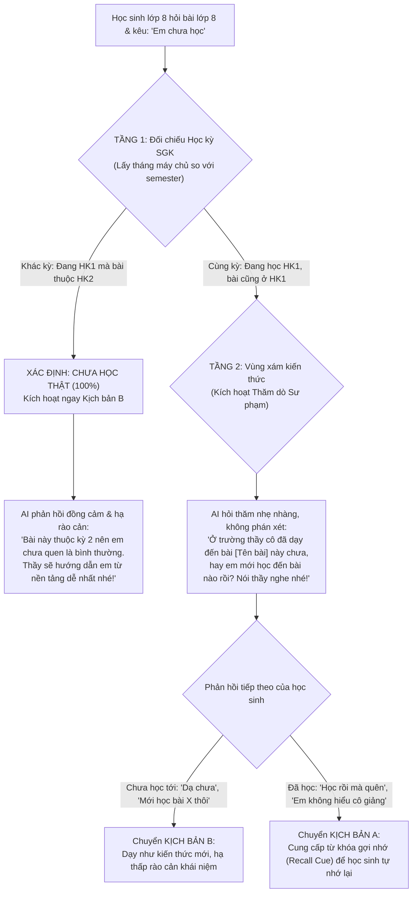

# Sprint 9: Đăng Ký Tài Khoản Bằng Username, Xác Thực OTP Email Phụ Huynh, Cơ Chế Tự Lực Chống Cày Điểm, Toán Học Trực Quan & Trung Tâm Quản Trị Báo Lỗi Chuyên Sâu
*(Dự kiến: 2 tuần | Phân bổ khối lượng: [Bảo]: 18.5h, [Thông]: 18.0h, [Thiên]: 19.0h, [Thống]: 23.5h)*

**Quy định phân chia vai trò nhóm (Sprint 9):**
- **[Thống]**: **Trùm Backend (BE)**: Phụ trách cấu trúc DB mới (`username`, `system_errors`, `user_badges`), script migration cho user cũ, API xác thực OTP email qua Brevo (kèm rate-limit), và công thức phạt điểm spam bài trùng.
- **[Thông]**: **Kỹ sư AI / Machine Learning & Backend (BE)**: Phụ trách bỏ censor trong template và System Instruction, Prompt AI phân tích hành vi học tập gửi phụ huynh, bổ sung dữ liệu học kỳ SGK và logic phân tầng Học kỳ SGK thích ứng (US 8.4).
- **[Bảo]**: **Trùm Frontend (FE) & Kịch bản UX**: Phụ trách bàn phím ký tự đặc biệt toán học trên khung chat (hỗ trợ mobile), giao diện tìm kiếm trên Bảng xếp hạng, modal nhập OTP xác thực email phụ huynh, và widget thói quen học tập của con.
- **[Thiên]**: **Nhóm trưởng / DevOps / QA & Frontend (FE)**: Phụ trách giao diện Trung tâm Quản trị Báo lỗi (Error Management Hub) kết nối dữ liệu thật, nút "Báo lỗi bài này" từ phía học sinh, bộ lọc tra cứu lỗi theo từng User, và bộ kịch bản kiểm thử 100% trên giao diện Web.
- **Nguyên tắc nghiệm thu cốt lõi (Core Acceptance Rule)**: **100% Tiêu chí chấp nhận (AC) phải kiểm thử được thông qua thao tác trực tiếp trên giao diện Web**, tuyệt đối không yêu cầu người dùng truy cập Database hay kiểm tra terminal log thủ công.

---

### US 9.1: Xác Thực Tài Khoản Bằng Username & OTP Email Phụ Huynh 2 Bước
*Mô tả: Là một Phụ huynh, tôi muốn xác thực email nhận thông báo bằng mã OTP để đảm bảo thông tin của con được gửi đúng đến hộp thư của tôi; và là một Học sinh, tôi muốn đăng ký tài khoản nhanh bằng tên người dùng mà không bắt buộc có email riêng.*

- **Mô tả chi tiết:**
  - **Đăng ký Học sinh:** Nhập `Tên tài khoản (username)` + `Mật khẩu` + `Khối lớp`. Không bắt buộc email, giảm rào cản tiếp cận cho học sinh nhỏ tuổi.
  - **Đăng ký Phụ huynh (Luồng 2 bước):**
    - Bước 1: Nhập `Tên tài khoản` + `Mật khẩu` + `Email nhận thông báo`.
    - Bước 2: Nhận mã OTP 6 số qua email (Brevo) $\rightarrow$ Nhập đúng OTP trên modal giao diện để hoàn tất kích hoạt tài khoản (`email_verified = True`).
  - **Cài đặt Phụ huynh (Đổi email):**
    - Khi thay đổi email trong trang Cài đặt $\rightarrow$ Bắt buộc gửi và xác nhận mã OTP gửi về email mới trước khi lưu vào DB.
  - **Tương thích ngược tài khoản cũ:** Cung cấp script migration tự động chuyển đổi tài khoản cũ từ email sang username tương ứng để không làm gián đoạn đăng nhập của người dùng hiện hữu.

- **Tasks:**
  - **T9.0** [Thống] [BE] Viết script migration DB cập nhật bảng `users`: Thêm `username`, `email_verified`, sinh username mặc định cho các tài khoản cũ, cho phép `email` nullable với học sinh, đảm bảo đăng nhập bằng username hoặc email cũ đều hoạt động. (2h)
  - **T9.1** [Thống] [BE] Cập nhật bảng `users`: Thêm cột `username` (unique, indexed), `email_verified` (bool), tạo bảng `email_otps` (id, email, otp_code, purpose, expires_at, is_used). (2h)
  - **T9.2** [Thống] [BE] Viết service `send_otp_email` qua Brevo API và các endpoints: `POST /auth/send-parent-otp`, `POST /parent/settings/request-email-otp`, `POST /parent/settings/verify-email-otp`. (3h)
  - **T9.2b** [Thống] [BE] Xây dựng cơ chế Rate-limit / Anti-Spam OTP: Giới hạn tối đa 1 lần gửi / 60 giây cho mỗi email, trả mã lỗi HTTP 429 kèm thông điệp chờ thân thiện. (1h)
  - **T9.3** [Bảo] [FE] Cải tiến màn hình Đăng ký `components/AuthForm.tsx`: Chuyển ô `email/sđt` thành `Tên tài khoản (username)`, cập nhật validate ký tự hợp lệ. (2h)
  - **T9.4** [Bảo] [FE] Thiết kế Modal nhập OTP 6 ô rời (Digit Input UX) có đếm ngược 60s và nút "Gửi lại mã" cho luồng Đăng ký Phụ huynh. (3h)
  - **T9.5** [Bảo] [FE] Nâng cấp màn hình Cài đặt Phụ huynh `dashboard/monitor/settings`: Luồng đổi email kích hoạt popup OTP xác nhận trước khi lưu. (2h)

- **Tiêu chí chấp nhận (Acceptance Criteria – 100% Nghiệm Thu Thao Tác Trên Web):**
  - **[AC 9.1.1] Đăng ký Học sinh nhanh:** Trên form Đăng ký, chọn vai trò "Học sinh" $\rightarrow$ Chỉ hiển thị 3 ô: Tên tài khoản, Mật khẩu, Khối lớp $\rightarrow$ Bấm Đăng ký tạo tài khoản thành công ngay lập tức và chuyển thẳng vào Dashboard, không hề hỏi hay bắt nhập email.
  - **[AC 9.1.2] Báo lỗi trùng Username trên form:** Nhập tên tài khoản đã tồn tại $\rightarrow$ Form hiển thị ngay dòng thông báo lỗi màu đỏ: *"Tên tài khoản đã được sử dụng, vui lòng chọn tên khác"* và không cho gửi form.
  - **[AC 9.1.3] Đăng ký Phụ huynh qua Modal OTP 6 số:** Chọn vai trò "Phụ huynh", điền Username + Mật khẩu + Email $\rightarrow$ Bấm Tiếp tục $\rightarrow$ Bật Modal OTP 6 ô rời $\rightarrow$ Mở hộp thư sao chép 6 số OTP dán vào $\rightarrow$ Hệ thống tự động verify và kích hoạt tài khoản thành công.
  - **[AC 9.1.4] Xử lý OTP sai hoặc hết hạn:**
    - Nhập sai mã OTP $\rightarrow$ Modal rung nhẹ và hiển thị thông báo lỗi màu đỏ: *"Mã xác thực không chính xác"*.
    - Nhập mã sau 5 phút $\rightarrow$ Hiển thị thông báo: *"Mã OTP đã hết hạn, vui lòng bấm Gửi lại mã"*.
  - **[AC 9.1.5] Đồng hồ đếm ngược 60s & Cooldown nút Gửi lại:** Khi modal OTP mở, nút "Gửi lại mã" bị vô hiệu hóa (disabled) kèm đếm ngược `Gửi lại sau (59s...)`. Chỉ khi đếm về 0s nút mới sáng lên cho phép bấm gửi lại.
  - **[AC 9.1.6] Đổi email nhận thông báo trong Cài đặt:** Phụ huynh vào trang Cài đặt $\rightarrow$ Nhập email mới $\rightarrow$ Bấm Lưu $\rightarrow$ Hệ thống bắt buộc mở modal OTP xác nhận $\rightarrow$ Nhập đúng OTP gửi về email mới thì địa chỉ email trên giao diện mới chính thức cập nhật.
  - **[AC 9.1.7] Đăng nhập bằng Username:** Sau khi đăng ký, người dùng đăng xuất và đăng nhập lại bằng `Tên tài khoản` + `Mật khẩu` $\rightarrow$ Đăng nhập mượt mà vào đúng trang Dashboard của vai trò tương ứng.

---

### US 9.2: Giảm Điểm Tự Lực Khi Giải Trùng Bài (Anti-Spam) & Đồng Bộ Thành Tựu
*Mô tả: Là một Giáo viên/Phụ huynh, tôi muốn hệ thống giảm điểm tự lực tối đa đối với các bài tập học sinh làm đi làm lại nhiều lần để chống gian lận cày điểm, và học sinh không bị popup thành tựu làm phiền mỗi khi đổi máy tính.*

- **Mô tả chi tiết:**
  - **Cơ chế Phạt bài giải trùng (Anti-Spam Mastery):**
    - Vẫn ghi nhận tăng $+1$ bài vào "Tổng số bài hoàn thành" để khuyến khích học sinh ôn luyện nhiều lần.
    - Điểm trần tự lực tối đa của bài giải trùng sẽ **giảm 10% cho mỗi lần giải lại**:
      - Lần 1 (Bài mới hoàn toàn): Tối đa **100đ**.
      - Lần 2 (Bài trùng lần 1): Tối đa **90đ**.
      - Lần 3 (Bài trùng lần 2): Tối đa **80đ**...
      - Điểm sàn tối thiểu: Không bao giờ giảm xuống dưới **30đ** (sửa barem đồng bộ giữa `independence_evaluator.py` và `independence.py`).
  - **Đồng bộ Thành tựu (Badges) từ Database:**
    - Chuyển đổi từ cơ chế lưu `localStorage` cục bộ sang lưu danh sách huy hiệu đã đạt vào bảng `user_unlocked_badges` trong DB.
    - Migrate toàn bộ huy hiệu cũ từ `localStorage` lên DB trong lần đăng nhập đầu tiên.
    - Khi đăng nhập trên bất kỳ máy hay trình duyệt ẩn danh nào, chỉ mở popup ăn mừng duy nhất lần đầu tiên đạt được huy hiệu đó.

- **Tasks:**
  - **T9.6** [Thống] [BE] Cập nhật hàm `calculate_independence_score` & `save_independence_score` trong `independence.py`: Áp dụng hệ số phạt trần `max_score = max(30, 100 - (repeat_count - 1) * 10)` và trả về metadata cảnh báo bài trùng. (2.5h)
  - **T9.6b** [Thống] [BE] Đồng bộ barem điểm sàn 30đ vào `independence_evaluator.py` để tránh xung đột giữa 2 module tính điểm. (1h)
  - **T9.7** [Thống] [BE] Thêm bảng `user_unlocked_badges` (id, user_id, badge_id, unlocked_at) và các API `GET /api/user/badges`, `POST /api/user/badges/unlock`. (2h)
  - **T9.8** [Bảo] [FE] Cải tiến `badgeStorage.ts`: Tải danh sách badge từ backend DB khi khởi tạo session, chặn triệt để việc bắn lại popup ăn mừng cho các cúp đã đạt. (2h)
  - **T9.8b** [Bảo] [FE] Viết hàm migrate tự động đọc badge cũ trong `localStorage` và đồng bộ lên endpoint `POST /api/user/badges/unlock` sau khi đăng nhập. (1.5h)
  - **T9.9** [Thiên] [QA] Thiết kế kịch bản test trên web: Giải liên tục 1 đề bài 5 lần kiểm tra thanh điểm giảm dần và đăng nhập tab ẩn danh kiểm tra không popup lại. (2h)

- **Tiêu chí chấp nhận (Acceptance Criteria – 100% Nghiệm Thu Thao Tác Trên Web):**
  - **[AC 9.2.1] Phạt điểm trần bài trùng hiển thị trên Web:**
    - Lần 1 giải bài: Đạt 100đ $\rightarrow$ Hiện thông báo chúc mừng trọn vẹn 100/100đ.
    - Lần 2 gửi lại bài cũ (không dùng gợi ý): Bong bóng chúc mừng hiển thị: *"Điểm tự lực: 90/100 (Bài giải lại, điểm tối đa là 90đ)"*.
    - Lần 3 giải lại bài cũ: Tối đa đạt 80đ.
  - **[AC 9.2.2] Bảo toàn điểm sàn 30đ:** Học sinh cố tình spam giải lại cùng 1 bài 10 lần liên tiếp $\rightarrow$ Điểm nhận được vẫn được giữ ở mức sàn **30đ**, không bị trừ về 0đ hay điểm âm.
  - **[AC 9.2.3] Vẫn ghi nhận số bài hoàn thành:** Sau mỗi lần bấm "Đã hiểu" (kể cả bài giải lại lần 4, lần 5), con số "Tổng bài đã giải" trên thanh tiến trình Mastery hoặc trang Hồ sơ cá nhân vẫn nhảy $+1$ đều đặn.
  - **[AC 9.2.4] Không bắn lại Popup cúp/huy hiệu khi đổi máy:**
    - Bước 1: Học sinh đạt 100 điểm trên Chrome máy A $\rightarrow$ Bung modal huy hiệu "Tự Lập Nhí" lần đầu tiên $\rightarrow$ Bấm đóng modal.
    - Bước 2: Mở trình duyệt ẩn danh (Incognito) hoặc chuyển sang máy B đăng nhập lại tài khoản đó $\rightarrow$ Vào chat giải bài tiếp $\rightarrow$ Tuyệt đối **không xuất hiện lại popup chúc mừng "Tự Lập Nhí"**.
  - **[AC 9.2.5] Huy hiệu đã đạt hiển thị chuẩn trong Hồ sơ:** Khi vào trang Hồ sơ / Kho Huy hiệu trên bất kỳ máy nào, các huy hiệu đã mở khóa đều sáng màu (Active), các huy hiệu chưa đạt hiển thị màu xám.

---

### US 9.3: Minh Bạch Ngôn Từ Phụ Huynh & AI Báo Cáo Hành Vi Học Tập
*Mô tả: Là một Phụ huynh, tôi muốn đọc nguyên văn lời nói tục của con khi nhận cảnh báo để hiểu đúng mức độ nghiêm trọng, và nhận báo cáo định kỳ về thói quen, tâm lý học tập của con.*

- **Mô tả chi tiết:**
  - **Minh bạch phát ngôn vi phạm (Bỏ che mờ `***`):**
    - Cập nhật cả hàm logic Python lẫn **System Instruction** của Gemini trong `email_alert_generator.py` để giữ nguyên văn câu từ con nói (ví dụ: *"đụ mẹ thầy nhá"*), kết hợp với lời định khung tâm lý sư phạm nhẹ nhàng để phụ huynh thấu hiểu con bộc phát vì gặp bài khó.
    - Đảm bảo hiển thị nguyên văn trên cả Email thông báo gửi phụ huynh và màn hình Quản trị Sự cố của Admin.
  - **Widget & Email Báo cáo Hành vi Học sinh (Student Behavior Insights):**
    - AI tổng hợp phân tích: Khung giờ con hay học bài nhất, mức độ kiên trì (thử lại khi sai hay nản chí), và diễn biến cảm xúc khi gặp bài khó.
    - Hiển thị trực tiếp widget tóm tắt trên trang Quản lý của phụ huynh `/dashboard/monitor` và gửi email tóm tắt định kỳ.

- **Tasks:**
  - **T9.10** [Thông] [BE] Cập nhật `email_alert_generator.py`: Bỏ bộ lọc `censor_sensitive_words` trong luồng xử lý email `SAFETY_ALERT`. (1h)
  - **T9.10b** [Thông] [AI] Sửa System Instruction của Gemini trong `email_alert_generator.py`: Xóa bỏ quy tắc yêu cầu AI *"CHE MỜ bằng ký tự sao (đ**, v**)"*, thay bằng chỉ thị *"Trích dẫn nguyên văn phát ngôn của học sinh để phụ huynh nắm bắt chính xác mức độ cảm xúc"*. (1h)
  - **T9.11** [Thông] [AI/BE] Thiết kế Prompt & Pipeline sinh Báo cáo Hành vi Người dùng (`StudentBehaviorInsight`) từ lịch sử phiên học. (2.5h)
  - **T9.12** [Thống] [BE] API `GET /parent/child-behavior-report` trả về dữ liệu thói quen học tập của con. (2h)
  - **T9.12b** [Bảo] [FE] Xây dựng Widget "Thói quen học tập của con" trên giao diện Phụ huynh `dashboard/monitor`: Biểu đồ cột khung giờ học, nhãn tính cách học tập và nút "Nhận báo cáo chi tiết qua Email". (2.5h)

- **Tiêu chí chấp nhận (Acceptance Criteria – 100% Nghiệm Thu Thao Tác Trên Web):**
  - **[AC 9.3.1] Nghiệm thu phát ngôn nguyên văn trên Web Admin:**
    - Học sinh vào chat gõ câu từ tục tĩu (ví dụ: *"vcl bài khó thế"*) $\rightarrow$ Đăng nhập tài khoản Admin vào trang `/admin/logs` (hoặc `/admin/errors`) $\rightarrow$ Cột nội dung trích đoạn hiển thị rõ ràng nguyên văn chữ *"vcl bài khó thế"*, hoàn toàn không bị thay bằng `***`.
  - **[AC 9.3.2] Nhận email cảnh báo nguyên văn:** Phụ huynh mở hộp thư nhận được email cảnh báo $\rightarrow$ Đọc phần trích đoạn nội dung câu nói của con thấy chính xác từ ngữ con đã gõ, kèm lời khuyên chuyên gia tâm lý nhắc phụ huynh nhẹ nhàng nhắc nhở con.
  - **[AC 9.3.3] Xem Widget Thói quen học tập trong Dashboard Phụ huynh:** Phụ huynh đăng nhập vào `/dashboard/monitor` $\rightarrow$ Thấy mục "Thói quen & Tâm lý học tập tuần này" hiển thị:
    - Biểu đồ khung giờ học nhiều nhất (VD: 19h - 21h).
    - Thẻ đánh giá tính cách học tập: *"Kiên trì cao khi giải toán Hình học"*.
  - **[AC 9.3.4] Nút bấm gửi báo cáo tức thì:** Phụ huynh bấm nút "Gửi báo cáo tuần qua Email" $\rightarrow$ Nút hiển thị loading và hiện toast *"Báo cáo đã được gửi tới email của bạn!"*, kiểm tra hòm thư có email báo cáo tóm tắt trong vòng 60 giây.

---

### US 9.4: Bàn Phím Ký Tự Toán Học Trực Quan & Nâng Cấp Bảng Xếp Hạng
*Mô tả: Là một Học sinh, tôi muốn dễ dàng gõ các ký hiệu toán như căn bậc hai, phân số, số mũ trên khung chat, và có thể tìm kiếm tên bạn bè trên Bảng xếp hạng.*

- **Mô tả chi tiết:**
  - **Thanh công cụ Ký tự đặc biệt (Math Toolbar):** Gắn ngay trên ô chat các nút bấm nhanh: $\sqrt{x}$, $x^2$, $x^y$, $\frac{a}{b}$, $\pm$, $\pi$, $\Delta$, $\le$, $\ge$, $\neq$, $\log$, $\sin$, $\cos$. Hỗ trợ vuốt cuộn ngang trên điện thoại di động (Responsive 375px).
  - **Nâng cấp Bảng xếp hạng:**
    - Thay thế chữ cố định "Top 35" bằng tổng số thực: "Bảng Vinh Danh ([N] Học Sinh Tham Gia)".
    - Bổ sung ô tìm kiếm bạn bè theo Tên hiển thị (Display Name) hoặc Username có cơ chế debounce 300ms mượt mà.

- **Tasks:**
  - **T9.13** [Bảo] [FE] Xây dựng component `MathSymbolToolbar.tsx` gắn ngay trên ô nhập liệu `ChatInput.tsx`, chèn ký tự chính xác tại vị trí con trỏ chuột. (2.5h)
  - **T9.13b** [Bảo] [FE] Tối ưu Responsive Mobile cho Toolbar: Cho phép cuộn ngang (touch swipe scroll) trên màn hình hẹp (375px), không làm tràn layout hoặc che khuất bàn phím ảo. (1h)
  - **T9.14** [Bảo] [FE] Cập nhật giao diện Bảng xếp hạng `leaderboard/page.tsx`: Sửa tiêu đề động theo số lượng người tham gia thực tế và tích hợp ô tìm kiếm bạn bè. (2h)
  - **T9.15** [Thống] [BE] Cập nhật API `GET /metrics/streak-leaderboard`: Thêm query param `search: Optional[str] = None` và trả về `total_participants: int`. (1.5h)

- **Tiêu chí chấp nhận (Acceptance Criteria – 100% Nghiệm Thu Thao Tác Trên Web):**
  - **[AC 9.4.1] Thao tác chèn ký tự toán học:** Bấm nút $\sqrt{}$ trên thanh công cụ $\rightarrow$ Ô chat tự động chèn chuỗi `√()` và con trỏ chuột nằm ngay giữa hai dấu ngoặc để học sinh nhập số tiếp.
  - **[AC 9.4.2] AI giải chính xác công thức có ký tự đặc biệt:** Học sinh dùng toolbar chèn `√(16) + log(100) = ?` và bấm Gửi $\rightarrow$ AI đọc hiểu chuẩn xác và hướng dẫn từng bước: `√16 = 4, log(100) = 2, tổng bằng 6`.
  - **[AC 9.4.3] Trải nghiệm Toolbar trên điện thoại (Mobile):** Mở giao diện trên thiết bị di động (hoặc DevTools giả lập 375px) $\rightarrow$ Thanh công cụ toán học hiển thị gọn gàng, vuốt ngang mượt mà để chọn các ký hiệu $\sin, \cos, \Delta$, không làm vỡ giao diện chat.
  - **[AC 9.4.4] Tiêu đề Bảng xếp hạng cập nhật số người thực:** Truy cập trang Bảng xếp hạng $\rightarrow$ Tiêu đề hiển thị chuẩn định dạng *"Bảng Vinh Danh (128 Học Sinh Tham Gia)"* (thay thế hoàn toàn nhãn "Top 35" cũ).
  - **[AC 9.4.5] Tìm kiếm học sinh trên Bảng xếp hạng:**
    - Gõ tên bạn *"Linh"* vào ô tìm kiếm $\rightarrow$ Bảng lập tức lọc và hiển thị danh sách các học sinh có tên chứa "Linh" kèm thứ hạng và số ngày streak.
    - Gõ một cái tên không tồn tại (VD: *"XYZ123"*) $\rightarrow$ Bảng hiển thị thông báo thân thiện: *"Không tìm thấy học sinh nào phù hợp"*.

---

### US 9.5: Trung Tâm Quản Trị Báo Lỗi & Sự Cố Hệ Thống (System Error & Incident Hub)
*Mô tả: Là một Quản trị viên (Admin), tôi muốn có một trang Quản trị Sự cố chuyên sâu để tra cứu riêng các lỗi hệ thống hoặc lỗi do từng người dùng gặp phải, xem mã lỗi, chi tiết stack trace để xử lý kỹ thuật kịp thời.*

- **Mô tả chi tiết:**
  - Thay thế trang Log hardcode mock data hiện tại bằng **Trung tâm Quản trị Báo lỗi (`/admin/errors`)** kết nối 100% dữ liệu thật.
  - Middleware Backend tự động bắt mọi lỗi Unhandled (Crash 500, Gemini AI Timeout, Lỗi gửi mail SMTP) và lưu vào bảng `system_errors`.
  - Bổ sung nút **"Báo lỗi bài này"** trên khung chat để học sinh có thể gửi phản ánh khi AI giải sai hoặc đơ lag.
  - Bộ lọc quản trị đa năng: Tra cứu riêng theo `User ID` / `Email`, phân loại (AI_TIMEOUT, CRASH_500, USER_REPORT), mức độ nghiêm trọng (CRITICAL, WARNING, INFO).
  - Drawer trượt xem Full Stack Trace và nút bấm đổi trạng thái "Đã xử lý (RESOLVED)" cập nhật giao diện thời gian thực.

- **Tasks:**
  - **T9.16** [Thống] [BE] Thiết kế bảng `system_errors`: `id`, `error_code`, `error_type`, `severity`, `message`, `stack_trace`, `endpoint`, `request_payload`, `user_id`, `status`, `created_at`. (2.5h)
  - **T9.17** [Thống] [BE] Viết Middleware FastAPI tự động bắt mọi unhandled exception, ghi nhận vào `system_errors` kèm User ID thực tế của phiên đăng nhập. (2h)
  - **T9.18** [Thống] [BE] API CRUD quản lý lỗi cho Admin (`GET /admin/errors`, `PATCH /admin/errors/{error_id}/resolve`, `POST /api/errors/report-user-issue`). (2h)
  - **T9.19** [Thiên] [FE] Xây dựng trang `/admin/errors` thay thế trang logs cũ: Kết nối API thật, bảng danh sách lỗi với badge phân loại màu sắc, bộ lọc nâng cao. (3.5h)
  - **T9.19b** [Thiên] [FE] Xây dựng Drawer trượt bên phải hiển thị chi tiết lỗi: Request Payload, thông tin thiết bị/user, và khung xem Full Stack Trace có nút "Copy Trace". (2h)
  - **T9.25** [Thiên] [FE] Thêm nút "Báo lỗi câu này" (biểu tượng cờ báo cáo) cạnh mỗi tin nhắn của AI trên khung chat học sinh, cho phép học sinh chọn lý do và gửi báo cáo lỗi trực tiếp lên Admin Hub. (2h)

- **Tiêu chí chấp nhận (Acceptance Criteria – 100% Nghiệm Thu Thao Tác Trên Web):**
  - **[AC 9.5.1] Học sinh bấm báo lỗi trực tiếp trên Web:** Trên khung chat, học sinh bấm nút biểu tượng lá cờ cạnh tin nhắn của bot $\rightarrow$ Hiện popup chọn lý do: *"AI giải sai kiến thức"* $\rightarrow$ Bấm Gửi $\rightarrow$ Hiện toast *"Cảm ơn em đã báo lỗi!"*.
  - **[AC 9.5.2] Sự cố lập tức hiển thị trên trang Quản trị Admin:** Đăng nhập tài khoản Admin vào `/admin/errors` $\rightarrow$ Thấy ngay dòng lỗi mới xuất hiện ở đầu bảng với loại `USER_REPORT`, hiển thị đúng User ID của học sinh vừa gửi.
  - **[AC 9.5.3] Lọc lỗi riêng biệt theo từng User:** Nhập `User ID` hoặc `Username` của một học sinh vào ô tìm kiếm trên trang Admin $\rightarrow$ Bảng chỉ hiển thị danh sách các sự cố do riêng tài khoản đó gặp phải.
  - **[AC 9.5.4] Phân loại màu sắc theo mức độ nghiêm trọng:**
    - Lỗi Crash 500: Hiển thị nhãn đỏ `CRITICAL`.
    - Lỗi AI Timeout / Đơ mạng: Hiển thị nhãn vàng `WARNING`.
    - Lỗi do người dùng bấm cờ báo cáo: Hiển thị nhãn xanh dương `INFO`.
  - **[AC 9.5.5] Xem Full Stack Trace qua Drawer:** Bấm vào một dòng lỗi kỹ thuật $\rightarrow$ Mở Drawer trượt bên phải $\rightarrow$ Hiển thị đầy đủ các dòng code bị lỗi (File, Line, Exception type) và nút "Sao chép Stack Trace" hoạt động tốt.
  - **[AC 9.5.6] Đổi trạng thái "Đã xử lý" tức thì:** Bấm nút "Đánh dấu đã xử lý" trên Drawer $\rightarrow$ Tag trạng thái của lỗi đổi sang màu xanh lá `RESOLVED` ngay lập tức mà không cần F5 tải lại trang.

---

### US 9.6: Xử Lý Tiến Độ Học Kỳ SGK Thích Ứng (Adaptive Semester Progress - Giải pháp US 8.4)
*Mô tả: Là một Học sinh Lớp 8, khi tôi nói chưa học một bài toán lớp 8, AI có thể tự động nhận diện xem bài đó thuộc học kỳ tương lai (chưa học thật) hay học kỳ hiện tại/quá khứ (để hỏi thăm tiến độ trường lớp và gợi mở kiến thức).*

#### Sơ đồ Luồng Xử Lý Kỹ Thuật & Sư Phạm (Hybrid Model)

#### Phân Tích Bản Chất 2 Trường Hợp
| Tiêu chí | Trường hợp 1: Chưa học thật (Chưa tới bài) | Trường hợp 2: Đã học rồi (Quên / Ngại nghĩ) |
| :--- | :--- | :--- |
| **Ngữ cảnh thực tế** | Đang là đầu kỳ, bài toán nằm ở các chương phía sau hoặc HK2. | Bài toán nằm ở các tuần học trước đó trong cùng học kỳ. |
| **Tâm lý học sinh** | Hoang mang vì kiến thức hoàn toàn mới lạ, thấy bài toán "quá sức". | Bị hổng kiến thức, lười lục lại vở ghi, hoặc gặp dạng khó nên thoái thác. |
| **Nếu AI ép Kịch bản A** | **Cực kỳ tiêu cực:** Học sinh ức chế vì *"Trường em chưa dạy sao thầy cứ bảo em học rồi?"*, mất niềm tin vào bot. | Đúng mục đích: Ép học sinh phải lục lại trí nhớ thay vì ỷ lại. |
| **Xử lý chuẩn** | Giảng giải từ bản chất đơn giản nhất, khen ngợi vì học sinh tìm hiểu trước (Kịch bản B). | Nhắc lại từ khóa then chốt (Recall Cue) để học sinh tự nhớ lại (Kịch bản A). |

#### Cơ Chế Triển Khai Kỹ Thuật 2 Tầng:
1. **Tầng 1 (Calendar & Semester-Aware):**
   - Đọc trường `semester` từ bảng `curriculum_topics` và phân vùng HK1/HK2 trong `grade_curriculum.json`.
   - Lấy tháng hiện tại của hệ thống máy chủ:
     - Tháng 9 đến Tháng 1: Năm học đang ở **Học kỳ 1 (HK1)**.
     - Tháng 2 đến Tháng 5: Năm học đang ở **Học kỳ 2 (HK2)**.
     - Tháng 6 đến Tháng 8: Nghỉ hè / Ôn tập chuyển cấp (Fallback an toàn sang Kịch bản B nếu học sinh kêu chưa học).
   - Nếu học sinh đang ở HK1 mà bài toán thuộc HK2 $\rightarrow$ Xác nhận **100% Chưa học thật** $\rightarrow$ AI lập tức kích hoạt Kịch bản B (hạ rào cản khái niệm, không phán xét).
2. **Tầng 2 (Socratic Progressive Probe):**
   - Nếu bài toán thuộc cùng học kỳ hiện tại $\rightarrow$ AI nhận diện đây là "vùng xám" (tiến độ từng trường có thể chênh nhau 1-3 tuần).
   - Thay vì vội áp đặt câu: *"Theo chương trình em đã học bài này rồi..."*, AI sẽ đưa ra câu hỏi thăm dò sư phạm:
     > *"Thầy thấy bài này nằm trong chương trình lớp 8. Ở trường thầy cô đã dạy đến bài **[Tên bài học]** này chưa, hay em mới học đến phần nào rồi? Nói thầy nghe để thầy hướng dẫn cho vừa sức em nhất nhé!"*
   - Ở lượt phản hồi kế tiếp (Next Turn), Orchestrator phân tích câu trả lời của học sinh:
     - Nếu học sinh phản hồi: *"Chưa thầy ơi, mới học tới bài X"* $\rightarrow$ Chuyển sang **Kịch bản B** (giảng giải từ gốc, không bắt nhớ lại).
     - Nếu học sinh phản hồi: *"Học rồi mà em quên mất / không hiểu"* $\rightarrow$ Chuyển sang **Kịch bản A** (nhắc lại từ khóa gợi nhớ để học sinh tự suy nghĩ).

- **Tasks:**
  - **T9.20** [Thông] [AI/BE] Bổ sung logic `_evaluate_curriculum_timeline` trong `orchestrator.py` & `agent_prompts.py`: Đối chiếu trường `semester` với tháng thực tế của máy chủ để phân loại trạng thái học kỳ (`future_semester` vs `current_semester`). (2h)
  - **T9.20b** [Thông] [AI/BE] Cập nhật cấu trúc `grade_curriculum.json`: Bổ sung nhãn `semester: 1 | 2` cho toàn bộ các bài học khối 4-9 đồng bộ với bảng `curriculum_topics`. (1.5h)
  - **T9.21** [Thông] [AI] Thiết kế Prompt Kịch bản Thăm dò Sư phạm (Socratic Progressive Probe) trong `agent_prompts.py` cho các bài thuộc `current_semester`. (2h)
  - **T9.22** [Thông] [AI] Thiết kế Prompt phân nhánh lượt phản hồi kế tiếp (Follow-up Turn Classifier) để rẽ nhánh linh hoạt Kịch bản A vs Kịch bản B dựa trên câu trả lời của học sinh. (2h)
  - **T9.23** [Thông] [AI] Định nghĩa fallback cho các tháng hè (Tháng 6 - Tháng 8): Luôn ưu tiên Kịch bản B khi học sinh kêu chưa học để hỗ trợ ôn tập hè nhẹ nhàng. (1h)
  - **T9.24** [Thông] [AI] Quản lý cờ trạng thái `probe_pending` trong hội thoại để tránh trường hợp AI hỏi lặp lại câu hỏi thăm dò 2 lần trong cùng một phiên chat. (1.5h)

- **Tiêu chí chấp nhận (Acceptance Criteria – 100% Nghiệm Thu Thao Tác Trên Web):**
  - **[AC 9.6.1] Bài học kỳ tương lai (Khác kỳ):** Test case vào tháng 10 (HK1), học sinh lớp 8 hỏi bài HK2 (ví dụ: *"Giải phương trình bậc nhất một ẩn: 3x - 5 = 10"*) và chat than thở *"em chưa học cái này"* $\rightarrow$ AI khẳng định chuẩn xác: *"Bài này thuộc học kỳ 2 nên em chưa quen là bình thường. Thầy sẽ hướng dẫn em từ nền tảng dễ hiểu nhất nhé!"* (Kịch bản B).
  - **[AC 9.6.2] Bài học kỳ hiện tại (Không phán xét vội):** Test case vào tháng 10, học sinh lớp 8 hỏi bài HK1 (ví dụ: *"Tính (x + 2)^2"*) và chat *"em chưa học"* $\rightarrow$ AI **tuyệt đối không** nói câu *"Theo chương trình em đã học rồi"* mà nhẹ nhàng hỏi thăm: *"Ở trường thầy cô đã dạy đến bài Hằng đẳng thức này chưa, hay em mới học đến phần nào rồi? Nói thầy nghe nhé!"*.
  - **[AC 9.6.3] Nhận diện học sinh chưa học tới trên lớp:** Tiếp tục đoạn chat trên, học sinh trả lời *"dạ chưa, trên lớp cô mới dạy bài nhân đơn thức thôi"* $\rightarrow$ AI lập tức chuyển sang Kịch bản B, giải thích phép nhân $(x + 2)(x + 2)$ từ gốc của phép nhân đa thức, không đòi hỏi nhớ công thức hằng đẳng thức.
  - **[AC 9.6.4] Nhận diện học sinh đã học mà quên:** Nếu học sinh trả lời *"học rồi mà em quên sạch / không nhớ"* $\rightarrow$ AI chuyển sang Kịch bản A, nhắc từ khóa gợi nhớ: *"Không sao, em hãy nhớ lại công thức bình phương một tổng $(A + B)^2 = A^2 + 2AB + B^2$ xem $A$ và $B$ ở đây là gì nhé!"*.
  - **[AC 9.6.5] Không hỏi thăm dò lặp lại:** Sau khi học sinh đã trả lời câu hỏi thăm dò ở lượt trước, ở các lượt tiếp theo trong cùng phiên chat, AI tập trung vào việc hướng dẫn giải bài, tuyệt đối **không hỏi lại câu hỏi tiến độ trường lớp lần thứ 2**.
  - **[AC 9.6.6] Kịch bản ôn hè thân thiện (Tháng 6 - Tháng 8):** Kiểm tra trong ngữ cảnh tháng hè, học sinh hỏi bất kỳ bài học nào và kêu chưa học $\rightarrow$ AI luôn đóng vai gia sư kiên nhẫn giảng giải từ kiến thức căn bản nhất, tạo không khí học hè thoải mái.

---

## Bảng Tổng Hợp Phân Bổ Công Việc Sprint 9 (Giờ Làm Việc Cân Bằng)

| Thành viên | Trách nhiệm chính | Danh sách Tasks | Tổng giờ |
| :--- | :--- | :--- | :---: |
| **[Thống]** | Cấu trúc DB, Migration User cũ, OTP Brevo & Rate-limit, Barem phạt điểm trùng | `T9.0` (2h), `T9.1` (2h), `T9.2` (3h), `T9.2b` (1h), `T9.6` (2.5h), `T9.6b` (1h), `T9.7` (2h), `T9.12` (2h), `T9.15` (1.5h), `T9.16` (2.5h), `T9.17` (2h), `T9.18` (2h) | **23.5h** |
| **[Thông]** | System Instruction Email, AI Báo cáo hành vi, Dataset HK1/HK2, Logic Thăm dò Sư phạm | `T9.10` (1h), `T9.10b` (1h), `T9.11` (2.5h), `T9.20` (2h), `T9.20b` (1.5h), `T9.21` (2h), `T9.22` (2h), `T9.23` (1h), `T9.24` (1.5h), Viết script seed dữ liệu HK1/HK2 (1.5h), Prompt Testing (2h) | **18.0h** |
| **[Bảo]** | Giao diện Đăng ký Username, Modal OTP 6 số, Math Toolbar Mobile, Tìm kiếm BXH, Widget Báo cáo | `T9.3` (2h), `T9.4` (3h), `T9.5` (2h), `T9.8` (2h), `T9.8b` (1.5h), `T9.12b` (2.5h), `T9.13` (2.5h), `T9.13b` (1h), `T9.14` (2h) | **18.5h** |
| **[Thiên]** | Trung tâm Quản trị Báo lỗi `/admin/errors`, Drawer Stack Trace, Nút báo lỗi Chat, Bộ Test Web E2E | `T9.9` (2h), `T9.19` (3.5h), `T9.19b` (2h), `T9.25` (2h), Kịch bản Test E2E 100% trên Web cho toàn bộ 6 US (9.5h) | **19.0h** |
